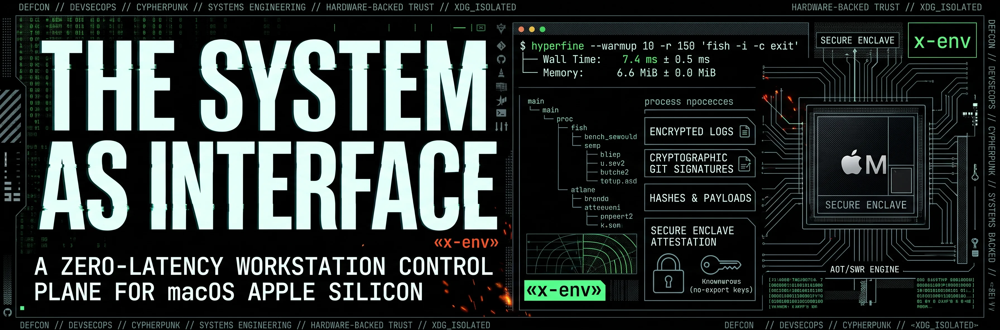
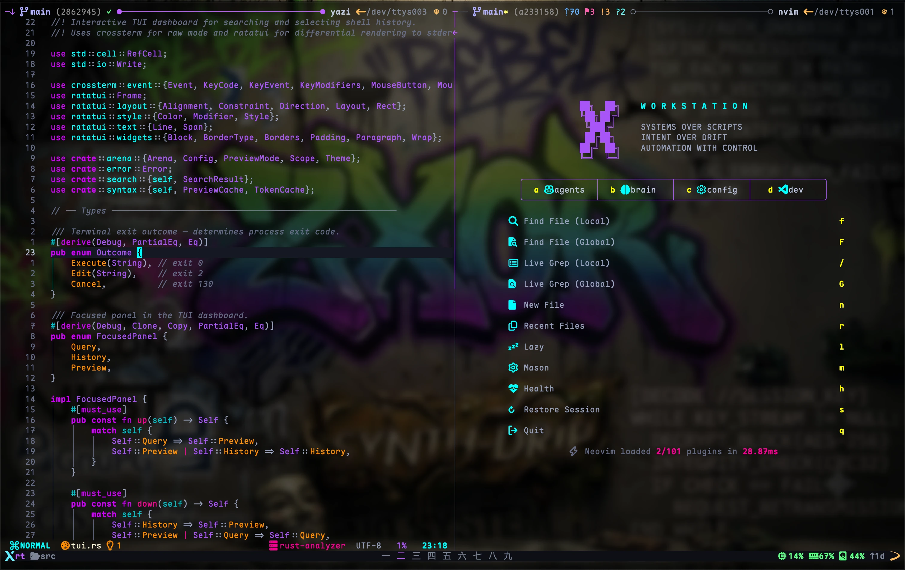
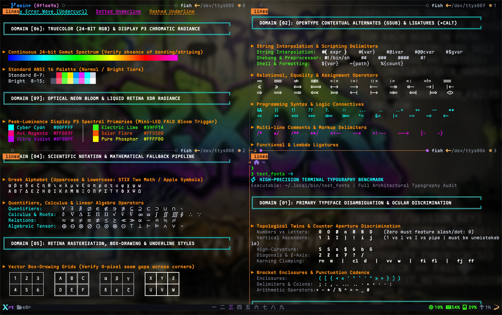
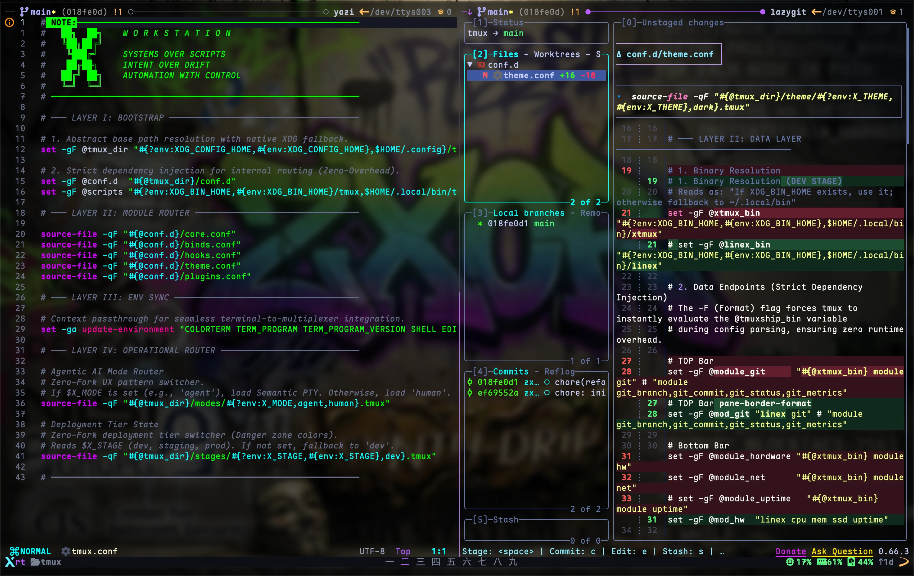

<p align="center">
  
</p>

---

### The System as Interface: A Zero-Latency Workstation Control Plane for macOS Apple Silicon

$$
\mathcal{X} = \langle \underset{\text{agents}}{\mathcal{A}}, \underset{\text{brain}}{\mathcal{B}}, \underset{\text{config}}{\mathcal{C}}, \underset{\text{dev}}{\mathcal{D}} \rangle
$$

---

## 1. Ontological Coordinate & Scope

`x-env` is the **deterministic Control Plane** of the personal computational environment. Within the four-domain model of **X Meta Workspace**, it governs how execution occurs across all actors and subsystems:

```text
[x] META-WORKSPACE ($HOME/x)
├── [a] agents    → Agency     (Who acts?)
├── [b] brain     → Knowledge  (What is known?)
├── [c] config    → Control    (How is execution governed?)
└── [d] dev       → Production (What is constructed?)
```

### Closed-Loop Control

```text
       ┌─────────── [a] agents (Agency: Who acts?) ───────────┐
       │                                                      │
       ▼                                                      ▼
[c] config (Control: Invariants) ◄────► [d] dev (Production: Artifacts)
       ▲                                                      │
       │                                                      ▼
       └─────────── [b] brain (Knowledge: State Model) ───────┘
```

`x-env` is **not a legacy dotfile repository**. It is a version-controlled, declarative single source of truth (SSOT) that governs system policies, toolchain declarations, and application runtimes while strictly isolating persistent configuration from volatile runtime state.

Targeting macOS on Apple Silicon hardware, the repository structures configurations under a centralized configuration namespace (`config/`), projected idempotently into the host system in strict adherence to the **XDG Base Directory Specification** (`~/.config/`). It establishes the deterministic execution baseline for both interactive human workflows and automated AI agents.

---

## 2. Invariants & Design Principles

| Principle | Implementation Invariant |
| :--- | :--- |
| **Declarative State** | All system and tool configurations are expressed as plain text committed to version control. No runtime state exists that cannot be reconstructed from this repository. |
| **Zero-Fork SLA** | Shell initialization eliminates blocking subshells. Dynamic evaluations (`fork-exec` cycles) on the critical boot path are strictly eliminated. |
| **Idempotency** | Every configuration deployment and bootstrap routine is safe to execute repeatedly with zero side-effects beyond the initial application. |
| **Layered Separation of Concerns** | Shell configuration is partitioned into decade-spaced layers (`00` to `50` and `90`) with strict dependency ordering, enforcing a clean bounded-context model. |
| **Self-Healing Caches (SWR)** | Static pre-compiled caches are invalidated via `test -nt` timestamp comparisons using Stale-While-Revalidate: the active session loads existing cache ($O(1)$, < 0.5 ms), while background workers rebuild asynchronously. |
| **Lazy Evaluation** | Heavy resources not required on shell spawn (deep tab completions, environment flags, abbreviations) are deferred to first-use autoload wrappers or prompt hooks. |
| **Hardware-Anchored Cryptography** | Commits are cryptographically signed via hardware Secure Enclave (`PROTOCOL.sshsig` / Secretive Touch ID). Private keys never touch NVMe storage or general RAM. |

---

## 3. Repository Architecture

The root repository layout strictly isolates user-space configurations and package manifests into two core operational trees:

```text
├── config/                       # Single Source of Truth for $XDG_CONFIG_HOME (~/.config)
│   ├── fish/                     # Shell: decade-spaced conf.d/ topology & SWR cache engine
│   ├── ghostty/                  # Primary GPU terminal: native macOS Zig renderer
│   ├── kitty/                    # Terminal: tab-bar automation, custom themes
│   ├── alacritty/                # Minimal GPU terminal
│   ├── tmux/                     # Terminal multiplexer: 3-window model & stage routing
│   ├── nvim/                     # Primary editor: Capability-Oriented Domain Architecture
│   ├── starship/                 # Cross-shell prompt (pre-compiled into AOT cache)
│   ├── git/                      # Git: Secure Enclave commit signing & APFS normalization
│   ├── jj/                       # Jujutsu VCS: conflict-first workflow
│   ├── ssh/                      # OpenSSH: post-quantum KEX & deterministic socket hashing
│   ├── bat/                      # Syntax-highlighted pager (17+ custom syntaxes)
│   ├── yazi/                     # Modern async terminal file manager
│   ├── ripgrep/                  # High-performance search & ignore rules
│   ├── dnscrypt-proxy/           # DoH/DNSCrypt encrypted DNS
│   ├── pf/                       # macOS Packet Filter firewall rules
│   ├── macos-security/           # NIST / CIS / DISA STIG compliance baselines
│   ├── obsidian/                 # Knowledge management vault configuration
│   ├── karabiner/                # Keyboard remapping rules
│   ├── btop/                     # System & hardware resource monitor
│   ├── curl/ & wget/             # Hardened network clients (TLS 1.3, ML-KEM-768)
│   ├── colorsdb & iconsdb        # Canonical named color & Nerd Font icon reference
│   └── ls_colors & eza_colors    # Terminal directory colorization specifications
│
├── pkg/                          # Declarative System & Toolchain Manifests
│   ├── Brewfile                  # Homebrew bundle (CLI utilities, GUI casks, fonts, AI agents)
│   ├── mise.toml                 # Environment substrate, XDG vars, toolchain versions
│   └── rustup.toml               # Rust toolchain components and targets
│
└── README.md                     # Systems architecture specification & benchmarks
```

---

## 4. Visual Showcase

<p align="center">
  
</p>

<p align="center">
  
</p>

<p align="center">
  
</p>

---

## 5. Performance Benchmarks

### Measurement Methodology

- **Hardware:** Apple Silicon (`arm64`, unified memory architecture).
- **Operating System:** macOS Darwin (XNU microkernel).
- **Measurement Tool:** `hyperfine` with 10 warmup runs across 150 benchmark iterations.
- **Scope:** End-to-end process creation, configuration evaluation, and shell exit.

```fish
hyperfine --warmup 10 -r 150 'fish -i -c exit'
```  

| Metric | mean | σ | min | max |
| :--- | :---: | :---: | :---: | :---: |
| **Wall Time [ms]** | **7.4** | 0.5 | 6.6 | 8.5 |
| **Memory [MiB]** | **6.6** | 0.0 | 6.5 | 6.7 |

```fish
fish --profile-startup /tmp/fish.prof -ic exit && sort -nrk2 /tmp/fish.prof | head -20
```

| Time (µs) | Sum (µs) | Command / Trace |
| :---: | :---: | :--- |
| 92 | 466 | `> for file in $__fish_config_dir/conf.d/*.fish $__fish_sysconf_dir/conf.d/*.fish...` |
| 116 | 270 | `-> source $file` |
| 19 | 202 | `> __fish_reconstruct_path` |
| 4 | 131 | `> if test -n "$XDG_DATA_DIRS"...` |
| 101 | 123 | `> status get-file __fish_build_paths.fish \| source` |
| 58 | 112 | `-> set xdg_data_dirs (string replace -r '([^/])/$' '$1' -- $xdg_data_dirs)/fish` |
| 4 | 110 | `-> if test (count $new_user_path) -lt (count $fish_user_paths)...` |
| 44 | 106 | `--> test (count $new_user_path) -lt (count $fish_user_paths)` |
| 1 | 104 | `> if status is-interactive...` |
| 16 | 99 | `-> __fish_theme_migrate` |
| 81 | 83 | `--> source /Users/x0r/.config/fish/functions/__fish_theme_migrate.fish` |
| 4 | 75 | `> if not set -q FISH_UNIT_TESTS_RUNNING...` |
| 5 | 62 | `--> if not set -q SSH_CLIENT...` |
| 59 | 59 | `---> count $new_user_path` |
| 54 | 54 | `--> string replace -r '([^/])/$' '$1' -- $xdg_data_dirs` |
| 39 | 51 | `-> set -l basename (string replace -r '^.*/' '' -- $file)` |
| 1 | 48 | `> if status is-interactive...` |
| 10 | 45 | `-> fish_config theme choose default --no-override` |
| 34 | 35 | `--> source /Users/x0r/.config/fish/functions/fish_config.fish` |
| 29 | 33 | `> builtin source /Users/x0r/.config/fish/config.fish` |

---

## 6. References & Upstream Specifications

### Standards & Specifications
- [XDG Base Directory Specification v0.8+](https://specifications.freedesktop.org/basedir-spec/latest/)
- [POSIX IEEE Std 1003.1-2024](https://pubs.opengroup.org/onlinepubs/9799919799/)
- [SSH Signature Protocol (`PROTOCOL.sshsig`)](https://github.com/openssh/openssh-portable/blob/master/PROTOCOL.sshsig)
- [NIST Post-Quantum Cryptography Standards (FIPS 203 ML-KEM)](https://csrc.nist.gov/pubs/fips/203/final)

### Hardware Security & Cryptography
- [Secretive (Apple Secure Enclave SSH Agent)](https://github.com/maxgoedjen/secretive)
- [Mozilla SOPS (Secrets Operations)](https://github.com/getsops/sops)
- [age Encryption Tool](https://github.com/FiloSottile/age)

### Core Runtimes & Subsystems
- [Fish Shell Documentation](https://fishshell.com/docs/current/)
- [Ghostty Terminal](https://ghostty.org)
- [Tmux Terminal Multiplexer](https://github.com/tmux/tmux)
- [Neovim Documentation](https://neovim.io)
- [Mise Development Environment](https://mise.jdx.dev)
