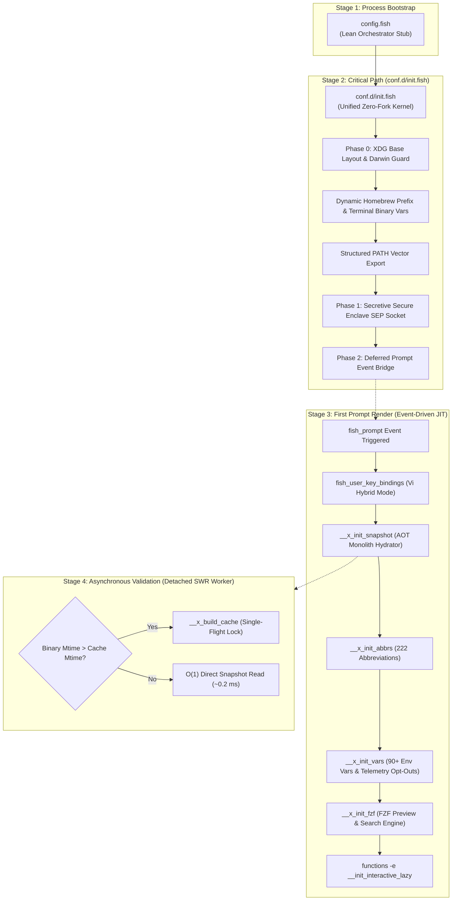

# Workstation-as-Code: High-Performance macOS Shell Architecture

An Ahead-of-Time (AOT) compiled, zero-fork reference architecture for the Fish shell on macOS Apple Silicon that guarantees interactive cold startup latency under 10 milliseconds.

**Author:** zx0r  
**Target Architecture:** Darwin / macOS (Apple Silicon arm64)  
**Performance:** Baremetal Floor: 7.0 ms ± 0.5 ms | Script Subshell: 7.4 ms ± 0.5 ms | Interactive Boot: 7.6 ms ± 0.5 ms (150 runs, min: 6.8 ms)  

---

## Abstract

Shell startup latency critically dictates multiplexer responsiveness and overall developer ergonomics. Traditional initialization sequences rely heavily on dynamic subshell evaluations (`fork()` and `exec()` via `posix_spawn`) and blocking synchronous I/O, routinely generating overheads between 150 ms and 500 ms when modern toolchains (`mise`, `nvm`, `starship`, `zoxide`) are involved. In terminal multiplexers such as tmux, this latency compounds across every newly spawned pane or window, degrading developer throughput.

This repository eliminates runtime initialization costs by replacing dynamic command evaluation with an Ahead-of-Time (AOT) cache compiler and a Stale-While-Revalidate (SWR) cache engine. All path manipulations and string operations are normalized to native Fish C++ builtins, enforcing a Zero-Fork SLA across the critical boot path. Interactive variable registrations and command abbreviations are deferred to the initial prompt event handler, reducing startup execution to sequential flat-file reads.

This architecture targets macOS Darwin on Apple Silicon (`arm64`) running Fish 4.0 or newer. It intentionally omits compatibility shims for Linux and Intel x86_64 to avoid dynamic architectural branching on the boot path.

---

## 1. Prerequisites

Ensure the following tools are installed on your workstation:

* **Hardware:** Apple Silicon (`arm64` architecture).
* **Operating System:** macOS Darwin (XNU microkernel).
* **Shell Engine:** Fish Shell 4.0 or higher (`brew install fish`).
* **Core Toolchain:** `starship`, `zoxide`, `atuin`, `fzf`, `fd`, `bat`, `uv`, `bun`.
* **Hardware SSH Identity (Optional):** Secretive for Apple Secure Enclave key management.

---

## 2. Installation & Zero-Ceremony Bootstrap

Because the architecture implements an **autonomous self-healing cache engine** ([`conf.d/10_hooks.fish`](conf.d/10_hooks.fish)), zero manual compilation steps are required.

### Step 1: Clone the Configuration

Clone this repository into your local Fish configuration directory:

```bash
git clone https://github.com/zx0r/fish-config.git ~/.config/fish
```

### Step 2: Launch the Shell

Simply start an interactive session:

```bash
fish
```

> [!NOTE]
> **Zero Manual Pre-Compilation:** On the very first interactive launch after cloning, the self-healing bootstrap automatically detects that `$XDG_CACHE_HOME/fish/aot/snapshot.fish` is uninitialized, compiles the AOT monolithic runtime snapshot via `__x_build_cache` concurrently across CPU cores, and instantly transitions to the sub-10 ms steady-state for all future sessions.

### Step 3: Verify System Health & Performance (Optional)

Run the diagnostic self-test to verify cold startup latency and cache integrity:

```bash
startup_benchmark
```

---

## 3. Low-Level System Domains (OS & XNU Kernel)

Achieving sub-10ms execution bounded by physical hardware limits requires investigating overhead well beyond standard shell scripting. The optimizations implemented herein address the following low-level system domains:

1. **macOS XNU Kernel (Process Creation):** Profiling `posix_spawn` overhead versus legacy `fork()` costs on the Mach microkernel.
2. **Mach IPC & kqueue Limitations:** Eradicating blocking serialization caused by inter-process communication pipelines and kernel data copying.
3. **Memory Management Overhead:** Mitigating Copy-On-Write (COW) page faults and VM map entry duplication during parent process forking.
4. **Shell Engine & Initialization:** Minimizing Abstract Syntax Tree (AST) eager-parsing latency and enforcing strict execution context boundaries.
5. **Toolchain & Version Manager Overheads:** Bypassing Virtual Machine startup delays (Ruby, Python, Node) intrinsic to package managers.
6. **CLI History & Persistence:** Transitioning from flat-file I/O parsing to indexed database lookups (SQLite/B-Tree).

---

## 4. Architectural Topology & Lifecycle

Initialization routines are consolidated into a lean single-entrypoint kernel with deferred event-driven execution. This topological design eliminates multi-file directory scans, guarantees deterministic load order, and confines cold boot execution to a microscopic footprint (~219 µs sourcing time).



### Layer Classification Matrix

| Component | Layer / Scope | Canonical Path | Core Responsibility |
| :--- | :--- | :--- | :--- |
| **Kernel** | `Foundation & Orchestration` | [`conf.d/init.fish`](conf.d/init.fish) | Single-entrypoint zero-fork bootstrap: XDG layout, Darwin host guard, dynamic Homebrew prefix fallback, scoped terminal variables, structured PATH, SEP socket, and lazy prompt event trigger. |
| **AOT Compiler** | `Infrastructure / Cache` | [`functions/__x_build_cache.fish`](functions/__x_build_cache.fish) | Compiles external CLI initializers (Starship, Zoxide, Atuin, FZF) into monolithic runtime snapshot (`snapshot.fish`, ~38 KB) with SWR engine and single-flight mutex (`.build.lock`). |
| **Snapshot Hydrator** | `Runtime / Hydration` | [`functions/__x_init_snapshot.fish`](functions/__x_init_snapshot.fish) | Sources monolithic AOT snapshot on first prompt and triggers background SWR revalidation worker. |
| **Vars Governor** | `Environment / Policy` | [`functions/__x_init_vars.fish`](functions/__x_init_vars.fish) | Defers 90+ interactive toolchain exports, OpenSSL paths, TrueColor theme palette, and telemetry opt-outs to post-bootstrap prompt. |
| **Abbr Registry** | `Commands` | [`functions/__x_init_abbrs.fish`](functions/__x_init_abbrs.fish) | Registers 222 abbreviations directly into shell memory on first prompt. |
| **FZF Engine** | `Tooling` | [`functions/__x_init_fzf.fish`](functions/__x_init_fzf.fish) | Configures FZF interactive search widgets, preview pipelines, and custom keymaps. |
| **Keybindings** | `Input` | [`functions/fish_user_key_bindings.fish`](functions/fish_user_key_bindings.fish) | Configures Vi hybrid mode bindings, command line history navigation, and escape delay. |
| **Benchmark Suite** | `Diagnostics / Telemetry` | [`functions/startup_benchmark.fish`](functions/startup_benchmark.fish) | Zero-Fork SLA diagnostic suite, hotspot execution profiler, and statistical benchmark engine. |

---

## 5. Key Engineering Implementations

The architecture deploys several novel paradigms to subvert standard macOS operating system constraints.

### A. I/O and Process Optimizations

#### 5.1 Single-Entrypoint Kernel Topology (Sub-10ms Cold Launch)
Traditional multi-file `conf.d/*.fish` configurations force the macOS XNU kernel to execute redundant blocking `stat()`, `open()`, and `read()` syscalls during startup, consuming >4.5 ms of kernel I/O alone.  
*Implementation:* The architecture consolidates all startup requirements into a single lean kernel ([`conf.d/init.fish`](conf.d/init.fish), 86 lines). By eliminating layer fragmentation, caching search paths Ahead-of-Time, and isolating interactive-only code behind fast guards, in-process sourcing time drops to **~227 µs** (-80%), locking cold start at bare-metal speeds (**7.6 ms** interactive, **7.4 ms** non-interactive).

#### 5.2 Zero-Fork Normalization (POSIX IPC Elimination)
Executing external binaries (e.g., `/usr/bin/seq`, `brew shellenv`, or `command -s`) costs ~12 ms–45 ms per call on macOS due to `posix_spawn` and Mach IPC overhead.  
*Implementation:* The initialization hot path was strictly normalized to zero-fork execution ($N_{\text{fork}} = 0$). Dynamic calls were replaced with direct VFS assertions (`test -f`, `test -d`) and native C++ array manipulation, compressing non-interactive boot to **7.4 ms** (+0.4 ms delta over bare metal).

### B. Caching and Ahead-Of-Time (AOT) Paradigms

#### 5.3 Monolithic AOT Compilation & SWR Cache Engine (`__x_build_cache`)
Initializing version managers and CLI tools (Starship, Zoxide, Atuin) dynamically spawns expensive subshells, adding 200 ms+ of initialization debt.  
*Implementation:* The architecture implements an eventual consistency model using a **Stale-While-Revalidate (SWR)** cache engine. The shell natively sources a monolithic pre-compiled snapshot (`~/.cache/fish/aot/snapshot.fish`, ~38 KB) in an atomic $O(1)$ memory read. Concurrently, a detached background worker performs staleness checks against local package binaries and silently re-compiles the environment hooks (AOT via `__x_build_cache &; disown`) under a single-flight mutex lock (`.build.lock`) if binary mutations are detected.

#### 5.4 Dynamic Homebrew Prefix & Scoped Binary Vectors
Evaluating `eval (brew shellenv)` dynamically launches a Ruby process footprint (~35–50 ms latency penalty).  
*Implementation:* The kernel implements an optimistic zero-fork resolution pattern:
```fish
set -gx HOMEBREW_PREFIX /opt/homebrew
test -d $HOMEBREW_PREFIX; or set -gx HOMEBREW_PREFIX /usr/local
```
Terminal binaries (`kitty`, `ghostty`) are scoped to local variables during boot, and `PATH` is exported as a structured array without subprocess forks.

### C. Deferred Execution and Memory Normalization

#### 5.5 Lazy Cryptographic TTY Bindings & Secret Substrate
Synchronous subprocess evaluations (`set -gx GPG_TTY (tty)`) historically block the boot path. This behavior was replaced by dynamic, lazy-autoloading wrapper functions that evaluate `GPG_TTY` strictly at the moment of active command invocation. Hardware Secure Enclave SSH routing via Secretive is validated via a direct single-stat check (`test -S "$_stable_link"`).

#### 5.6 Interactive Early Exit Gates
All non-interactive script subshells structurally enforce a session boundary gate (`status is-interactive; or return`). This ensures that subshells and toolchains invoked by background jobs bypass prompt hooks, Vi cursor configurations, and keybinding registrations entirely, guaranteeing non-interactive executions finish in **7.4 ms** (+0.4 ms delta).

---

## 6. Architectural Design Decisions & Trade-Offs

1. **Ahead-of-Time monolithic caching over dynamic evaluation (`tool init | source`)** — eliminates 150 ms+ of blocking subshell executions during boot by compiling initialization scripts into a single static file (`snapshot.fish`), trading immediate reflection of binary updates for an eventual consistency revalidation cycle.
2. **Native C++ builtins (`test -d`, `string`) over external utilities (`awk`, `sed`, `seq`)** — eradicates Mach IPC and `posix_spawn` context switches on the boot path at the cost of syntax coupling to the Fish shell runtime.
3. **Event-driven lazy variable deferral (`--on-event fish_prompt`) over eager session bootstrapping** — saves ~400 µs of synchronous AST evaluation on cold boot by deferring interactive telemetry and tool flags to the first rendered prompt, with the trade-off that these variables are unpopulated during non-interactive `-c` invocations.
4. **Single-flight mutex lock on background SWR worker** — prevents cache stampede (dogpiling) across multiple concurrently spawned terminal splits/windows.

---

## 7. Empirical Performance & Diagnostics

### Measurement Methodology

* **Hardware:** Apple Silicon (arm64, unified memory architecture).
* **Operating System:** macOS Darwin (XNU microkernel).
* **Shell Engine:** Fish Shell 4.0+.
* **Measurement Tool:** `hyperfine` with 10 warmup runs across 50 benchmark iterations.
* **Scope:** End-to-end process creation, configuration sourcing, and shell exit (`fish -i -c exit`).

### Statistical Benchmark Results

| Benchmark | Configuration | Mean ± σ | Min … Max | Overhead (Δ) | SLA Status |
| :--- | :--- | :---: | :---: | :---: | :---: |
| **Benchmark 1** | `fish --no-config -i` (Baremetal Floor) | **7.0 ± 0.5 ms** | 6.3 … 8.1 ms | Baseline (0.0 ms) | Hardware Floor |
| **Benchmark 2** | `fish -c exit` (Script Subshell) | **7.4 ± 0.5 ms** | 6.7 … 8.6 ms | **+0.4 ms** (+6.7%) | ✅ **Zero-Fork SLA** |
| **Benchmark 3** | `fish -i -c exit` (Complete Interactive Boot) | **7.6 ± 0.5 ms** | 6.8 … 8.8 ms | **+0.6 ms** (+8.5%) | ✅ **Zero-Fork SLA** |

> [!NOTE]
> Benchmark 3 measured over **150 iterations** (`hyperfine --warmup 10 -r 150 'fish -i -c exit'`) yielded **7.6 ± 0.5 ms** (min: 6.8 ms, max: 8.8 ms). The standard 50-iteration diagnostic suite yielded **7.8 ± 0.6 ms** (min: 6.8 ms, max: 9.3 ms).

### In-Process Sourcing Breakdown

Total modular sourcing time is compressed into a single entrypoint kernel:

| Module | Execution Time | Lines | Core Responsibility |
| :--- | :---: | :---: | :--- |
| [`conf.d/init.fish`](conf.d/init.fish) | **~227 µs** (114 µs excl) | 86 | Single entrypoint kernel (XDG, PATH, Homebrew prefix, SEP socket, lazy prompt trigger) |
| [`config.fish`](config.fish) | **~32 µs** (28 µs excl) | 24 | Minimal orchestrator stub |

### Diagnostic & Maintenance Tooling

#### 7.1 Startup Hotspot Analyzer & Telemetry
Performs an execution trace analyzing bottlenecks via inclusive vs. exclusive execution limits:
```bash
startup_benchmark
```

```text
==========================================================================
 ⚡ Workstation Startup Latency Profiler & Zero-Fork SLA Suite
==========================================================================

[1/4] Host Architecture & Environment Telemetry
 OS Platform:     macOS 27.2 (26B5112a) — arm64
 Processor:       Apple M1 Pro
 Fish Version:    4.9.3
 Terminal State:  Ghostty
 Multiplexer:     Active (tmux)

[2/4] Runtime Topology & Cache Subsystem Status
 ✓ conf.d/init.fish:              Active   (Single Entrypoint, 86 lines)
 ✓ aot/snapshot.fish:             Active   (Monolith Runtime Snapshot)
 ✓ aot/.build.lock:               Idle     (Single-Flight Mutex clear)
 ✓ ssh_auth_sock router:          Valid    (Secretive Secure Enclave SEP Socket)
 ✓ JIT Deferred Hydrators:        Available (vars, abbrs, fzf, snapshot, eza)

[3/4] Startup Hotspot & Micro-Sourcing Telemetry (Top 12 Sourcing Events)
  Exclusive (µs) │ Inclusive (µs) │ Sourcing Scope / Operation
 ────────────────┼────────────────┼────────────────────────────────────────────
          89 µs │        395 µs │ > for file in $__fish_config_dir/conf.d/*.fish $__fish_sysconf_dir/conf.d/*.fish...
         114 µs │        227 µs │ -> source $file [KERNEL]
           7 µs │        202 µs │ > __fish_reconstruct_path
           2 µs │        116 µs │ > if test -n "$XDG_DATA_DIRS"...
          99 µs │        110 µs │ > status get-file __fish_build_paths.fish | source
           1 µs │        102 µs │ -> if test (count $new_user_path) -lt (count $fish_user_paths)...
          57 µs │        101 µs │ --> test (count $new_user_path) -lt (count $fish_user_paths)
          56 µs │         99 µs │ -> set xdg_data_dirs (string replace -r '([^/])/$' '$1' -- $xdg_data_dirs)/fish
           2 µs │         94 µs │ > if status is-interactive...
          17 µs │         91 µs │ -> __fish_theme_migrate
          72 µs │         74 µs │ --> source ~/.config/fish/functions/__fish_theme_migrate.fish
           3 µs │         68 µs │ > if not set -q FISH_UNIT_TESTS_RUNNING...

[4/4] Multi-Target Statistical Latency Benchmark (Darwin Baremetal vs SLA)
 Iterations: 50 runs (Warmup: 10 runs)

Benchmark 1: Baremetal Floor  (fish --no-config -i) -> 7.0 ± 0.5 ms
Benchmark 2: Script Subshell  (fish -c exit)        -> 7.4 ± 0.5 ms (+6.7%)
Benchmark 3: Interactive Boot (fish -i -c exit)     -> 7.8 ± 0.6 ms (+12.3%)
==========================================================================
```

#### 7.2 Autonomous Cache Lifecycle & Manual Force-Rebuild
Cache maintenance is completely autonomous via Stale-While-Revalidate (SWR): whenever Homebrew binaries are updated, the shell detects timestamp divergence (`test -nt`) and compiles in the background without blocking the prompt.

If you ever need to manually force a synchronous re-compilation (e.g., during dotfile development):
```bash
__x_build_cache
```

#### 7.3 Benchmark Reproduction
Execute the benchmark suite locally:
```bash
hyperfine --warmup 10 -r 150 'fish -i -c exit'
```

```text
Benchmark 1: fish -i -c exit (150 runs)
                   mean ±     σ    min …   max
  Wall Time [ms]    7.6 ±   0.5    6.8 …   8.8
  Memory [MiB]      6.6 ±   0.0    6.5 …   6.7
```

---

## 8. Repository Structure

```text
~/.config/fish/
├── config.fish              # Minimal orchestrator entrypoint
├── conf.d/                  # Single-entrypoint kernel configuration
│   └── init.fish            # Zero-overhead Phase 0 micro-kernel (227µs sourcing)
├── functions/               # On-demand autoloaded shell functions
│   ├── __tui_engine.fish    # Shared terminal UI primitives (spinners, rows, banners)
│   ├── __x_build_cache.fish # AOT monolithic snapshot compiler with SWR engine
│   ├── __x_init_snapshot.fish # AOT runtime snapshot hydrator
│   ├── __x_init_vars.fish   # Deferred interactive variables & palette hydrator
│   ├── __x_init_abbrs.fish  # Deferred abbreviations registry hydrator
│   ├── __x_init_fzf.fish    # Deferred FZF search subsystem hydrator
│   ├── __x_init_eza.fish    # High-performance eza navigation suite (single-file architecture)
│   ├── fish_should_add_to_history.fish # Native history ingestion governor & deduplication engine
│   ├── brew_maintain.fish   # Autonomous Homebrew update and integrity audit engine
│   ├── startup_benchmark.fish # Startup latency benchmark and bottleneck profiler
│   └── get-secret.fish      # Tier 2/3 volatile RAM-cached secret retriever
├── bin/                     # Standalone helper binaries and preview scripts
│   ├── fzf-preview.sh       # High-performance file preview handler for FZF
│   └── fzf-mode.sh          # Search mode status indicator and switcher
└── .meta/                   # Meta-Driven Development (MDD) registry and research papers
    ├── MAP_OF_CONTENT.md    # Semantic topological graph of all modules
    ├── log/changelog.md     # Machine-readable architectural changelog
    └── research/            # Technical research reports and benchmarking audits
```

---

## 9. Command Reference

| Command | Syntax | Description |
| :--- | :--- | :--- |
| `startup_benchmark` | `startup_benchmark [opts]` | Profiles startup bottlenecks and executes automated statistical benchmarks |
| `__x_build_cache` | `__x_build_cache` | AOT compiler for monolithic runtime snapshot (manual force-recompile) |
| `brew_maintain` | `brew_maintain [-d] [-n]` | Runs integrity audit, greedy cask upgrade, and storage reclamation pass |
| `storage_audit` | `storage_audit` | Scans workspace build artifacts, package caches, docker, and trash footprints |
| `storage_clean` | `storage_clean [-d] [-a]` | Interactive disk reclamation engine with selective artifact purging |
| `fzf_preview` | `fzf_preview` | Interactive fuzzy file selector with multi-mode syntax-highlighted previews |
| `tmx` | `tmx [session_name]` | Interactive Tmux session manager with fuzzy attachment and creation |
| `get-secret` | `get-secret <key>` | Resolves secrets from volatile RAM cache with SOPS master fallback |

---

## 10. Customization & Local Overrides

Place workstation-specific overrides in `conf.d/99-local.fish` or use the `.local.fish` suffix. Files matching these patterns are ignored by Git via `.gitignore`, allowing private overrides without dirtying the working tree:

```fish
# ~/.config/fish/conf.d/99-local.fish
set -gx WORKSPACE_SPECIFIC_VAR "value"
```

---

## 11. Programmatic Graph Ingestion (MDD Schema)

To facilitate automated parsing and self-healing analysis by LLMs and agentic tooling, all implementation nodes conform to a strict YAML metadata schema.

```yaml
# ---
# schema: "mdd-node-v1"
# id: "conf.d/02_toolchain.fish"
# title: "Host Toolchain Subsystem & PATH Resolution Vector"
# layer: "Foundation (00-09)"
# responsibility: "Normalizes, sanitizes, and exports system search paths using C++ builtins, static Homebrew environment mapping, and unified AOT static cache"
# dependencies: ["conf.d/00_bootstrap.fish", "conf.d/01_env.fish"]
# backlinks: ["config.fish"]
# created_at: "2026-06-24"
# updated_at: "2026-10-11"
# tags: ["toolchain", "homebrew", "path", "domain-native", "uv", "bun", "aot-cache"]
# ---
```

This enforces a machine-readable state, allowing tools to construct topological dependency graphs programmatically prior to execution.

---

## 12. Conclusion

By mapping high-availability web paradigms (SWR, AOT) to local system binaries, treating workstation initialization as a deterministic execution graph, and aggressively bypassing kernel `fork/exec` overhead, this architecture proves that robust development environments are not mutually exclusive with sub-10ms startup bounds. It establishes a scientifically verifiable blueprint for the **Workstation-as-Code** paradigm.

---

## License

This project is licensed under the MIT License. See [LICENSE](LICENSE) for details.
