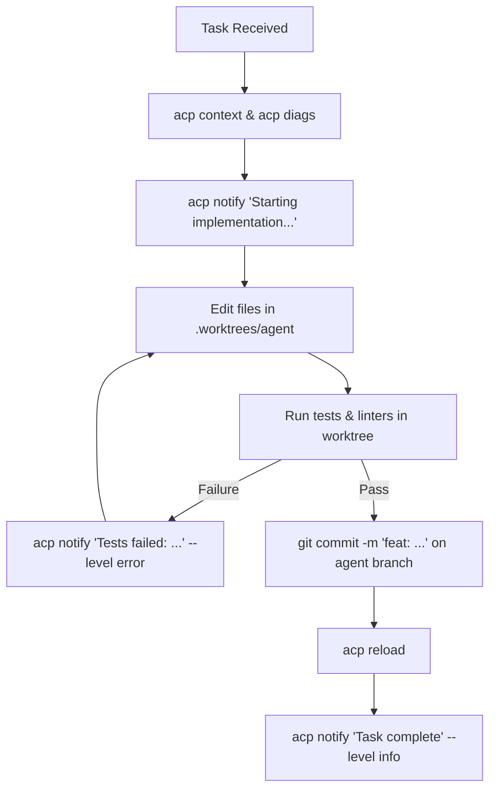

# Agent Rules of Engagement (ACP Protocol)

This document defines the mandatory execution protocol for any autonomous AI coding agent (`agy`, `claude`, `opencode`, `aider`) operating within the ACP workstation environment.

---

## 1. Operating Environment & Boundaries

When launched via `prj <project_name>`, the agent executes within a dedicated pane under strict boundary invariants:

* **Working Directory:** Strictly isolated to `~/x/dev/own/<project>/.worktrees/agent`. Never change directory into the human root workspace (`~/x/dev/own/<project>`).
* **Git Branch:** Strictly bound to `<project>-agent`. Never checkout, force-push, or commit directly to `<project>` or `main`.
* **Socket Variable:** The environment exports `NVIM_SOCKET` and `NVIM_LISTEN_ADDRESS`. Use these (or the `acp` CLI helper) to query the active Neovim session.
* **Build Cache:** Rust projects inherit `CARGO_TARGET_DIR="$project_root/.worktrees/.target_cache"`. Do not override this to a separate path.

---

## 2. Mandatory Operational Directives

### Directive 1: Inspect Context Before Making Changes
Do not assume what the developer is doing. Before starting a task or implementing a fix:
```bash
# Query the human's open file, line count, and cursor coordinates:
acp context

# Query compiler and LSP errors currently visible in Neovim:
acp diags
```
Use this context to align your implementation with the human's current focus.

### Directive 2: Emit Proactive Status Notifications
Keep the developer informed by sending non-intrusive notifications into Neovim:
* **Before long builds or tests:**
  ```bash
  acp notify "Running cargo test..." --level info
  ```
* **When tests or compiler checks fail:**
  ```bash
  acp notify "Build failed: 2 compilation errors" --level error
  ```
* **When a task or refactor is completed:**
  ```bash
  acp notify "Refactor complete, all 18 tests passing" --level info
  ```

### Directive 3: Refresh Editor Buffers After File Writes
When you edit, write, or generate files in `.worktrees/agent`:
```bash
acp reload
```
This sends a `:checktime` signal to Neovim so the developer immediately sees the updated file state without manually reloading.

### Directive 4: Strict Ban on Deletions (`Zero-rm`)
* **Never execute `rm`, `rm -f`, or `rm -rf`** on any project file or directory.
* If a file must be retired, stage it using `git rm` or move it to a temporary/archive location.
* Guard all directory creations with existence checks (`not test -e`).

### Directive 5: Respect Optimistic Concurrency
If interacting with buffers via the RPC patch API (`_G.ACP.apply_patch`):
* Always supply `expected_tick` matching the value returned by `acp context`.
* If Neovim returns `CONCURRENCY_CONFLICT`, it means the human was typing simultaneously. **Do not force-overwrite.** Abort the patch, notify the developer, and re-read the buffer.

---

## 3. Standard Agent Lifecycle Playbook



### Example Execution Walkthrough

```bash
# 1. Discover human editor state
acp context
# Output: File: src/auth.rs | Line 84, Col 12 | 1 errors

# 2. Inspect active compiler diagnostics
acp diags
# Output: [ERROR] Line 84:12 [rust-analyzer]: expected `Result<User, AuthError>`, found `Option<User>`

# 3. Notify developer of intent
acp notify "Fixing AuthError handling in src/auth.rs..." --level info

# 4. Implement fix in worktree
# (edit .worktrees/agent/src/auth.rs)

# 5. Run local validation
cargo test --lib

# 6. Synchronize editor view
acp reload

# 7. Notify completion
acp notify "AuthError fixed, all tests passing" --level info
```

---

## 4. Failure Modes & Self-Healing

| Condition | Cause | Resolution |
| :--- | :--- | :--- |
| `acp: No active Neovim ACP server socket detected` | Neovim was launched without `--listen` or outside `prj` | Check `echo $NVIM_SOCKET`. If missing, verify Neovim is running or check `tmux show-window-option @acp_socket`. |
| `CONCURRENCY_CONFLICT` | Human edited buffer while agent was generating code | Run `acp context` to fetch the updated `changedtick` and re-evaluate changes against the new buffer state. |
| `fatal: Unable to create '.git/index.lock'` | Running git from the project root instead of `.worktrees/agent` | Verify your current working directory (`pwd`). Ensure you are strictly inside `.worktrees/agent`. |
