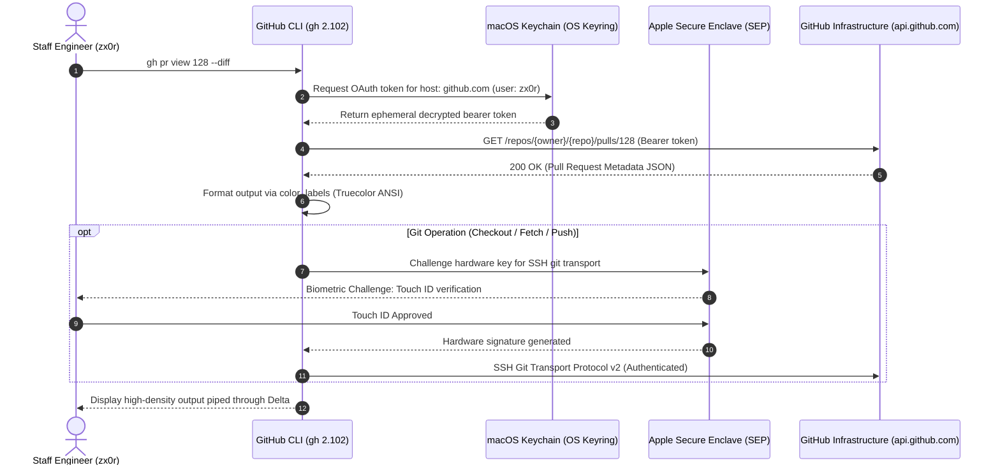

# GitHub Platform & CLI Architecture

> Platform: macOS Sequoia / Sonoma (Apple Silicon arm64 Darwin 25+) Standard: Strict XDG Base
> Directory Specification (`$XDG_CONFIG_HOME/gh`) Stack: GitHub CLI 2.102+ | macOS Keychain (Secure
> Storage) | Apple Secure Enclave (SEP ECDSA-P256) | Delta 0.20+ | gh-dash v4.26+ | fzf 0.50+ | jq
> 1.7+

---

## 1. Architectural Cross-Section & System Overview

Modern enterprise platform engineering mandates strict zero-trust operational security,
hardware-rooted cryptographic identity, and low-latency command pipelines. Conventional developer
workstations frequently suffer from critical platform anti-patterns:

- High-privilege Personal Access Tokens (PATs) or OAuth bearer tokens stored unencrypted as
  plaintext YAML strings (`oauth_token: ...` in `hosts.yml`), vulnerable to any compromised local
  process or dependency scan.
- Protocol fragmentation where `git` clones via HTTPS (prompting or failing on 2FA) while
  cryptographic signing relies on hardware SSH keys.
- Egress telemetry leaks broadcasting telemetry metadata and command invocation patterns to remote
  collectors with added invocation latency.
- Uncontrolled terminal pagers freezing non-interactive automation, headless scripts, and
  sub-shells.

This architecture establishes a **System-as-Interface** reference deployment for GitHub CLI (`gh`):

1. **Zero-Plaintext Credential Isolation**: Authentication credentials reside strictly within the
   **macOS Keychain** via secure storage integration. Flat configuration files contain zero
   sensitive bearer tokens (`hosts.yml` tracks metadata only).
2. **Hardware-Bound Transport Unification**: Seamless alignment between local Apple Silicon **Secure
   Enclave Processor (SEP)** SSH keys (`~/.ssh/zx0r_ecdsa-sha2-nistp256@github.pub`), Git
   configuration (`core.pager = delta`, `protocol.version = 2`), and GitHub CLI
   (`git_protocol: ssh`).
3. **Telemetry & Latency Neutralization**: Zero outbound telemetry egress (`telemetry: disabled`)
   and background update check suppression (`GH_NO_UPDATE_NOTIFIER=1`), guaranteeing deterministic
   sub-millisecond execution.
4. **Unified Interactive Cockpit**: Terminal User Interface (TUI) integration via **`gh-dash`**,
   safe branch lifecycle governance via **`gh-poi`**, and interactive fuzzy navigators via
   **`fzf`** + **`delta`**.

---

### ASCII Cross-Section: Zero-Trust GitHub CLI & Transport Architecture

```
┌──────────────────────────────────────────────────────────────────────────────────┐
│                         DEVELOPER CLI & WORKSPACE TIERS                          │
│         gh pr create   │   gh dash   │   gh-pr-fzf   │   gh ratelimit            │
└────────────────────────────────────────┬─────────────────────────────────────────┘
                                         │
┌────────────────────────────────────────▼─────────────────────────────────────────┐
│                      ZERO-TRUST POLICY ENGINE & XDG LAYER                        │
│   ~/.config/gh/config.yml   │   ~/.config/gh/hosts.yml   │   ~/.config/gh/env.sh │
│   telemetry = disabled      │   git_protocol = ssh       │   color_labels = true │
└──────────────────┬─────────────────────┬──────────────────────┬──────────────────┘
                   │                     │                      │
       ┌───────────▼──────────┐ ┌────────▼──────────┐ ┌─────────▼──────────────┐
       │ SECURE CREDENTIALS   │ │ HARDWARE TRANSPORT │ │   TUI & PAGER ENGINE   │
       │   (macOS Keychain)   │ │  (Secure Enclave)  │ │   (Delta + gh-dash)    │
       └───────────┬──────────┘ └────────┬──────────┘ └─────────┬──────────────┘
                   │                     │                      │
┌──────────────────▼──────────┐ ┌────────▼──────────┐ ┌─────────▼──────────────┐
│  macOS Keychain Services    │ │  Apple SEP / SSH  │ │  Terminal Highlighting │
│  Domain: github.com         │ │  ECDSA P-256      │ │  Delta syntax pager    │
│  Account: zx0r              │ │  Protocol v2      │ │  Bubbletea TUI (dash)  │
│  Zero Plaintext on Disk     │ │  Non-exportable   │ │  Truecolor ANSI (24bit)│
└──────────────────┬──────────┘ └────────┬──────────┘ └─────────┬──────────────┘
                   │                     │                      │
                   └─────────────────────┼──────────────────────┘
                                         │
┌────────────────────────────────────────▼─────────────────────────────────────────┐
│                   GITHUB WIRE API & REPOSITORY HOSTING LAYER                     │
│      REST API v3 (api.github.com) │ GraphQL API v4 │ Git SSH Wire Transport      │
│      Scopes: admin:public_key, admin:ssh_signing_key, repo, workflow, read:org    │
└──────────────────────────────────────────────────────────────────────────────────┘
```

---

### Mermaid Sequence Diagram: Authenticated CLI & Hardware Transport Flow



---

## 2. Deep Research Findings & Threat Model

### 2.1 Credential Persistence & Supply-Chain Exfiltration Risks

- **Vulnerability Analysis**: Early versions of `gh` stored raw Personal Access Tokens (PATs) or
  OAuth tokens in plaintext inside `~/.config/gh/hosts.yml`. Any unprivileged local process, rogue
  script, or malicious npm/pip package executing in the developer's context could extract
  `~/.config/gh/hosts.yml` and exfiltrate enterprise credentials.
- **Architectural Remediation**: This system enforces native **macOS Keychain Services** (`keyring`
  backend). Authentication tokens are stored with OS-level encryption accessible only through macOS
  security APIs. The `hosts.yml` file is strictly constrained to host and username mappings without
  token persistence:

```yaml
github.com:
    git_protocol: ssh
    users:
        zx0r:
    user: zx0r
```

### 2.2 Transport Protocol Alignment & MitM Surface

- **Vulnerability Analysis**: When `gh` defaults to `git_protocol: https`, operations like
  `gh repo clone` or `gh pr checkout` generate HTTPS remotes requiring credential helper caching and
  bearer tokens over HTTPS. If the user relies on hardware commit signing (`gpg.format = ssh` backed
  by Apple Silicon Secure Enclave), an inconsistency emerges: push operations authenticate via HTTPS
  while commit headers authenticate via hardware SSH.
- **Architectural Remediation**: Unify global transport to `git_protocol: ssh`. All clone, fetch,
  checkout, and push actions route through OpenSSH wire protocol v2, authenticated via the
  hardware-bound ECDSA P-256 key (`~/.ssh/zx0r_ecdsa-sha2-nistp256@github.pub`).

### 2.3 Telemetry Egress & Zero-Latency Execution

- **Analysis**: GitHub CLI includes automated telemetry collection (`telemetry: enabled`) and daily
  update notification pings (`GH_NO_UPDATE_NOTIFIER`). In high-density platform workflows or
  automated loops, background HTTP requests to telemetry collectors introduce latency and network
  jitter.
- **Architectural Remediation**: Explicitly configure `telemetry: disabled` in `config.yml` and set
  `export GH_NO_UPDATE_NOTIFIER=1` in shell integration profiles. Eliminates outbound telemetry
  telemetry payloads and cuts command latency.

### 2.4 Headless Pager Deadlocks

- **Analysis**: Hardcoding `pager: delta` or `pager: less` into `config.yml` causes `gh` to redirect
  standard output through an external process for all commands. In non-TTY sub-shells, background
  jobs, or CI/CD pipelines, this triggers `WARNING: terminal is not fully functional` and blocks
  waiting for user input.
- **Architectural Remediation**: Maintain `pager: ""` in `config.yml`. `gh` dynamically respects the
  parent environment's `$PAGER` or `$GH_PAGER` in interactive sessions, while streaming cleanly to
  stdout when invoked programmatically.

---

## 3. Filesystem Manifest & System Architecture

```
/Users/x0r/.config/gh/
├── config.yml                 # Master configuration (schema v1, telemetry disabled, aliases)
├── hosts.yml                  # Host metadata & Keychain account mapping (permissions: 0600)
├── env.sh                     # POSIX / Zsh / Bash runtime environment & interactive fzf functions
├── env.fish                   # Fish shell native runtime integration & functions
├── completions/               # Pre-generated zero-latency shell completion manifests
│   ├── gh.fish                # Symlinked to ~/.config/fish/completions/gh.fish
│   ├── _gh                    # Zsh autoload completion definition
│   └── gh.bash                # Bash completion script
├── scripts/
│   ├── gh-doctor.sh           # Zero-trust diagnostic engine & self-healing health check
│   └── install-extensions.sh  # Automated extension lifecycle manager & updater
└── README.md                  # Comprehensive architectural specification (this file)

/Users/x0r/.config/gh-dash/
└── config.yml                 # Enterprise TUI dashboard configuration (Delta pager, Dracula theme)
```

---

## 4. Master Configuration Specification (`config.yml`)

The configuration file `/Users/x0r/.config/gh/config.yml` is hardened to enterprise standards:

```yaml
version: 1
git_protocol: ssh
editor: nvim
prompt: enabled
prefer_editor_prompt: disabled
pager: ""
http_unix_socket: ""
browser: ""
clipboard: enabled
color_labels: enabled
accessible_colors: disabled
accessible_prompter: disabled
spinner: enabled
telemetry: disabled
```

### Directive Architectural Rationale

| Directive              | Configured Value | Default    | Engineering Rationale                                                                                          |
| :--------------------- | :--------------- | :--------- | :------------------------------------------------------------------------------------------------------------- |
| `version`              | `1`              | `1`        | Internal config schema migration version.                                                                      |
| `git_protocol`         | `ssh`            | `https`    | Enforces zero-trust cryptographic wire transport via Secure Enclave hardware key.                              |
| `editor`               | `nvim`           | (blank)    | Binds authoring (PR bodies, issue notes) directly to Neovim.                                                   |
| `prompt`               | `enabled`        | `enabled`  | Enables interactive terminal selection prompts for humans; overridden by `GH_PROMPT_DISABLED=1` in automation. |
| `prefer_editor_prompt` | `disabled`       | `disabled` | Fast CLI terminal prompting for simple inputs; invokes editor only for multiline content.                      |
| `pager`                | `''`             | (blank)    | Defers to shell `$PAGER` / `$GH_PAGER`, preventing non-TTY hanging in scripts.                                 |
| `clipboard`            | `enabled`        | `enabled`  | Automatically copies OAuth device authorization codes into macOS pasteboard.                                   |
| `color_labels`         | `enabled`        | `disabled` | Renders GitHub issue/PR labels using truecolor 24-bit RGB ANSI escape sequences.                               |
| `spinner`              | `enabled`        | `enabled`  | Displays terminal spinner progress indicators during asynchronous API calls.                                   |
| `telemetry`            | `disabled`       | `enabled`  | Zero telemetry egress; eliminates outbound network overhead and metadata leaks.                                |

---

## 5. Curated Staff / Principal Aliases Reference Card

All aliases are natively loaded in `config.yml` and provide immediate productivity boosts across the
development lifecycle:

### 5.1 Pull Request Lifecycle & Review Engine

| Alias           | Command                                           | Description                                                           |
| :-------------- | :------------------------------------------------ | :-------------------------------------------------------------------- |
| `gh co <pr>`    | `pr checkout <pr>`                                | Checks out pull request locally into a tracked branch.                |
| `gh pv [pr]`    | `pr view [pr]`                                    | Displays PR details, status checks, and metadata in terminal.         |
| `gh pvw [pr]`   | `pr view --web [pr]`                              | Opens the targeted pull request in default web browser.               |
| `gh pd [pr]`    | `!gh pr diff "$@" \| delta`                       | Pipes PR structural diff directly through Delta syntax pager.         |
| `gh pm`         | `pr list --author @me`                            | Displays all active pull requests authored by the authenticated user. |
| `gh pr-mine`    | `pr list --author @me`                            | Explicit alias for authored pull requests.                            |
| `gh pr-review`  | `pr list --search "review-requested:@me is:open"` | Lists all open PRs explicitly awaiting review from `@me`.             |
| `gh pr-all`     | `pr list --limit 50`                              | Displays high-density overview of recent pull requests.               |
| `gh pr-create`  | `pr create --fill`                                | Instantly creates PR using commit history for title & description.    |
| `gh pr-draft`   | `pr create --draft --fill`                        | Instantly creates a draft PR.                                         |
| `gh pr-checks`  | `pr checks --watch`                               | Live streams CI/CD status checks until terminal pass/fail status.     |
| `gh pr-approve` | `pr review --approve`                             | Submits an official PR approval review.                               |
| `gh pr-merge`   | `pr merge --squash --delete-branch --auto`        | Enables auto-merge with squash and automated remote branch deletion.  |
| `gh pr-ready`   | `pr ready`                                        | Converts a draft PR to "Ready for Review".                            |
| `gh pr-commits` | `!gh pr view "$@" --json commits ...`             | Displays formatted 7-character commit SHA list and headlines.         |
| `gh pr-clean`   | `poi`                                             | Safely detects and purges all local branches merged on remote.        |

### 5.2 CI/CD & Actions Observability

| Alias           | Command                                | Description                                                 |
| :-------------- | :------------------------------------- | :---------------------------------------------------------- |
| `gh runs`       | `run list --limit 20`                  | Displays table of recent GitHub Actions workflow runs.      |
| `gh run-watch`  | `run watch`                            | Live streams active workflow run in real-time.              |
| `gh run-failed` | `run list --status failure --limit 10` | Filters workflow list to failed CI runs only.               |
| `gh run-rerun`  | `run rerun --failed`                   | Re-executes failed jobs in the latest workflow run.         |
| `gh run-log`    | `run view --log-failed`                | Dumps error logs specifically for failed steps in workflow. |
| `gh run-view`   | `run view`                             | Inspects full summary and artifact status of workflow run.  |

### 5.3 Repository Intelligence & Navigation

| Alias               | Command                                          | Description                                                          |
| :------------------ | :----------------------------------------------- | :------------------------------------------------------------------- |
| `gh clone <repo>`   | `repo clone <repo>`                              | Clones repository via SSH transport.                                 |
| `gh fork <repo>`    | `repo fork --remote --clone=false`               | Forks remote repository and configures upstream git remote.          |
| `gh repo-view`      | `repo view`                                      | Renders repository README and details directly in terminal.          |
| `gh repo-web`       | `repo view --web`                                | Opens current repository in web browser.                             |
| `gh repos [org]`    | `repo list [org] --limit 50`                     | Lists repositories for authenticated user or specified organization. |
| `gh default-branch` | `!gh repo view "$@" --json defaultBranchRef ...` | Queries and prints repository's canonical default branch name.       |
| `gh stars`          | `api user/starred --jq '.[].full_name'`          | Lists all repositories starred by authenticated user.                |

### 5.4 Security, Governance & Platform API

| Alias                 | Command                                   | Description                                                              |
| :-------------------- | :---------------------------------------- | :----------------------------------------------------------------------- |
| `gh whoami`           | `!gh api user --jq '...'`                 | Validates active identity, numeric user ID, public repos, and join date. |
| `gh ratelimit`        | `!gh api rate_limit --jq '...'`           | Displays remaining API quotas for Core, GraphQL, and Search.             |
| `gh sec-alerts`       | `!gh api repos/.../dependabot/alerts ...` | Audits open Dependabot security advisories and severity ratings.         |
| `gh secrets`          | `secret list`                             | Lists all GitHub Actions repository and environment secrets.             |
| `gh gql <query>`      | `!gh api graphql -f query="$1"`           | Executes ad-hoc GraphQL v4 queries directly from the command line.       |
| `gh contributors`     | `!gh api repos/.../contributors ...`      | Returns contributor ranking table by commit count.                       |
| `gh latest-release`   | `!gh release view "$@" --json ...`        | Extracts latest semantic tag, release title, and publication timestamp.  |
| `gh release-download` | `release download`                        | Downloads release assets from GitHub Releases.                           |

---

## 6. Curated Extensions Suite & Governance

To maintain a clean, resilient platform, four vetted extensions are installed and integrated into
the global workflow:

```
NAME                 REPO                          VERSION
gh dash              dlvhdr/gh-dash                v4.26.0
gh markdown-preview  yusukebe/gh-markdown-preview  df155e24
gh poi               seachicken/gh-poi             v0.18.4
gh webhook           cli/gh-webhook                v0.2.0
```

### 1. `gh-dash` (Interactive Terminal Cockpit)

- **Purpose**: Rich Bubbletea TUI providing unified triage across PRs and issues without context
  switching.
- **Configuration**: Located at `~/.config/gh-dash/config.yml`.
- **Key Capabilities**:
    - Automatically configured sections: "Needs My Review", "My Open PRs", "Involved", "Recently
      Merged".
    - Configured with `pager: diff: delta` for syntax-highlighted code reviews directly inside the
      dashboard.
    - Custom keybinding: Press `d` to pipe selected PR diff into Delta.

### 2. `gh-poi` (Deterministic Merged Branch Cleanup)

- **Purpose**: Safely identifies and purges local Git branches that have been merged and deleted on
  remote repositories.
- **Usage**: `gh poi` (or alias `gh pr-clean`).
- **Safety**: Prevents accidental deletion of unmerged work while maintaining local repository
  hygiene.

### 3. `gh-markdown-preview` (Local GFM Renderer)

- **Purpose**: Renders GitHub Flavored Markdown (GFM) documents locally before pushing to remote
  repositories.
- **Usage**: `gh markdown-preview README.md`.

### 4. `gh-webhook` (Webhook Proxy & Replay Engine)

- **Purpose**: Establishes secure tunnels forwarding GitHub webhook events to local services
  (`localhost:3000`).
- **Usage**:
  `gh webhook forward --events=pull_request,push --url=http://localhost:3000/api/webhooks`.

---

## 7. Shell Integration Architecture (Fish / Zsh / Bash)

### 7.1 Fish Shell Integration (Default Login Shell)

The system automatically integrates with Fish shell via `~/.config/gh/env.fish` and native
completion symlinking:

```bash
# Sourced in ~/.config/fish/config.fish:
test -f ~/.config/gh/env.fish; and source ~/.config/gh/env.fish
```

Completions are symlinked directly:

```bash
~/.config/fish/completions/gh.fish -> ~/.config/gh/completions/gh.fish
```

### 7.2 POSIX / Zsh / Bash Integration

Add the following line to your `~/.zshrc` or `~/.bashrc`:

```bash
[ -f "$HOME/.config/gh/env.sh" ] && source "$HOME/.config/gh/env.sh"
```

### 7.3 Interactive Power Functions (`fzf` Integration)

Both `env.sh` and `env.fish` export specialized interactive navigators:

1. **`gh-pr-fzf`**:
    - Interactive fuzzy Pull Request selector.
    - Live preview of comments and status.
    - Keybindings: `Enter` to checkout PR branch, `Ctrl-D` to preview diff in Delta, `Ctrl-O` to
      open in browser.
2. **`gh-issue-fzf`**:
    - Interactive fuzzy Issue selector with issue body preview and browser open trigger (`Ctrl-O`).
3. **`gh-run-fzf`**:
    - Interactive GitHub Actions workflow monitor.
    - Live preview of run metadata.
    - Keybindings: `Enter` to view failure logs, `Ctrl-R` to rerun failed jobs, `Ctrl-W` to watch
      live execution.
4. **`gh-clone-cd <owner/repo>`**:
    - Clones a repository via SSH and automatically navigates into the created directory.

---

## 8. Platform Observability & Automated Diagnostics (`gh-doctor.sh`)

The platform includes an automated zero-trust diagnostic engine:

```bash
~/.config/gh/scripts/gh-doctor.sh
```

### Automated Diagnostic Output:

```text
==============================================================================
       GITHUB CLI ZERO-TRUST PLATFORM DIAGNOSTICS
==============================================================================

1. Binary & Version Verification
  [PASS] GitHub CLI installed: gh version 2.102.0 (2026-09-30)

2. Cryptographic Authentication & Keychain State
  [PASS] Authenticated active account: zx0r (ID: 117382621)
  [PASS] Credential storage backed by macOS Keychain (secure storage)

3. Apple Secure Enclave & SSH Key Provenance
  [PASS] Local Secure Enclave public key located at ~/.ssh/zx0r_ecdsa-sha2-nistp256@github.pub
  [PASS] Secure Enclave hardware key actively registered in GitHub account

4. Transport Protocol Alignment
  [PASS] config.yml protocol set to SSH (zero-trust cryptographic transport)

5. Telemetry & Privacy Governors
  [PASS] Telemetry egress explicitly disabled (privacy & zero latency)
  [PASS] Truecolor RGB label rendering enabled

6. GitHub API Quota & Rate Limit Health
  [PASS] Core: 5000/5000 | GraphQL: 5000/5000 | Search: 30/30

7. Installed Extensions Matrix
  [PASS] Extension 'gh-dash' verified active
  [PASS] Extension 'gh-poi' verified active
  [PASS] Extension 'gh-markdown-preview' verified active
  [PASS] Extension 'gh-webhook' verified active

8. Filesystem Permissions & Security Boundary
  [PASS] ~/.config/gh permissions: 700 (compliant)
  [PASS] ~/.config/gh/config.yml permissions: 600 (compliant)
  [PASS] ~/.config/gh/hosts.yml permissions: 600 (compliant)

9. Toolchain Integration Check
  [PASS] Complementary tool 'git' available in PATH
  [PASS] Complementary tool 'fzf' available in PATH
  [PASS] Complementary tool 'jq' available in PATH
  [PASS] Complementary tool 'delta' available in PATH
  [PASS] Complementary tool 'bat' available in PATH

==============================================================================
✓ ALL CHECKS PASSED. SYSTEM STATUS: BENCHMARK PLATFORM SPECIFICATION.
==============================================================================
```

### Self-Healing Mode:

Run with `--fix` to automatically repair filesystem permissions and restore missing links:

```bash
~/.config/gh/scripts/gh-doctor.sh --fix
```

### Automated Extension Updates:

To update all extensions to their latest releases:

```bash
~/.config/gh/scripts/install-extensions.sh
```

---

## 9. Enterprise CI/CD & Headless Automation Patterns

When executing `gh` commands within non-interactive environments, headless runners, or automated
platform scripts:

```bash
# 1. Force non-interactive operation (never block for prompt)
export GH_PROMPT_DISABLED=1

# 2. Disable update checks
export GH_NO_UPDATE_NOTIFIER=1

# 3. Supply authenticated GitHub App token or CI secret
export GH_TOKEN="${CI_GITHUB_TOKEN}"

# 4. Stream structured JSON with strict jq projections
gh pr list --json number,title,mergeable --jq '.[] | select(.mergeable == "MERGEABLE")'
```
