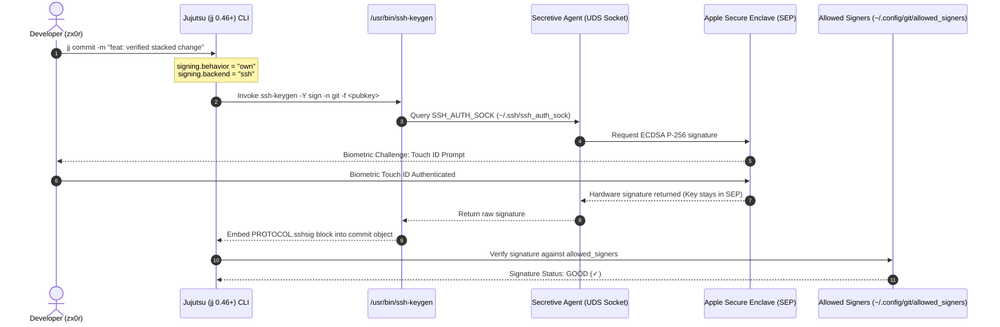

# Declarative Zero-Trust Jujutsu (jj) Architecture

### Platform: macOS 27+ (Apple Silicon / aarch64 Darwin 27.2+)
### Standard: Strict XDG Base Directory Specification (`$XDG_CONFIG_HOME/jj`)
### Stack: Jujutsu (jj) 0.46+ | Git 2.56+ | Delta 0.20+ | Difftastic 0.71+ | Mergiraf 0.20+ | Secretive (Apple SEP) | Touch ID | Neovim 0.12+

---

## 1. Architectural Cross-Section & System Overview

Jujutsu (`jj`) is a next-generation, Git-compatible distributed version control system designed around first-class concurrency, automatic working copy snapshotting, first-class conflicts, and branchless stacked change management.

In enterprise and high-security multi-tenant workstations, version control tooling must guarantee **Zero Identity Leakage**, **Hardware-Rooted Commit Provenance**, and **Zero Uncontrolled Mutations**. Conventional Jujutsu setups leave static `[user]` definitions in global config files or write identities into individual `.jj/repo/config.toml` repositories, which inevitably leads to:
1. Personal identities accidentally leaking into client/NDA repositories or enterprise remotes.
2. Machine hostnames or unverified local author tags contaminating Git DAG history.
3. Inconsistent signing keys across tools when switching between Git and Jujutsu interfaces.

This configuration establishes a **System-as-Interface** zero-trust architecture for Jujutsu:
* **Zero-Leak Invariant**: The global `~/.config/jj/config.toml` omits `[user]` entirely. Without an explicit, directory-scoped identity profile, Jujutsu warns and refuses to push commits to remotes.
* **Lexicographic Scoped Profiles (`conf.d/`)**: 1:1 architectural parity with Git's `includeIf "gitdir:..."` using Jujutsu's `--when.repositories` and `--when.workspaces` condition selectors.
* **Hardware-Rooted Provenance**: Native OpenSSH `PROTOCOL.sshsig` commit signatures backed by the **Apple Silicon Secure Enclave Processor (SEP)** via **Secretive**, enforcing interactive **Touch ID** biometric gating.
* **Multi-Engine AST Diffing & 3-Way Merges**: Full integration with **Delta** (high-density visual pager), **Difftastic** (syntax-tree structural diffing), and **Mergiraf** (Tree-sitter syntax-aware merge conflict resolver).
* **Deterministic Co-location**: Seamless interoperability with existing Git repositories (`--colocate`), stacked PR workflows, and branchless commit tracking.

```
┌──────────────────────────────────────────────────────────────────────────────────┐
│                         DEVELOPER CLI & WORKSPACE TIERS                          │
│           jj commit     │    jj status    │    jj diff -r @    │    jj git push      │
└────────────────────────────────────────┬─────────────────────────────────────────┘
                                         │
┌────────────────────────────────────────▼─────────────────────────────────────────┐
│                     DECLARATIVE JUJUTSU ZERO-TRUST ENGINE                        │
│                           ~/.config/jj/config.toml                               │
│        (Global Invariant: Zero Root Identity • Mandatory SSH Signing)            │
└──────────────────┬─────────────────────┬──────────────────────┬──────────────────┘
                   │                     │                      │
        ┌──────────▼──────────┐ ┌────────▼──────────┐ ┌─────────▼──────────────┐
        │  DOMAIN PROFILES    │ │  HARDWARE SIGNING │ │  STRUCTURAL AST ENGINES│
        │ (~/.config/jj/conf.d│ │  (Touch ID / SEP) │ │ (Delta/Difft/Mergiraf) │
        └──────────┬──────────┘ └────────┬──────────┘ └─────────┬──────────────┘
                   │                     │                      │
 ┌─────────────────▼───────────┐ ┌───────▼──────────┐ ┌─────────▼──────────────┐
 │ • 10-own.toml  (~ /x)       │ │ Apple Secure     │ │ • Delta (Terminal pager│
 │   zx0r personal / OSS       │ │ Enclave (SEP)    │ │   true-color & borders)│
 │ • 20-nda.toml  (~/x/dev/nda)│ │ OpenSSH sshsig   │ │ • Difftastic (AST diff)│
 │   client-isolated identity  │ │ Touch ID prompt  │ │ • Mergiraf (Tree-sitter│
 │ (Refuses push if unassigned)│ │ Non-exportable   │ │   semantic 3-way merge)│
 └─────────────────┬───────────┘ └───────┬──────────┘ └─────────┬──────────────┘
                   │                     │                      │
                   └─────────────────────┼──────────────────────┘
                                         │
┌────────────────────────────────────────▼─────────────────────────────────────────┐
│                    COLOCATED GIT & REPOSITORY INTEGRITY LAYER                    │
│    Local .git / .jj DAG Consistency │ OpenSSH allowed_signers Trust Store        │
└──────────────────────────────────────────────────────────────────────────────────┘
```

---

## 2. Zero-Trust Identity Isolation: Git vs Jujutsu Parity

To prevent author identity leaks across work boundaries, no identity is stored in `.git/config` or `.jj/repo/config.toml`. All scoping is driven deterministically by workspace path prefix.

### Comparative Architectural Mapping

| Dimension | Git Architecture | Jujutsu (`jj`) Architecture | Invariant Guaranteed |
| :--- | :--- | :--- | :--- |
| **Strict Fallback Guard** | `user.useConfigOnly = true` in `git/config` | Omit `[user]` in `jj/config.toml` | Refuses push if directory is unmapped |
| **Workspace Matcher** | `[includeIf "gitdir/i:~/x/**"]` | `--when.repositories = ["~/x"]`<br/>`--when.workspaces = ["~/x"]` | Scoped activation for personal code |
| **Sub-Domain Matcher** | `[includeIf "gitdir/i:~/x/dev/nda/**"]` | `--when.repositories = ["~/x/dev/nda"]`<br/>`--when.workspaces = ["~/x/dev/nda"]` | Absolute client/NDA boundary isolation |
| **Modular File Tree** | `~/.config/git/profiles/*.inc` | `~/.config/jj/conf.d/*.toml` | Native domain-driven loading |
| **Repo Config Contamination** | 0% (Empty `.git/config` user) | 0% (Empty `.jj/repo/config.toml` user) | Zero state drift across clones/pulls |

```mermaid
flowchart TD
    CMD["jj commit / jj git push"] --> DETECT{"Inspect Repository Root"}
    DETECT -->|Path starts with ~/x/dev/nda| NDA["Load conf.d/20-nda.toml<br/>• Identity: Commercial / Client<br/>• Signing: Client / Hardware Key<br/>• Prefix: nda/"]
    DETECT -->|Path starts with ~/x| OWN["Load conf.d/10-own.toml<br/>• Identity: zx0r (no-reply)<br/>• Signing: Touch ID SEP Key<br/>• Prefix: zx0r/"]
    DETECT -->|Path outside ~/x (e.g. /tmp)| UNKNOWN["Zero Identity Configured<br/>• user.name = UNSET<br/>• user.email = UNSET"]
    UNKNOWN --> WARN["Block Remote Push & Warn Developer"]
```

---

## 3. Hardware-Rooted Cryptographic Provenance (Apple Silicon SEP)

Jujutsu 0.46+ natively supports commit and rewrite signing using OpenSSH `PROTOCOL.sshsig`. In this workstation architecture, software keys and legacy GPG daemons are eliminated in favor of the **Apple Silicon Secure Enclave Processor (SEP)** via **Secretive**:

* **Touch ID Biometric Enforcement**: Every signed change requests biometric verification.
* **Non-Exportable Key Storage**: Private keys never touch disk or memory; operations occur in hardware enclave.
* **Unified Namespace Trust Store**: Signatures are verified against `~/.config/git/allowed_signers` matching Git's verification domain.



---

## 4. Structural AST Diff & 3-Way Merge Engines

Jujutsu operates with three coordinated diff and merge drivers:

1. **Delta (Terminal Visual Pager)**:
   * Integrated via `ui.pager = "delta"`.
   * Configured in `[merge-tools.delta]` for side-by-side terminal inspection (`jj ds`).
2. **Difftastic (AST Syntax Diffing)**:
   * Configured in `[merge-tools.difft]` (`jj dft`).
   * Parses ASTs using Tree-sitter to show semantic code changes while ignoring whitespace drift.
3. **Mergiraf (Syntax-Aware 3-Way Merge Resolution)**:
   * Configured in `[merge-tools.mergiraf]`.
   * Automatically resolves non-conflicting structural changes (imports, struct fields, function definitions) across divergent branches.

---

## 5. Declarative Configuration Matrix

### `~/.config/jj/config.toml`

| Namespace / Key | Value | Architectural Purpose |
| :--- | :--- | :--- |
| `signing.behavior` | `"own"` | Automatically sign all commits authored by the local identity |
| `signing.backend` | `"ssh"` | Modern OpenSSH `PROTOCOL.sshsig` over legacy GPG |
| `signing.backends.ssh.program` | `"/usr/bin/ssh-keygen"` | Hermetic macOS system crypto toolchain |
| `signing.backends.ssh.allowed-signers` | `"~/.config/git/allowed_signers"` | Single source of truth for developer trust |
| `ui.editor` | `"nvim"` | Primary modal development environment |
| `ui.pager` | `"delta"` | High-density syntax-highlighted terminal pager |
| `ui.diff-editor` | `":builtin"` | Fast in-memory interactive diff splitter |
| `ui.diff-formatter` | `":color-words"` | High-resolution inline word diff formatting |
| `ui.graph.style` | `"curved"` | Smooth terminal log DAG ASCII visualization |
| `ui.show-cryptographic-signatures`| `true` | Display verified signature status directly in log |
| `snapshot.max-new-file-size` | `"10MiB"` | Prevents accidental snapshotting of massive binary blobs |
| `snapshot.auto-track` | `"all()"` | Automatically tracks modified working-copy files |
| `git.auto-local-bookmark` | `true` | Automatic bookmark tracking for colocated Git repos |
| `git.push-bookmark-prefix` | `"zx0r/"` | Namespaces remote branches to avoid collisions |
| `git.abandon-unreachable-commits` | `true` | Prevents orphan commit accumulation in Git DAG |

---

## 6. High-Velocity Ergonomics & Stacked Workflow Aliases

| Alias | Target Command | Description |
| :--- | :--- | :--- |
| `jj d` | `jj diff` | Built-in color-words working-copy diff |
| `jj ds` | `jj diff --tool delta` | High-density visual Delta diff with line numbers |
| `jj dft` | `jj diff --tool difft` | Structural AST syntax-tree diff via Difftastic |
| `jj l` | `jj log` | Curved DAG log with cryptographic signature status |
| `jj s` | `jj status` | Instant working-copy status and snapshot summary |
| `jj b` | `jj bookmark` | Bookmark (branch) management |
| `jj c` | `jj commit` | Create commit from working copy |
| `jj sq` | `jj squash` | Squash current change into parent revision |
| `jj rb` | `jj rebase` | Rebase stacked revisions across branches |
| `jj n` | `jj new` | Create new empty change on top of current revision |
| `jj e` | `jj edit` | Check out and edit specific revision in place |
| `jj ab` | `jj abandon` | Discard change without losing working directory files |
| `jj sp` | `jj split` | Interactively split revision into discrete commits |
| `jj desc` | `jj describe` | Edit commit message and metadata |
| `jj lg` | `lazygit` | Launch Lazygit TUI inside colocated workspace |
| `jj gui` | `gitui` | Launch GitUI TUI inside colocated workspace |

---

## 7. Standards & References

* **Jujutsu Documentation**: https://docs.jj-vcs.dev/latest/
* **RFC 8308** (SSH Extension Negotiation & Signature Standards)
* **OpenSSH PROTOCOL.sshsig**: https://github.com/openssh/openssh-portable/blob/master/PROTOCOL.sshsig
* **FIPS 186-4**: Digital Signature Standard (ECDSA P-256 / Secure Enclave)
* **XDG Base Directory Specification**: https://specifications.freedesktop.org/basedir-spec/basedir-spec-latest.html
* **Tree-sitter & Mergiraf**: https://mergiraf.org/
