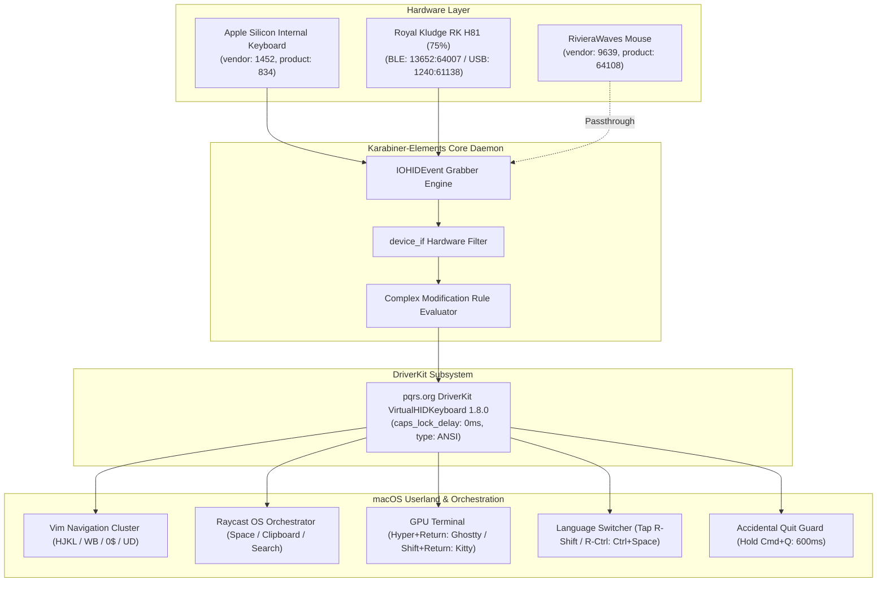

# 🏛️ macOS Apple Silicon Keyboard Subsystem & Karabiner Architecture
**Domain:** High-Performance Engineering Workstation | System-as-Interface  
**Standard:** Principal Architect & Staff System Engineer Workstation Standard  
**Platform:** macOS Apple Silicon (ARM64) | Karabiner-Elements 16.3.0 | DriverKit VirtualHIDDevice 1.8.0  
**Target Hardware:** MacBook Pro Internal SPI Keyboard + Royal Kludge RK H81 (BLE 5.0 / USB-C)  

---

## 1. Executive Summary & Architectural Overview

The keyboard input subsystem on macOS is often treated as a simple keycode mapping layer. In modern high-density software engineering workstations, the keyboard operates as a **modal system-as-interface**:
* Reducing physical finger travel to zero home-row displacement.
* Eliminating window manager and application shortcut collisions.
* Neutralizing hardware debouncing latency in the virtual HID driver.
* Isolating composite peripheral HID interfaces (e.g., Bluetooth rotary knobs and multi-interface endpoints).

This repository replaces fragile monolithic configurations with a **modular, validated, and reproducible build pipeline**.



---

## 2. DriverKit Virtual HID & Latency Physics

In macOS Big Sur and later, legacy Kernel Extensions (`.kext`) were replaced by DriverKit User-Client Extensions (`.dext`). Karabiner-Elements communicates directly with the macOS `IOHIDEventSystem` via `org.pqrs.Karabiner-DriverKit-VirtualHIDDevice`.

### 2.1 The Caps Lock Debounce Penalty (Neutralized)
macOS injects a hardware debounce delay (100–200ms) into the Caps Lock keycode to prevent accidental capitalization during fast typing. When Caps Lock is repurposed as a dual-role modifier (Escape on tap, Hyper on hold), this built-in OS delay causes swallowed Escape events and missed chords.

* **Configuration:** `"caps_lock_delay_milliseconds": 0` in `virtual_hid_keyboard`.
* **Impact:** Instructs the virtual HID driver to suppress Apple's debouncing queue, delivering 0ms immediate event dispatch.

### 2.2 Optimal Timing & Threshold Matrix

| Parameter | Value | Architectural Purpose |
| :--- | :--- | :--- |
| `basic.to_if_alone_timeout_milliseconds` | **`250 ms`** | Window to distinguish between a single tap (Escape, Language Switch) and a chorded modifier hold. Lowered from 500ms to eliminate missed tap triggers during rapid typing. |
| `basic.to_if_held_down_threshold_milliseconds` | **`500 ms`** | Snappy threshold for sustained hold actions. |
| `basic.simultaneous_threshold_milliseconds` | **`50 ms`** | Chording detection window without causing accidental rollover chattering during fast typing (80–120+ WPM). |
| `basic.to_delayed_action_delay_milliseconds` | **`250 ms`** | Idle reset timer for delayed actions. |

---

## 3. Ergonomic Key Layers & Modifier Topology

### 3.1 The Hyper Key Architecture (`Ctrl + Opt + Cmd + Shift`)
* **Physical Key:** `Caps Lock`
* **Tap Alone (<250ms):** `Escape` (Instant Vim/Modal Escape).
* **Hold Down:** `Hyper Key` (`left_command` + `left_control` + `left_option` + `left_shift`).
* **Zero Collision Guarantee:** No native macOS application or operating system shortcut binds to all four modifiers simultaneously. Hyper chords are 100% collision-free.

### 3.2 Modal Vim Navigation Subsystem
Full home-row cursor movement without moving wrists:

| Shortcut | Mapped HID Key | Action |
| :--- | :--- | :--- |
| **`Hyper + H`** | `Left Arrow` | Character left |
| **`Hyper + J`** | `Down Arrow` | Line down |
| **`Hyper + K`** | `Up Arrow` | Line up |
| **`Hyper + L`** | `Right Arrow` | Character right |
| **`Hyper + W`** | `Option + Right Arrow` | Forward word jump |
| **`Hyper + B`** | `Option + Left Arrow` | Backward word jump |
| **`Hyper + 0`** / **`Hyper + A`** | `Command + Left Arrow` | Home / Beginning of line |
| **`Hyper + $ (4)`** / **`Hyper + E`** | `Command + Right Arrow` | End / End of line |
| **`Hyper + U`** | `Page Up` | Scroll page up |
| **`Hyper + D`** | `Page Down` | Scroll page down |
| **`Hyper + I`** | `Command + Up Arrow` | Document top |
| **`Hyper + O`** | `Command + Down Arrow` | Document bottom |
| **`Hyper + X`** | `Delete` | Backward delete |
| **`Hyper + Shift + H/J/K/L`** | `Shift + Arrows` | Home-row text selection |
| **`Hyper + Shift + W/B`** | `Shift + Option + Arrows` | Word-by-word text selection |

### 3.3 Zero-Conflict Application & Window Orchestration
Eliminates destructive global hooks (such as raw `Cmd+Enter` or `Option+Enter` which hijack web form submissions and IDE quick-fixes) in favor of deterministic Hyper chords:

| Shortcut | Target Process | Launch Mechanism |
| :--- | :--- | :--- |
| **`Hyper + Return`** | **Ghostty** (Primary GPU Terminal) | LaunchServices Bundle ID (`com.mitchellh.ghostty`) |
| **`Hyper + Shift + Return`** | **Kitty** (Secondary Terminal) | LaunchServices Bundle ID (`net.kovidgoyal.kitty`) |
| **`Hyper + Grave (`)`** | **Quick Terminal HUD** | Global Quake terminal toggle |
| **`Hyper + Space`** | **Raycast** (System Orchestrator) | LaunchServices Bundle ID (`com.raycast.macos`) |
| **`Hyper + C`** | **Raycast Clipboard History** | Raycast Deeplink URL scheme |
| **`Hyper + F`** | **Raycast File Search** | Raycast Deeplink URL scheme |
| **`Hyper + S`** | **Safari** | LaunchServices Bundle ID (`com.apple.Safari`) |
| **`Hyper + M`** | **Apple Mail** | LaunchServices Bundle ID (`com.apple.mail`) |

### 3.4 Raycast Window Snapping & Multi-Display Orchestration
Native window management dispatched via Raycast URL deeplinks (`open -g "raycast://extensions/raycast/window-management/..."`):

* **Directional Snapping:**
  * `Hyper + Left / Right Arrow`: Snap left/right half.
  * `Hyper + Up Arrow`: Maximize window.
  * `Hyper + Down Arrow`: Center window.
* **Display Hopping & Secondary Layouts:**
  * `Hyper + Shift + Left Arrow`: Move active window to previous display.
  * `Hyper + Shift + Right Arrow`: Move active window to next display.
  * `Hyper + Shift + Up Arrow`: Almost maximize window.
  * `Hyper + Shift + Down Arrow`: Restore reasonable size.
* **Home-Row Vim Chording (`Hyper + Right-Option`):**
  * `Hyper + Right Option + H / L`: Snap left / right half.
  * `Hyper + Right Option + K / J`: Maximize / Center window.
  * `Hyper + Right Option + N / P`: Move to next / previous display.
  * `Hyper + Right Option + M`: Almost maximize window.

### 3.5 Zero-Latency Language Switching
* **Tapping `Right Shift` or `Right Control` (<250ms):** Emits `Ctrl + Space` (macOS native input source switcher).
* **Holding `Right Shift` or `Right Control`:** Functions natively as `Shift` or `Control` when chording.
* **Latency Profile:** The physical modifier down-event is emitted immediately on contact; zero buffering delay is added to typing.

### 3.6 System Safety Guard: Accidental Quit Protection
* **Tapping `Cmd + Q`:** Keypress is swallowed (empty action). Prevents catastrophic loss of open browser tabs, terminals, and unsaved IDE state.
* **Holding `Cmd + Q` (>600ms):** Dispatches native application quit.

---

## 4. Hardware Isolation: Royal Kludge RK H81 & Peripherals

The RK H81 is a composite HID device emitting across multiple endpoints:
* **Transport Modes:**
  * Bluetooth BLE 5.0 (`vendor_id: 13652`, `product_id: 64007`)
  * USB-C / 2.4G Receiver (`vendor_id: 1240`, `product_id: 61138`)
* **Device Isolation:**
  All physical modifier swaps (`Command` $\leftrightarrow$ `Option`) and secondary consumer control actions are strictly guarded by `device_if` conditions matching the hardware vendor IDs. The Apple MacBook internal keyboard is never affected.

---

## 5. Build, Lint & Automated Verification Pipeline (Principal Standard)

All configurations are maintained as modular single-responsibility JSON definitions under `assets/complex_modifications/` and reconciled against `karabiner.json` via a non-destructive Deep Merge compiler.

```
~/.config/karabiner/
├── README.md                          # Operator documentation
├── karabiner.json                     # Live runtime configuration (watched by Karabiner daemon)
├── docs/
│   └── ARCHITECTURE.md                # Systems architecture reference
├── scripts/
│   └── build_config.py                # Principal-grade Deep Merge compiler & watcher
├── assets/
│   └── complex_modifications/
│       ├── 01_hyper_caps_lock.json    # Caps Lock dual-role (Hyper / Escape)
│       ├── 02_vim_navigation.json     # Vim modal navigation & selection
│       ├── 03_app_launcher.json       # App & Raycast orchestration
│       ├── 04_language_toggle.json    # Right-Shift/Ctrl language switcher
│       ├── 05_system_safety.json      # Accidental Cmd+Q quit protection
│       ├── 06_rk_h81_hardware.json    # RK H81 hardware layer
│       └── 07_window_management.json  # Raycast window snapping & display hopping
└── automatic_backups/                 # Pristine baseline & auto-rotated snapshots
```

### Enterprise Compiler Capabilities:
* **Non-Destructive Deep Merge:** Injects `complex_modifications` rules and sets optimal DriverKit parameters while preserving existing user device toggles, mouse acceleration, and Simple Modifications configured via GUI.
* **Dynamic Hardware Introspection:** Directly queries `karabiner_cli --list-connected-devices` to detect physical keyboards and mice in real-time.
* **Auto-Rotated Backups:** Keeps a strict cap of 5 historical backups alongside the pristine baseline; skips creating backups when output is byte-identical (idempotent).
* **CLI Interface:**
  ```bash
  # Compile, deep-merge and deploy atomically
  python3 scripts/build_config.py

  # Dry-run with unified diff
  python3 scripts/build_config.py --diff

  # Lint all modules with official karabiner_cli
  python3 scripts/build_config.py --lint

  # Inspect live connected HID hardware endpoints
  python3 scripts/build_config.py --status

  # Reactive sub-50ms continuous watch mode
  python3 scripts/build_config.py --watch
  ```
