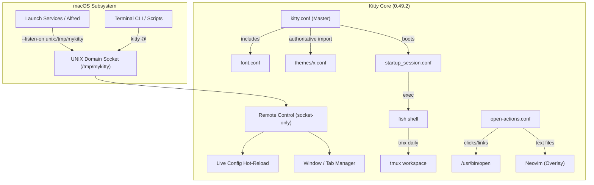

# ⚡ KITTY TERMINAL | PRINCIPAL ARCHITECT SPECIFICATION

> **High-Performance Terminal Architecture for macOS**
> _Workspace:_ `zx0r` &nbsp;|&nbsp; _Color Space:_ `Display P3` &nbsp;|&nbsp; _Shell:_ `fish`
> &nbsp;|&nbsp; _Multiplexer:_ `tmux` &nbsp;|&nbsp; _Editor:_ `neovim`

---

## 📑 Table of Contents

1. [Architectural Overview](#-architectural-overview)
2. [System Topology & IPC Pipeline](#-system-topology--ipc-pipeline)
3. [Workspace File Matrix](#-workspace-file-matrix)
4. [Typography Engineering: The 5 Objective Criteria](#-typography-engineering-the-5-objective-criteria)
5. [Interactive A/B Font Benchmark](#-interactive-ab-font-benchmark)
6. [Color Pipeline: Environment X (Dark Tier)](#-color-pipeline-environment-x-dark-tier)
7. [Window Geometry, Splits & Instant Zoom](#-window-geometry-splits--instant-zoom)
8. [Comprehensive Keybindings Matrix](#-comprehensive-keybindings-matrix)
9. [macOS Native Integration & Protocol Handlers](#-macos-native-integration--protocol-handlers)
10. [Diagnostics, Validation & Maintenance](#-diagnostics-validation--maintenance)
11. [Aesthetics, Blur & Window Material Profiles](#-aesthetics-blur--window-material-profiles)

---

## 🏛 Architectural Overview

This configuration is engineered strictly under the **"System-as-Interface"** paradigm:

- **Zero Boilerplate / Zero Disk I/O Noise**: Completely purged the 3,000-line default template,
  eliminated infinite loops constantly overwriting configuration via `sed`, and excised
  Linux-specific legacy artifacts (`xdg-open`, `eDP`, `HDMI`).
- **Modular Decoupling**: Typography is fully isolated into
  [font.conf](file:///Users/x0r/.config/kitty/font.conf), while colors are imported authoritatively,
  preventing downstream CSS/config override collisions.
- **120Hz ProMotion Frame Timing**: Calibrated with `repaint_delay 8` (fitting inside the 8.33ms
  120Hz frame budget) and `sync_to_monitor yes` (locking to CoreVideo `CVDisplayLink` with automatic
  thread idle sleep to eliminate battery drain and Metal screen tearing).
- **Extended Keyboard Protocol (`CSI u`)**: Native progressive enhancement with hardware-accurate
  key disambiguation (`Shift+Enter`, `Ctrl+Enter`, `Ctrl+I` vs `Tab`) passing cleanly across Tmux
  and Neovim.
- **Retina / Apple Display P3 Fidelity**: Native Display P3 wide-gamut reproduction paired with
  GPU-accelerated backdrop blur (`background_blur 40`) and frosted obsidian glass opacity
  (`background_opacity 0.90`, `dim_opacity 0.75`).
- **Deep CLI Toolchain Integration**: Line-number click routing into Neovim overlay
  (`open-actions.conf`), Kitty Graphics Protocol passthrough for `yazi`, and OSC 8 hyperlinks for
  `eza` and `ripgrep`.

---

## 🌐 System Topology & IPC Pipeline

Kitty operates as a managed system daemon with bidirectional IPC socket control:



---

## 📁 Workspace File Matrix

| File / Directory                                                                               | System Role              | Architectural Responsibility                                                                 |
| :--------------------------------------------------------------------------------------------- | :----------------------- | :------------------------------------------------------------------------------------------- |
| [kitty.conf](file:///Users/x0r/.config/kitty/kitty.conf)                                       | **Master Configuration** | 12 declarative architectural modules (geometry, keymaps, mouse, render pipeline, core).      |
| [font.conf](file:///Users/x0r/.config/kitty/font.conf)                                         | **Typography Engine**    | Modularized font family, style weights, OpenType feature tags, and micro-metric calibration. |
| [open-actions.conf](file:///Users/x0r/.config/kitty/open-actions.conf)                         | **Protocol Dispatcher**  | Native macOS handler for files, URLs, media, PDF documents, and SSH sessions.                |
| [startup_session.conf](file:///Users/x0r/.config/kitty/startup_session.conf)                   | **Bootstrap Session**    | Boots or attaches to the daily multiplexed tmux workspace in splits layout (`tmx daily`).    |
| [macos-launch-services-cmdline](file:///Users/x0r/.config/kitty/macos-launch-services-cmdline) | **Daemon Flags**         | Initializes the IPC socket `--listen-on unix:/tmp/mykitty` when launched from Finder/Dock.   |
| [themes/x.conf](file:///Users/x0r/.config/kitty/themes/x.conf)                                 | **Active Palette**       | High-contrast cyberpunk palette: `Environment X : Dark Tier`.                                |
| [scripts/test_fonts.py](file:///Users/x0r/.config/kitty/scripts/test_fonts.py)                 | **Typography Benchmark** | Interactive terminal stress-test card and live A/B font profile switcher (<100ms).           |
| [scripts/pass_keys.py](file:///Users/x0r/.config/kitty/scripts/pass_keys.py)                   | **Kitten Navigator**     | Seamless directional window navigation between Neovim splits and Kitty panes.                |
| [kitty_ZX0R.conf](file:///Users/x0r/.config/kitty/kitty_ZX0R.conf)                             | **Original Backup**      | Immutable backup of the original pre-optimization configuration (3,238 lines).               |

---

## 🔬 Typography Engineering: The 5 Objective Criteria

Terminal monospace font quality is evaluated against 5 mathematical and physiological criteria.
Misconfigurations in cell metrics or optical weights inevitably cause either eye strain or code
errors.

```
┌────────────────────────────────────────────────────────────────────────┐
│             TERMINAL TYPOGRAPHY & LEGIBILITY EVALUATION MATRIX         │
├─────────────────────┬────────────────────┬─────────────────────────────┤
│ Criteria            │ Inspection Vector  │ Engineering Justification   │
├─────────────────────┼────────────────────┼─────────────────────────────┤
│ 1. Disambiguation   │ 0 vs O, 1 vs l vs I│ Prevents cognitive errors   │
│ 2. Optical Weight   │ Regular vs Light   │ Eliminates eye fatigue      │
│ 3. Grid Snapping    │ ┌─┐ │ ║ █          │ Eliminates subpixel gaps    │
│ 4. Ligature Context │ == != -> =>        │ Decomposes under cursor     │
│ 5. Glyph Balance    │  ⚡ 🚀 󰊤         │ Perfect vertical centering  │
└─────────────────────┴────────────────────┴─────────────────────────────┘
```

### 1. Glyph Disambiguation Test

- **`0` vs `O` vs `D` vs `Q`**: Zero must feature an explicit differentiator (slashed zero `+zero`
  or dot) to prevent confusion in code literals such as `0x00` or `CONFIG_O_FLAG`.
- **`1` vs `l` vs `I` vs `|` vs `!`**: The numeral `1`, lowercase `l`, uppercase `I`, and `pipe`
  must possess distinct serifs and stroke geometries.
- **Quotes and Backticks**: The backtick (`` ` ``) must have an explicit oblique angle clearly
  differentiated from single quotes (`'`).

### 2. Optical Weight & Retina Contrast on Deep Black (`#000000`)

- **ExtraLight / Thin Failure Mode**: Against an OLED/Retina pure black backdrop (`#000000`),
  ultra-thin strokes act like faint wires. Ocular ciliary muscles constantly overcompensate trying
  to focus on subpixel anti-aliasing artifacts. Eye strain manifests within 30–40 minutes.
- **The Engineering Optimum (`Regular` / `Medium`)**: Sufficient stroke body for Apple CoreText
  rasterization. Glyphs retain authoritative contrast without blooming or fading.

### 3. Pixel-Snapping & Border Grid (Box-Drawing)

- Box-drawing Unicode characters (`┌─┐`, `│ │`, `╔═╗`, progress bars `███░░░`) must connect
  **without 1-pixel horizontal or vertical gaps**.
- Settings `modify_font cell_width 100%` and `modify_font cell_height 100%` guarantee 1:1 character
  cell alignment. The legacy `-2px` horizontal compression was squashing glyphs unnaturally.

### 4. Ligature Cursor Context (`calt` + `disable_ligatures cursor`)

- Programming ligatures (`!=`, `===`, `->`, `=>`, `<!--`) render seamlessly while scanning code, but
  **automatically decompose into individual characters when the cursor touches them**. This prevents
  cursor offset desynchronization during text manipulation.

### 5. Nerd Fonts & Powerline Glyph Centering

- Separators ``, `` and symbols `⚡`, `🚀`, `` are isolated via `symbol_map` ranges to
  `Symbols Nerd Font Mono`, preventing primary font scaling from distorting vertical alignment.

---

## 🚀 Interactive A/B Font Benchmark

A dedicated benchmark suite is provided in
[scripts/test_fonts.py](file:///Users/x0r/.config/kitty/scripts/test_fonts.py):

```bash
python3 ~/.config/kitty/scripts/test_fonts.py
```

### Available Live Profiles:

- **`[1] Legacy Profile`**: `JetBrainsMonoNL ExtraLight 14pt` (with `-2px` cell width compression
  and `cv02/ss03/ss07` stylistic sets).
- **`[2] Principal Regular (Active)`**: `JetBrains Mono Regular 13pt` (1:1 proportions, slashed zero
  `+zero`, clean contextual ligatures).
- **`[3] High-Contrast Medium`**: `JetBrains Mono Medium 13pt` (increased optical stroke weight for
  deep black `#000000`).
- **`[4] Modern Round`**: `Maple Mono NF 13pt` (trending geometric font with rounded terminals and
  cursive italics).
- **`[5] Classic Gold Standard`**: `FiraCode NF 13pt` (industry-standard ligature geometry and wide
  character cells).

Selecting `1`–`5` rewrites [font.conf](file:///Users/x0r/.config/kitty/font.conf) and signals Kitty
via its IPC socket: **the font hot-reloads in <100ms right before your eyes**.

---

## 🎨 Color Pipeline: Environment X (Dark Tier)

Calibrated for dark terminal voids in the **Apple Display P3** wide color space:

| UI Element          | HEX Value              | Architectural Role                                             |
| :------------------ | :--------------------- | :------------------------------------------------------------- |
| **Background**      | `#000000`              | Absolute void; zero backdrop noise.                            |
| **Foreground**      | `#FFFFFF`              | Maximum contrast and crisp readability.                        |
| **Active Border**   | `#00FFFF`              | Cyber Cyan — instantaneous window focus orientation.           |
| **Inactive Border** | `#282C3A`              | Deep Slate — recedes unfocused panes into the void.            |
| **Cursor**          | `#FF8C00`              | Vibrant Neon Orange navigation vector.                         |
| **Selection**       | `#00FFFF` on `#000000` | High-precision inverted cyan selection.                        |
| **Hyperlinks**      | `#00FFFF`              | Curly underline (`url_style curly`) with cyan hover highlight. |
| **Visual Bell**     | `#FF00FF`              | Vibrant Magenta terminal alert pulse (`visual_bell_color`).    |

> [!NOTE] In the legacy setup, default parameters placed lower in the file inadvertently overwrote
> the theme, producing pitch-black active borders (`#000000`) and lemon-chiffon selection highlights
> (`#fffacd`). In the new architecture, `themes/x.conf` is loaded authoritatively without downstream
> interference.

---

## 🪟 Window Geometry, Splits & Instant Zoom

Active layouts: `enabled_layouts splits,stack`.

```
Vertical Split:                  Horizontal Split:                 Active Pane Zoom (Stack):
┌──────────────┬──────────────┐  ┌────────────────────────────┐  ┌────────────────────────────┐
│              │              │  │                            │  │                            │
│   Window 1   │   Window 2   │  ├────────────────────────────┤  │   Window (Full View)       │
│              │              │  │                            │  │                            │
└──────────────┴──────────────┘  └────────────────────────────┘  └────────────────────────────┘
```

- **Instant Zoom (`kitty_mod+z`)**: Toggles the active window into the `stack` layout (maximizing
  across the entire viewport) and back. Provides full 1:1 parity with Tmux `prefix + z`.
- **Split Management**:
    - `kitty_mod + enter` — launch vertical split (`vsplit`) in current working directory.
    - `kitty_mod + \` — launch horizontal split (`hsplit`) in current working directory.

---

## ⌨️ Comprehensive Keybindings Matrix

> `kitty_mod` is assigned to **`cmd + opt`** (Cmd + Option).

### 1. Applications & Sessions

| Keybinding        | Action                     | Description                                          |
| :---------------- | :------------------------- | :--------------------------------------------------- |
| `cmd + g`         | `launch lazygit`           | Launch Lazygit in a new tab within current directory |
| `cmd + t`         | `launch fish -c tmx`       | Tmux Session Manager in a new tab                    |
| `cmd + shift + t` | `launch fish -c "tmx new"` | Initialize a new Tmux Session                        |

### 2. Window & Split Management

| Keybinding          | Action                     | Description                         |
| :------------------ | :------------------------- | :---------------------------------- |
| `kitty_mod + enter` | `launch --location=vsplit` | Vertical window split               |
| `kitty_mod + \`     | `launch --location=hsplit` | Horizontal window split             |
| `kitty_mod + z`     | `toggle_layout stack`      | **Zoom / Maximize** active pane     |
| `kitty_mod + w`     | `close_window`             | Close active split                  |
| `kitty_mod + ]`     | `next_window`              | Focus next window                   |
| `kitty_mod + [`     | `previous_window`          | Focus previous window               |
| `kitty_mod + r`     | `start_resizing_window`    | Interactive split resize mode       |
| `kitty_mod + 1..0`  | `first_window..tenth`      | Direct window focus by index (1–10) |

### 3. Tab Management

| Keybinding            | Action          | Description        |
| :-------------------- | :-------------- | :----------------- |
| `kitty_mod + t`       | `new_tab`       | Create new tab     |
| `kitty_mod + q`       | `close_tab`     | Close active tab   |
| `kitty_mod + right`   | `next_tab`      | Focus next tab     |
| `kitty_mod + left`    | `previous_tab`  | Focus previous tab |
| `kitty_mod + alt + t` | `set_tab_title` | Rename active tab  |

### 4. History, Scrollback & Kitten Hints

| Keybinding          | Action                     | Description                                              |
| :------------------ | :------------------------- | :------------------------------------------------------- |
| `kitty_mod + h`     | `show_scrollback`          | Open full scrollback in a **Neovim** overlay buffer      |
| `F1`                | `overlay pager (less)`     | Fast scrollback viewing in overlay mode with ANSI colors |
| `kitty_mod + /`     | `search_scrollback`        | Interactive history regex search                         |
| `kitty_mod + g`     | `show_last_command_output` | Inspect output of the last command                       |
| `kitty_mod + k / j` | `scroll_to_prompt -1 / 1`  | Semantic prompt jumping (OSC 133) in Fish                |
| `kitty_mod + p > f` | `hints --type path`        | Pick file path from screen and insert at cursor          |
| `kitty_mod + p > l` | `hints --type line`        | Pick line of text from screen and insert                 |
| `kitty_mod + p > w` | `hints --type word`        | Pick individual word from screen and insert              |
| `kitty_mod + p > h` | `hints --type hash`        | Pick git commit hash / SHA and insert                    |
| `kitty_mod + p > n` | `hints --type linenum`     | Pick `file:line` and open directly in Neovim at line     |
| `kitty_mod + p > u` | `hints --type url`         | Pick URL from screen and open in browser                 |

### 5. Font Metrics Scaling

| Keybinding                        | Action                               |
| :-------------------------------- | :----------------------------------- |
| `kitty_mod + =` / `kitty_mod + +` | Increment font size (`+2.0 pt`)      |
| `kitty_mod + -`                   | Decrement font size (`-2.0 pt`)      |
| `kitty_mod + backspace`           | Reset font size to default (13.0 pt) |

### 6. macOS System Operations & Disambiguation

| Keybinding       | Action                     | Description                                               |
| :--------------- | :------------------------- | :-------------------------------------------------------- |
| `ctrl + cmd + f` | Native Fullscreen mode     | 0ms instant transition via `macos_traditional_fullscreen` |
| `kitty_mod + f2` | Edit master `kitty.conf`   | Instant config editor                                     |
| `ctrl + cmd + ,` | Reload Kitty configuration | Hot-reloads configuration files live                      |
| `Shift + Enter`  | `\x1b[13;2u`               | Disambiguated `CSI u` key event                           |
| `Ctrl + Enter`   | `\x1b[13;5u`               | Disambiguated `CSI u` key event                           |
| `Ctrl + Tab`     | `\x1b[9;5u`                | Distinct tab forward in Neovim/Tmux                       |
| `cmd + q`        | Quit Kitty application     | Clean process termination                                 |

---

## 🍏 macOS Native Integration & Protocol Handlers

Through [open-actions.conf](file:///Users/x0r/.config/kitty/open-actions.conf), Kitty transparently
intercepts file actions, mouse clicks, and compiler errors:

- **File + Line Number Fragments (`path/to/file:42`)**: Automatically matches
  `fragment_matches [0-9]+` and launches an overlay Neovim instance positioned directly at the
  target line (`nvim +42 path/to/file`).
- **Directories**: Open in a new OS window targeting that path (`--cwd $FILE_PATH`).
- **Text Files (`text/*`)**: Instantly open inside an overlay Neovim instance
  (`${EDITOR:-nvim} $FILE_PATH`).
- **Images and PDFs**: Dispatched to macOS native previewers (`/usr/bin/open $FILE_PATH`).
- **SSH Links (`ssh://`)**: Launch a new Kitty window establishing the SSH tunnel.
- **HTTP/HTTPS**: Dispatched to default macOS web browser.
- **Shell Scripts (`.sh`, `.fish`, `.zsh`, `.command`)**: Executed inside a new window with
  `--hold`.

---

## 🧩 Ecosystem Calibration: Fish, Tmux & Modern CLI Toolchain

To extract maximum performance from Kitty on macOS, the surrounding ecosystem must be synchronized
with Kitty's protocols.

### 1. Tmux Configuration (`~/.tmux.conf`)

Add the following directives to guarantee Truecolor, extended keys, zero escape delay, and Kitty
Graphics Protocol (KGP) image passthrough:

```tmux
# 1. PTY Identity inside tmux (NEVER set TERM=xterm-kitty inside tmux)
set -s default-terminal "tmux-256color"

# 2. Inform tmux of Kitty host capabilities (CSI u, DEC Mode 2026, undercurls, OSC 52)
set -as terminal-features ",xterm-kitty:RGB:extkeys:sync:usstyle:hyperlinks:clipboard:mouse:cstyle:ccolour"

# 3. Progressive keyboard protocol (Kitty Keyboard Protocol / CSI u)
set -s extended-keys on
set -s extended-keys-format csi-u

# 4. Zero escape delay (Eliminates insert-mode exit lag in Neovim)
set -s escape-time 0

# 5. Window focus reporting (Enables Neovim FocusGained/FocusLost & autoread)
set -s focus-events on

# 6. Kitty Graphics Protocol passthrough (required for Yazi / icat / snacks.image)
set -g allow-passthrough all

# 7. OSC 52 cross-boundary clipboard synchronization
set -s set-clipboard on

# 8. Environment passthrough (Passes Kitty IPC socket, Truecolor and Snacks flag to Neovim)
set -ga update-environment "COLORTERM TERM_PROGRAM TERM_PROGRAM_VERSION SHELL EDITOR VISUAL GPG_TTY KITTY_PID KITTY_WINDOW_ID KITTY_LISTEN_ON NVIM_NOTTYFAST SNACKS_KITTY"
```

#### Neovim `:checkhealth` & Multiplexer Synchronization Matrix

Without these specific variables and options, Neovim's built-in `:checkhealth` reports critical
warnings when running inside a multiplexer:

| Parameter / Variable | Value           | Solves `:checkhealth` Issue                                            | Technical Mechanism                                                                                                              |
| :------------------- | :-------------- | :--------------------------------------------------------------------- | :------------------------------------------------------------------------------------------------------------------------------- |
| `escape-time`        | `0`             | `WARNING: 'escape-time' is higher than 300ms`                          | Eliminates the 500ms delay when pressing `<Esc>` to exit Insert mode.                                                            |
| `focus-events`       | `on`            | `WARNING: 'focus-events' is not enabled. 'autoread' may not work`      | Forwards terminal focus sequences so Neovim auto-reloads changed files.                                                          |
| `COLORTERM`          | `truecolor`     | `WARNING: Neither Tc nor RGB capability set. True colors are disabled` | Propagates 24-bit RGB capabilities into child Neovim processes.                                                                  |
| `TERM_PROGRAM`       | `kitty`         | Image preview plugin failures (`image.nvim`, `snacks.image`)           | Informs Neovim that the underlying display surface is Kitty, enabling Kitty Graphics Protocol.                                   |
| `SNACKS_KITTY`       | `1`             | `ERROR: your terminal does not support the kitty graphics protocol`    | Bypasses runtime PTY probing in `snacks.nvim`/`image.nvim` inside Tmux; fixes ghost typing (`tty(...)`) into buffers on startup. |
| `NVIM_NOTTYFAST`     | `1`             | Degraded redrawing performance                                         | Informs Neovim that the terminal emulator is modern and high-speed, bypassing slow-TTY heuristics.                               |
| `KITTY_LISTEN_ON`    | `unix:/tmp/...` | Broken IPC integration (`smart-splits.nvim`)                           | Allows Neovim Lua plugins to communicate with Kitty's control socket directly.                                                   |
| `allow-passthrough`  | `all`           | Terminal graphics sequence swallowing                                  | Prevents Tmux from stripping raw graphics escape codes emitted by `icat` or image plugins.                                       |

### 2. Fish Shell Configuration (`~/.config/fish/config.fish` / `conf.d/20-abbr.fish`)

Leverage OSC 8 hyperlinks, prompt reflow, and Kitty socket automation:

```fish
# Enable native OSC 8 terminal hyperlinks for eza and ripgrep
alias l="eza -la --icons --git --hyperlink=auto"
alias rg="rg --hyperlink-format=kitty"

# IPC Remote Control alias (points automatically to Kitty's active socket)
if test -S "/tmp/mykitty"
    alias krc="kitty @ --to unix:/tmp/mykitty"
end
```

### 3. Yazi File Manager (Image Previews)

Yazi natively detects Kitty and renders thumbnail previews via the Kitty Graphics Protocol (`icat`)
with zero configuration. When running inside Tmux, `set -g allow-passthrough all` in `~/.tmux.conf`
passes the GPU texture directly through the multiplexer to Kitty.

---

## 🛠 Diagnostics, Validation & Maintenance

### Static Syntax Validation via Kitty Python Engine

Validate syntax and configuration keys without restarting:

```bash
kitty +runpy "import kitty.config; opts = kitty.config.load_config('kitty.conf'); print('Status: OK, Parsed Opts:', len(opts.__dict__))"
```

### Hot-Reload Configuration via IPC Socket

```bash
kitty @ --to unix:/tmp/mykitty load-config
```

### Dynamic Font Scaling via IPC

```bash
kitty @ --to unix:/tmp/mykitty set-font-size 13.0
```

### Restoring Original Configuration

To revert to the pre-optimization configuration at any time:

```bash
cp ~/.config/kitty/kitty_ZX0R.conf ~/.config/kitty/kitty.conf
kitty @ --to unix:/tmp/mykitty load-config
```

---

## 🌌 Aesthetics, Blur & Window Material Profiles

Kitty's background transparency and backdrop rendering on macOS are handled via CoreAnimation and
GPU compositing. Below are the three battle-tested architectural profiles:

### 1. Architectural Profiles (`kitty.conf`)

#### Profile 1: «Obsidian Glass» (Active Production Standard)

_Engineered for 8–12 hour daily engineering workflows. Preserves 100% text contrast while providing
subtle macOS backdrop depth._

```conf
background_opacity         0.90       # 90% opacity: zero text fading or color wash over light windows
background_blur            40         # 40pt radius: fully dissolves high-frequency background details
dynamic_background_opacity yes        # Enables runtime opacity adjustment without restart
dim_opacity                0.75       # Secondary/dimmed text (comments, git log) remains razor sharp
inactive_text_alpha        1.0        # Inactive window text alpha (kept at 1.0 when managed by Tmux)
macos_titlebar_color       dark       # Seamless dark chrome titlebar
```

#### Profile 2: «Cyberpunk Frosted» (Heavy Glassmorphism)

_Prominent frosted glass aesthetic with amplified background blur._

```conf
background_opacity         0.82       # Pronounced translucency revealing wallpaper colors
background_blur            45         # Heavy blur radius: diffuses background noise into gradients
dynamic_background_opacity yes
dim_opacity                0.80       # Boosted dim opacity to counter translucent background
inactive_text_alpha        1.0
macos_titlebar_color       dark
```

#### Profile 3: «Pure OLED Monolith» (Maximum Contrast)

_Zero compositing overhead; optimal for direct sunlight, battery savings, or high-ambient-light
setups._

```conf
background_opacity         1.0        # Complete opacity: pure void #000000
background_blur            0          # Blur disabled: zero WindowServer GPU compositing load
dynamic_background_opacity yes
dim_opacity                0.70       # Standard dim attenuation
inactive_text_alpha        1.0
macos_titlebar_color       dark
```

---

### 2. Testing & Runtime Switching

#### A. Interactive Keyboard Tuning (On-The-Fly)

With `dynamic_background_opacity yes` enabled in `kitty.conf`:

- `Cmd + Ctrl + =` (or `+`) &rarr; Increase opacity / denser background (`+0.05`).
- `Cmd + Ctrl + -` &rarr; Decrease opacity / more transparent (`-0.05`).
- `Cmd + Ctrl + 0` &rarr; Reset to default production profile (`0.90`).

#### B. Instant Terminal Testing via IPC Socket

Switch opacity dynamically from any terminal shell without modifying files:

```bash
# Test Cyberpunk Frosted (0.82)
kitty @ --to unix:/tmp/mykitty set-background-opacity 0.82

# Test Pure OLED Monolith (1.0)
kitty @ --to unix:/tmp/mykitty set-background-opacity 1.0

# Reset to Obsidian Glass (0.90)
kitty @ --to unix:/tmp/mykitty set-background-opacity 0.90
```

#### C. Persistent Configuration

Uncomment the target profile in `kitty.conf` and trigger a live reload:

```bash
# Hot-reload configuration instantly
krc load-config
# Or press Ctrl+Cmd+,
```
