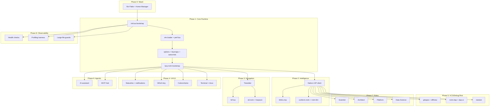

# Zero-Overhead Neovim Reference Architecture — Implementation Plan

> **Codename:** `x0r/nvim`
> **Target Personas:** Lead Scientist · Principal Architect · Staff Systems/Platform Engineer · Principal Data Scientist
> **Epoch:** September 2026 · Neovim ≥ 0.11/0.12 · Lua 5.1 / LuaJIT 2.1
> **Author:** Synthesized from multi-agent deep research (5 subagents × 7 domains)

---

## Table of Contents

1. [Executive Summary](#1-executive-summary)
2. [Architectural Invariants & SLA](#2-architectural-invariants--sla)
3. [Target Directory Topology](#3-target-directory-topology)
4. [Phase 0 — WaaC Foundation & Provisioning](#4-phase-0--waac-foundation--provisioning)
5. [Phase 1 — Core Runtime & Bootstrap](#5-phase-1--core-runtime--bootstrap)
6. [Phase 2 — Semantic Intelligence Layer](#6-phase-2--semantic-intelligence-layer)
7. [Phase 3 — AST, Navigation & Discovery](#7-phase-3--ast-navigation--discovery)
8. [Phase 4 — Cognitive UX/UI & Terminal Integration](#8-phase-4--cognitive-uxui--terminal-integration)
9. [Phase 5 — VCS, Debugging & Testing](#9-phase-5--vcs-debugging--testing)
10. [Phase 6 — Agentic & MCP Integration](#10-phase-6--agentic--mcp-integration)
11. [Phase 7 — Role-Specific Layers](#11-phase-7--role-specific-layers)
12. [Phase 8 — Health, Profiling & Guards](#12-phase-8--health-profiling--guards)
13. [Anti-Pattern Registry](#13-anti-pattern-registry)
14. [Plugin Decision Matrix](#14-plugin-decision-matrix)
15. [Verification Protocol](#15-verification-protocol)
16. [Dependency Graph](#16-dependency-graph)

---

## 1. Executive Summary

This plan defines the construction of a **canonical, zero-overhead Neovim configuration** engineered for four elite technical roles operating at the Staff+ / Principal tier. The architecture is derived from exhaustive research across 5 parallel subagents investigating 7 interconnected domains of the September 2026 Neovim ecosystem.

### Core Thesis

> The configuration is not a dotfile — it is a **Workstation-as-Code artifact**: deterministically provisioned, modularly composed, and role-extensible. Every architectural decision passes a strict Zero-Overhead SLA: no plugin may block the UI thread for >2ms, and cold startup must remain <20ms.

### Key Research Findings Driving Architecture

| Finding | Source | Impact |
|---|---|---|
| `vim.pack` (native, Neovim 0.12+) replaces third-party package management | Subagent 1 — `nvim.pack` analysis | Package layer uses native `:packadd` routing |
| `lz.n` provides minimal lazy-loading without RTP takeover | Subagent 1 — `lz.n` analysis | Lazy orchestration decoupled from plugin management |
| `blink.cmp` (Rust fuzzy matcher) outperforms `nvim-cmp` | Subagent 2 — completion benchmarks | Completion engine selection |
| `fzf-lua` + native `ripgrep` dominates monorepo-scale discovery | Subagent 2 — picker benchmarks | File/content discovery engine |
| `snacks.nvim` consolidates UI primitives (dashboard, notifications, terminal) | Subagent 2/3 — UX analysis | Single dependency for UI surface |
| `vim.system()` supersedes `plenary.job` for process management | Subagent 4 — MCP architecture | All async process spawning uses native API |
| Nix + `mkOutOfStoreSymlink` enables hot-reload with deterministic deps | Subagent 1/5 — WaaC analysis | Provisioning strategy |
| `rvpm`-style AoT loader compilation eliminates runtime glob I/O | Subagent 1 — loader architecture | Startup optimization pattern |

---

## 2. Architectural Invariants & SLA

Every module, plugin, and integration MUST satisfy these non-negotiable constraints:

```
┌─────────────────────────────────────────────────────────────────┐
│  INVARIANT                          │  THRESHOLD                │
├─────────────────────────────────────┼───────────────────────────┤
│  Cold startup (headless +qa)        │  < 20 ms                  │
│  Main-thread block per event        │  < 2 ms                   │
│  Zero synchronous shell spawns      │  0 in autocmds/statusline │
│  Native-first principle             │  Core API > 3rd party     │
│  Graceful degradation               │  Missing binary ≠ crash   │
│  Modular isolation                  │  1 domain = 1 directory   │
│  No process-spawning storms         │  All via vim.system()     │
└─────────────────────────────────────┴───────────────────────────┘
```

---

## 3. Target Directory Topology

```
~/.config/nvim/
├── init.lua                          # Bootstrap: vim.loader → options → lazy orchestrator
├── lua/
│   ├── core/
│   │   ├── options.lua               # vim.o / vim.opt — deterministic, no side effects
│   │   ├── keymaps.lua               # Global keymaps, leader namespace tree
│   │   ├── autocmds.lua              # Global autocmds with augroup isolation
│   │   ├── lazy.lua                  # Plugin manager bootstrap (lazy.nvim or lz.n)
│   │   └── perf.lua                  # vim.loader, GC tuning, bytecode cache warmup
│   ├── plugins/
│   │   ├── lsp.lua                   # Native LSP client orchestration
│   │   ├── completion.lua            # blink.cmp configuration
│   │   ├── treesitter.lua            # Incremental AST, highlights, textobjects
│   │   ├── picker.lua                # fzf-lua (primary) / snacks.picker (fallback)
│   │   ├── navigation.lua            # Harpoon / oil.nvim / mini.files
│   │   ├── vcs.lua                   # gitsigns, fugitive/neogit, diffview
│   │   ├── dap.lua                   # DAP client, UI, virtual text
│   │   ├── testing.lua               # neotest orchestration
│   │   ├── ui.lua                    # Statusline, winbar, tabline, notifications
│   │   ├── terminal.lua              # Terminal/tmux integration
│   │   ├── formatting.lua            # conform.nvim (async formatter pipeline)
│   │   ├── diagnostics.lua           # Native diagnostics + lint aggregation
│   │   ├── ai.lua                    # MCP hub, agentic workflows
│   │   └── colorscheme.lua           # Theme with semantic token support
│   ├── roles/
│   │   ├── scientist.lua             # Lead Scientist layer
│   │   ├── architect.lua             # Principal Architect layer
│   │   ├── platform.lua              # Staff Systems/Platform Engineer layer
│   │   └── datascience.lua           # Principal Data Scientist layer
│   └── lib/
│       ├── guard.lua                 # Large-file protection, feature-flag checks
│       ├── profile.lua               # Built-in profiling harness
│       └── health.lua                # :checkhealth extensions
├── ftplugin/                         # Per-filetype overrides (lazy, zero-cost, MUST BE IN ROOT)
│   ├── python.lua
│   ├── rust.lua
│   ├── lua.lua
│   ├── go.lua
│   ├── typescript.lua
│   ├── nix.lua
│   ├── markdown.lua
│   ├── jupyter.lua                   # Role: Data Scientist
│   └── terraform.lua                 # Role: Platform Engineer
├── after/
│   └── ftplugin/                     # Post-plugin filetype tuning
├── snippets/                         # LSP-native snippet library
├── queries/                          # Custom Treesitter queries
└── nix/                              # WaaC provisioning manifests
    ├── flake.nix                     # Top-level flake
    ├── flake.lock                    # Pinned dependency hashes
    ├── modules/
    │   ├── neovim.nix                # Neovim package + runtime deps
    │   ├── lsp-servers.nix           # All LSP binaries
    │   ├── formatters.nix            # All formatter binaries
    │   └── devshells.nix             # Per-project ephemeral shells
    └── overlays/
        └── neovim-nightly.nix        # Nightly overlay if needed
```

---

## 4. Phase 0 — WaaC Foundation & Provisioning

**Domain:** D1 — Workstation as Code & Declarative Infrastructure
**Research Source:** Subagent 1 (Nix ecosystem), Subagent 5 (WaaC methodology)

### 4.1 Architectural Decision

| Approach | Verdict | Rationale |
|---|---|---|
| **NixVim** (pure-Nix DSL) | ❌ Rejected | Eliminates hot-reload; full rebuild for every config change |
| **NVF** (modular flake abstraction) | ❌ Rejected | Over-abstracted for a hand-tuned reference config |
| **nixCats** (Lua-native + Nix deps) | ⚠️ Considered | Good hybrid but adds framework overhead |
| **Nix wrapper + `mkOutOfStoreSymlink`** | ✅ **Selected** | Hot-reload Lua config; deterministic binary deps via Nix |

### 4.2 Tasks

| ID | Task | Deliverable | Priority |
|---|---|---|---|
| P0-01 | Create `nix/flake.nix` with Neovim nightly overlay | `flake.nix`, `flake.lock` | 🔴 Critical |
| P0-02 | Define `modules/neovim.nix`: wrap nvim with all runtime deps (ripgrep, fd, fzf, node, python3) | `neovim.nix` | 🔴 Critical |
| P0-03 | Define `modules/lsp-servers.nix`: pin all LSP binaries (lua-language-server, pyright, rust-analyzer, gopls, typescript-language-server, nil_ls, terraform-ls) | `lsp-servers.nix` | 🔴 Critical |
| P0-04 | Define `modules/formatters.nix`: pin formatters (stylua, black, ruff, gofumpt, prettier, nixfmt-rfc-style, tofu) | `formatters.nix` | 🟡 High |
| P0-05 | Define `modules/devshells.nix`: per-project shells with `nix develop` integration | `devshells.nix` | 🟢 Medium |
| P0-06 | Configure `mkOutOfStoreSymlink` for `~/.config/nvim/lua` in home-manager | Home-manager module | 🔴 Critical |
| P0-07 | Secret injection via `sops-nix` or `agenix` for API keys (AI/MCP tokens) | Encrypted secrets manifest | 🟢 Medium |
| P0-08 | Create `Makefile` or `just` recipe for bootstrap: `nix build`, `nix profile install`, health check | `justfile` | 🟡 High |

### 4.3 Acceptance Criteria

- [ ] `nix build .#neovim` produces a working Neovim with all LSPs/formatters on `$PATH`
- [ ] Editing `lua/` files takes effect immediately without rebuild
- [ ] `nix flake check` passes
- [ ] Works identically on macOS (Apple Silicon) and NixOS/x86_64

---

## 5. Phase 1 — Core Runtime & Bootstrap

**Domain:** D2 — Core Runtime Mechanics, LuaJIT Optimization & Lifecycle
**Research Source:** Subagent 1 (lazy.nvim architecture, rvpm, lz.n, nvim.pack)

### 5.1 Architectural Decisions

| Decision | Choice | Rationale |
|---|---|---|
| Module loader | `vim.loader` (native, bytecode cache) | Built-in since 0.9.1; zero external deps |
| Plugin manager | `lazy.nvim` | Mature lockfile determinism, handler-based lazy triggers, profiler built-in. `lz.n` too minimal for role-layer needs. `rvpm` interesting but pre-1.0. |
| Lazy strategy | `defaults.lazy = true` globally | Every plugin lazy unless explicit `lazy = false` |
| Built-in disable | Disable unused providers | `loaded_python3_provider`, `loaded_ruby_provider`, `loaded_perl_provider`, `loaded_node_provider` set to `0` |
| GC tuning | `vim.opt.updatetime = 200` + schedule GC on `FocusLost` | Minimize GC pressure during typing |

### 5.2 Tasks

| ID | Task | Deliverable | Priority |
|---|---|---|---|
| P1-01 | Create `init.lua`: require `core.perf` → `core.options` → `core.lazy` → `core.keymaps` → `core.autocmds` | `init.lua` | 🔴 Critical |
| P1-02 | Implement `core/perf.lua`: `vim.loader.enable()`, disable built-in providers, GC tuning (`collectgarbage("setpause", 110)` / `collectgarbage("setstepmul", 400)`), disable shada on startup | `core/perf.lua` | 🔴 Critical |
| P1-03 | Implement `core/options.lua`: deterministic `vim.o`/`vim.opt` settings (no side effects, no autocmds) | `core/options.lua` | 🔴 Critical |
| P1-04 | Implement `core/lazy.lua`: bootstrap lazy.nvim, configure `defaults.lazy = true`, performance mode, lockfile path | `core/lazy.lua` | 🔴 Critical |
| P1-05 | Implement `core/keymaps.lua`: leader key (`<Space>`), mnemonic namespace tree (`<leader>f` = find, `<leader>g` = git, `<leader>l` = LSP, `<leader>d` = debug, `<leader>t` = test, `<leader>a` = AI) | `core/keymaps.lua` | 🟡 High |
| P1-06 | Implement `core/autocmds.lua`: augroup-isolated autocmds (highlight on yank, auto-resize splits, restore cursor, trim trailing whitespace on save) | `core/autocmds.lua` | 🟡 High |
| P1-07 | Implement `lib/guard.lua`: large-file protection (>1MB: disable treesitter, LSP, completion; >10MB: minimal mode) | `lib/guard.lua` | 🟡 High |

### 5.3 Loading Timeline Target

```
┌──────────────────────────────────────────────────────────────┐
│  Phase       │ Trigger          │ What Loads                 │
├──────────────┼──────────────────┼────────────────────────────┤
│  Immediate   │ (synchronous)    │ vim.loader, options, theme │
│  VimEnter    │ After init       │ Keymaps, autocmds          │
│  UIEnter     │ After first draw │ Statusline, which-key      │
│  BufReadPre  │ File open        │ Treesitter, LSP, gitsigns  │
│  InsertEnter │ First insert     │ blink.cmp, autopairs       │
│  BufWritePre │ On save          │ conform.nvim               │
│  Keymap      │ On keypress      │ Pickers, DAP, test, VCS    │
│  Deferred    │ 1ms idle         │ Colorizer, todo-comments   │
└──────────────┴──────────────────┴────────────────────────────┘
```

### 5.4 Acceptance Criteria

- [ ] `hyperfine "nvim --headless +qa"` reports **<20ms** mean
- [ ] `:Lazy profile` shows zero plugins loaded before `UIEnter` except colorscheme
- [ ] No `require()` calls in `init.lua` beyond the core pipeline

---

## 6. Phase 2 — Semantic Intelligence Layer

**Domain:** D3 — LSP, Completion, Formatting & Diagnostics
**Research Source:** Subagent 2 (blink.cmp, rustaceanvim, native LSP)

### 6.1 Architectural Decisions

| Component | Choice | Rejected Alternative | Rationale |
|---|---|---|---|
| LSP client | Native `vim.lsp` (0.12+) | lspconfig (still used for convenience but not required) | Native API is zero-overhead; lspconfig is a thin convenience wrapper |
| Completion | `saghen/blink.cmp` | `nvim-cmp` | Rust-backed fuzzy matcher; async; eliminates Lua GC pressure on completion |
| Formatting | `stevearc/conform.nvim` | `null-ls` (deprecated), `guard.nvim` | Non-blocking, async; supports range formatting; no LSP pseudo-server |
| Linting | `mfussenegger/nvim-lint` | `null-ls` | Lightweight, event-driven; no fake LSP overhead |
| Snippets | Native LSP snippets + `blink.cmp` built-in | `LuaSnip`, `vim-vsnip` | blink.cmp has native snippet expansion; zero extra dependency |

### 6.2 Tasks

| ID | Task | Deliverable | Priority |
|---|---|---|---|
| P2-01 | Implement `plugins/lsp.lua`: native `vim.lsp.start()` with dynamic server attachment, capability negotiation, root-dir resolution per workspace | `plugins/lsp.lua` | 🔴 Critical |
| P2-02 | Configure per-server settings: `lua_ls`, `pyright/basedpyright`, `rust-analyzer` (via `rustaceanvim`), `gopls`, `ts_ls`, `nil_ls`, `terraform-ls` | Within `plugins/lsp.lua` + `ftplugin/` | 🔴 Critical |
| P2-03 | Implement `plugins/completion.lua`: `blink.cmp` with source prioritization (LSP > snippets > buffer > path), ghost-text mode, Rust fuzzy engine | `plugins/completion.lua` | 🔴 Critical |
| P2-04 | Implement `plugins/formatting.lua`: `conform.nvim` with format-on-save (async), range formatting support, per-ft formatter registry | `plugins/formatting.lua` | 🟡 High |
| P2-05 | Implement `plugins/diagnostics.lua`: native `vim.diagnostic` config, virtual text tuning, multiline rendering, severity-based signs, float borders | `plugins/diagnostics.lua` | 🟡 High |
| P2-06 | Configure `rustaceanvim` in `ftplugin/rust.lua`: zero-setup, inlay hints, test runner, DAP integration | `ftplugin/rust.lua` | 🟡 High |
| P2-07 | Configure `basedpyright` + `ruff` in `ftplugin/python.lua`: type checking + linting pipeline | `ftplugin/python.lua` | 🟡 High |

### 6.3 Acceptance Criteria

- [ ] LSP attaches within 1 frame of `BufReadPost` for supported filetypes
- [ ] Completion popup appears within <50ms of keystroke
- [ ] Format-on-save is non-blocking (editor remains interactive during format)
- [ ] Diagnostics render with virtual text and float on `<leader>le`

---

## 7. Phase 3 — AST, Navigation & Discovery

**Domain:** D4 — Treesitter, Pickers, Spatial Navigation
**Research Source:** Subagent 2 (fzf-lua, snacks.nvim, Treesitter incremental selection)

### 7.1 Architectural Decisions

| Component | Choice | Rationale |
|---|---|---|
| AST engine | Native Treesitter (C library) | Zero-latency incremental parsing; built into Neovim core |
| Picker | `ibhagwan/fzf-lua` | Fastest picker for monorepo scale; native `fzf`+`rg` backend; zero Lua sorting |
| File navigation | `stevearc/oil.nvim` | Buffer-as-filesystem editing; minimal UI overhead |
| Spatial pinning | `ThePrimeagen/harpoon` (v2) | O(1) access to pinned files; zero discovery overhead |
| Folding | Native Treesitter folds (`vim.treesitter.foldexpr()`) | No plugin needed |

### 7.2 Tasks

| ID | Task | Deliverable | Priority |
|---|---|---|---|
| P3-01 | Implement `plugins/treesitter.lua`: parser auto-install, highlight, indent, incremental selection, textobjects | `plugins/treesitter.lua` | 🔴 Critical |
| P3-02 | Add custom textobjects: function (`af`/`if`), class (`ac`/`ic`), parameter (`aa`/`ia`), conditional (`aI`/`iI`) | Within treesitter config | 🟡 High |
| P3-03 | Implement `plugins/picker.lua`: `fzf-lua` with keymaps (`<leader>ff` files, `<leader>fg` live grep, `<leader>fb` buffers, `<leader>fs` symbols, `<leader>fr` recent, `<leader>fh` help) | `plugins/picker.lua` | 🔴 Critical |
| P3-04 | Implement `plugins/navigation.lua`: `oil.nvim` for directory editing, `harpoon` for spatial pinning (`<leader>h` namespace) | `plugins/navigation.lua` | 🟡 High |
| P3-05 | Configure folding: `foldmethod=expr`, `foldexpr=vim.treesitter.foldexpr()`, `foldlevel=99` (all open by default) | Within `core/options.lua` | 🟢 Medium |
| P3-06 | Add large-file AST bypass: >1MB files disable treesitter highlighting, use regex fallback | Within `lib/guard.lua` | 🟡 High |

### 7.3 Acceptance Criteria

- [ ] Treesitter highlighting renders on first frame for files <500KB
- [ ] `<leader>ff` opens picker within <100ms even in 100K-file repo
- [ ] Live grep (`<leader>fg`) streams results with zero lag
- [ ] Oil.nvim opens current directory buffer within <50ms

---

## 8. Phase 4 — Cognitive UX/UI & Terminal Integration

**Domain:** D5 — Visual Telemetry, Notifications, Keymaps, Terminal Symbiosis
**Research Source:** Subagent 3 (zero-polling telemetry, event-driven UX, tmux integration)

### 8.1 Architectural Decisions

| Component | Choice | Rationale |
|---|---|---|
| Statusline | `snacks.nvim` statusline or `mini.statusline` | Event-driven, zero-polling; communicates VCS/LSP/diagnostics without timer overhead |
| Notifications | `snacks.nvim` notifier | Replaces `vim.notify` with non-intrusive floating notifications |
| Which-key | `folke/which-key.nvim` | Discoverability layer for mnemonic keymap tree |
| Terminal | Native `vim.fn.termopen()` + tmux-navigator | No plugin dependency for terminal; tmux navigation via `christoomey/vim-tmux-navigator` |
| Colorscheme | `catppuccin/nvim` or `folke/tokyonight.nvim` | Semantic token support, Treesitter-aware, high contrast variants |

### 8.2 Tasks

| ID | Task | Deliverable | Priority |
|---|---|---|---|
| P4-01 | Implement `plugins/ui.lua`: statusline (mode, file, git branch, diagnostics, LSP progress, macro recording, search count — all event-driven), tabline, winbar | `plugins/ui.lua` | 🟡 High |
| P4-02 | Configure `snacks.nvim` notifier: floating notifications with timeout, severity-based icons, non-blocking | Within `plugins/ui.lua` | 🟡 High |
| P4-03 | Implement `which-key.nvim` integration: register all leader-key namespaces with descriptive labels | Within `plugins/ui.lua` or dedicated `plugins/which-key.lua` | 🟡 High |
| P4-04 | Implement `plugins/terminal.lua`: tmux-aware navigation (`<C-h/j/k/l>`), clipboard sync, true-color passthrough | `plugins/terminal.lua` | 🟢 Medium |
| P4-05 | Implement `plugins/colorscheme.lua`: theme with semantic token map, dark/light auto-toggle based on terminal background | `plugins/colorscheme.lua` | 🟡 High |
| P4-06 | Diagnostic float styling: bordered, syntax-highlighted, position-stable | Within `plugins/diagnostics.lua` | 🟢 Medium |
| P4-07 | Keymap architecture: implement full mnemonic tree with `<leader>` prefix | Within `core/keymaps.lua` | 🟡 High |

### 8.3 Keymap Namespace Architecture

```
<Space>   (Leader)
├── f     Find (fzf-lua pickers)
│   ├── f   Files
│   ├── g   Grep (live)
│   ├── b   Buffers
│   ├── s   Symbols (workspace)
│   ├── r   Recent files
│   ├── h   Help tags
│   └── d   Diagnostics
├── l     LSP
│   ├── a   Code action
│   ├── r   Rename
│   ├── d   Definition
│   ├── D   Declaration
│   ├── i   Implementation
│   ├── t   Type definition
│   ├── R   References
│   ├── e   Diagnostic float
│   ├── f   Format (range or buffer)
│   └── s   Signature help
├── g     Git
│   ├── s   Stage hunk
│   ├── u   Undo stage
│   ├── p   Preview hunk
│   ├── b   Blame line
│   ├── d   Diff buffer
│   ├── l   Log (file)
│   └── g   Lazygit (terminal)
├── d     Debug (DAP)
│   ├── b   Toggle breakpoint
│   ├── B   Conditional breakpoint
│   ├── c   Continue
│   ├── i   Step into
│   ├── o   Step over
│   ├── O   Step out
│   ├── r   REPL
│   └── u   Toggle DAP UI
├── t     Test (neotest)
│   ├── t   Run nearest
│   ├── f   Run file
│   ├── s   Run suite
│   ├── l   Run last
│   ├── o   Output
│   └── S   Summary
├── a     AI / Agent
│   ├── c   Chat
│   ├── a   Code action (AI)
│   ├── e   Explain selection
│   └── m   MCP tool call
├── h     Harpoon
│   ├── a   Add file
│   ├── h   Open menu
│   ├── 1-4 Jump to pin 1-4
│   └── n/p Next/prev
├── x     Trouble / Diagnostics list
│   ├── x   Toggle workspace diagnostics
│   ├── d   Document diagnostics
│   ├── q   Quickfix
│   └── l   Location list
└── w     Window management
    ├── s   Split horizontal
    ├── v   Split vertical
    ├── q   Close window
    └── =   Equalize
```

### 8.4 Acceptance Criteria

- [ ] Statusline updates on VCS/LSP events with zero timer-based polling
- [ ] Zero layout shifts when diagnostics/notifications appear
- [ ] `<C-h/j/k/l>` navigates seamlessly between Neovim splits and tmux panes
- [ ] True-color rendering verified in kitty/alacritty/wezterm + tmux

---

## 9. Phase 5 — VCS, Debugging & Testing

**Domain:** D6 — Non-Blocking VCS, DAP, Test Runners
**Research Source:** Subagent 3 (async Git, lazy DAP, neotest)

### 9.1 Architectural Decisions

| Component | Choice | Rationale |
|---|---|---|
| Git signs | `lewis6991/gitsigns.nvim` | Async, `libuv`-backed; inline hunk staging |
| Git UI | `sindrets/diffview.nvim` + lazygit (terminal) | Diffview for merge conflicts; lazygit for full TUI |
| DAP | `mfussenegger/nvim-dap` + `rcarriga/nvim-dap-ui` | Standard DAP client; UI loads only on debug session |
| Test runner | `nvim-neotest/neotest` | Async test execution; per-adapter architecture |

### 9.2 Tasks

| ID | Task | Deliverable | Priority |
|---|---|---|---|
| P5-01 | Implement `plugins/vcs.lua`: gitsigns (event=`BufReadPre`), inline hunk staging, blame, diff | `plugins/vcs.lua` | 🟡 High |
| P5-02 | Configure diffview.nvim for merge conflict resolution (keymap-triggered, fully lazy) | Within `plugins/vcs.lua` | 🟢 Medium |
| P5-03 | Implement `plugins/dap.lua`: `nvim-dap` + `nvim-dap-ui` (loaded on `<leader>d` keymaps only) | `plugins/dap.lua` | 🟢 Medium |
| P5-04 | Configure DAP adapters: `codelldb` (Rust/C/C++), `debugpy` (Python), `delve` (Go), `node-debug2` (JS/TS) | Within `plugins/dap.lua` + `ftplugin/` | 🟢 Medium |
| P5-05 | Implement `plugins/testing.lua`: neotest with adapters (`neotest-python`, `neotest-rust`, `neotest-go`, `neotest-jest`) | `plugins/testing.lua` | 🟢 Medium |
| P5-06 | Integrate lazygit as terminal popup (`<leader>gg`) via native `vim.fn.termopen()` | Within `plugins/vcs.lua` or `plugins/terminal.lua` | 🟡 High |

### 9.3 Acceptance Criteria

- [ ] Git signs appear within 1 frame of buffer load
- [ ] DAP UI loads in <200ms on first `<leader>db` press
- [ ] Test results render inline with zero UI freeze
- [ ] Lazygit opens in floating terminal within <100ms

---

## 10. Phase 6 — Agentic & MCP Integration

**Domain:** D7 — Zero-Overhead AI & MCP Workflows
**Research Source:** Subagent 4 (MCPHub.nvim, vim.system(), process lifecycle)

### 10.1 Architectural Decisions

| Decision | Choice | Rationale |
|---|---|---|
| MCP management | `ravitemer/mcphub.nvim` or equivalent Supervisor pattern | Lifecycle management, health monitoring, process reaping |
| AI coding | `yetone/avante.nvim` or `olimorris/codecompanion.nvim` | Cursor-style chat + inline diff editing |
| Process spawning | `vim.system()` exclusively | No `plenary.job`, no `io.popen()`, no `vim.fn.system()` in hot paths |
| Lifecycle | `VimLeavePre` autocmd kills all child MCP processes | Prevents zombie processes |

### 10.2 Tasks

| ID | Task | Deliverable | Priority |
|---|---|---|---|
| P6-01 | Implement `plugins/ai.lua`: AI coding assistant (lazy, loaded on `<leader>a` keymaps) | `plugins/ai.lua` | 🟢 Medium |
| P6-02 | Configure MCP server management: lifecycle hooks, health checks, auto-restart | Within `plugins/ai.lua` | 🟢 Medium |
| P6-03 | Implement `VimLeavePre` process cleanup: iterate active child PIDs, send SIGTERM, fallback SIGKILL after 2s | Within `core/autocmds.lua` | 🟡 High |
| P6-04 | Configure API key injection: read from `$ANTHROPIC_API_KEY`, `$OPENAI_API_KEY` etc. (never hardcoded) | Within `plugins/ai.lua` | 🟡 High |

### 10.3 Acceptance Criteria

- [ ] AI chat opens without blocking the editor UI
- [ ] Zero zombie processes after `:qa` (verified with `pgrep`)
- [ ] MCP tool calls execute asynchronously; UI remains interactive
- [ ] `:checkhealth ai` reports all servers healthy

---

## 11. Phase 7 — Role-Specific Layers

Each role layer is an **additive module** that activates additional plugins, keymaps, and filetype configurations on top of the shared core. The active role is determined by `vim.g.x0r_role` (set in user's local env or `init.lua`).

### 11.1 Lead Scientist (`roles/scientist.lua`)

| Capability | Plugin / Config | Trigger |
|---|---|---|
| Jupyter notebook editing | `GCBallesteros/jupytext.nvim` + `benlubas/molten-nvim` | `ft=ipynb, python` |
| R / Julia LSP | `r-language-server`, `JuliaEditorSupport/julia-vim` | `ft=r, julia` |
| LaTeX authoring | `lervag/vimtex` | `ft=tex` |
| BibTeX completion | `blink.cmp` BibTeX source | `ft=bib` |
| Markdown rendering | `MeanderingProgrammer/render-markdown.nvim` | `ft=markdown` |
| CSV/TSV viewer | `hat0uma/csvview.nvim` | `ft=csv` |
| Mathematical notation | Unicode input method / `julia-vim` LaTeX-to-Unicode | Global opt-in |

### 11.2 Principal Architect (`roles/architect.lua`)

| Capability | Plugin / Config | Trigger |
|---|---|---|
| Multi-language LSP (Rust, Go, TS, Nix, Terraform, Proto) | All LSPs enabled with workspace config | `BufReadPre` |
| Architecture diagrams | Mermaid preview via `iamcco/markdown-preview.nvim` | `ft=markdown` |
| REST client | `rest-nvim/rest.nvim` | `ft=http` |
| Docker/Compose LSP | `docker-compose-language-service`, `dockerfile-ls` | `ft=dockerfile,yaml.docker-compose` |
| Git worktree management | `ThePrimeagen/git-worktree.nvim` | Keymap |
| Todo/Issue tracking | `folke/todo-comments.nvim` | `BufReadPost` |
| Structural search/replace | `cshuaimin/ssr.nvim` | Keymap |

### 11.3 Staff Systems/Platform Engineer (`roles/platform.lua`)

| Capability | Plugin / Config | Trigger |
|---|---|---|
| Terraform/OpenTofu | `terraform-ls`, `tflint` | `ft=terraform,hcl` |
| Kubernetes | `ramilito/kubectl.nvim` | Keymap |
| Ansible | `ansible-ls` | `ft=yaml.ansible` |
| Shell/Bash | `bash-language-server`, `shellcheck` | `ft=sh,bash,zsh` |
| Nix | `nil_ls` + `nixfmt-rfc-style` | `ft=nix` |
| YAML/JSON Schema | `yaml-language-server` with schemastore | `ft=yaml,json` |
| Systemd units | Custom filetype detection | `ft=systemd` |
| Log viewing | Large-file optimized read-only mode | Pattern-match on `*.log` |

### 11.4 Principal Data Scientist (`roles/datascience.lua`)

| Capability | Plugin / Config | Trigger |
|---|---|---|
| Python (scientific) | `basedpyright` + `ruff` + `black` | `ft=python` |
| Jupyter integration | `jupytext.nvim` + `molten-nvim` (shared with Scientist) | `ft=ipynb` |
| SQL | `sqls` or `sql-formatter` | `ft=sql` |
| Data inspection | REPL integration via terminal | Keymap |
| Parquet/Arrow preview | Custom command wrapping `parquet-tools` | Command |
| YAML (ML pipelines) | `yaml-language-server` with schemastore | `ft=yaml` |
| DVC integration | Custom autocmds for `.dvc` files | `BufReadPre *.dvc` |
| Virtual environments | Auto-detect `venv`/`conda` and set `python.pythonPath` | `DirChanged`, `BufEnter` |

### 11.5 Tasks

| ID | Task | Deliverable | Priority |
|---|---|---|---|
| P7-01 | Implement role selection mechanism: `vim.g.x0r_role` → conditional `require("roles.<role>")` | `core/lazy.lua` or `init.lua` | 🟡 High |
| P7-02 | Implement `roles/scientist.lua` | Module file | 🟢 Medium |
| P7-03 | Implement `roles/architect.lua` | Module file | 🟢 Medium |
| P7-04 | Implement `roles/platform.lua` | Module file | 🟢 Medium |
| P7-05 | Implement `roles/datascience.lua` | Module file | 🟢 Medium |
| P7-06 | Create ftplugin files for all role-specific filetypes | `ftplugin/*.lua` | 🟢 Medium |

### 11.6 Acceptance Criteria

- [ ] Switching `vim.g.x0r_role` to a different value changes active plugins without affecting core
- [ ] Role-specific plugins do NOT load when their role is not selected
- [ ] Each role adds <5ms to startup time
- [ ] `:checkhealth` reports role-specific LSPs as healthy

---

## 12. Phase 8 — Health, Profiling & Guards

**Domain:** Cross-cutting — Observability & Resilience
**Research Source:** All subagents (profiling, health, large-file guards)

### 12.1 Tasks

| ID | Task | Deliverable | Priority |
|---|---|---|---|
| P8-01 | Implement `lib/profile.lua`: `:X0rProfile` command that wraps `--startuptime` + `hyperfine` + `:Lazy profile` into unified report | `lib/profile.lua` | 🟢 Medium |
| P8-02 | Implement `lib/health.lua`: custom `:checkhealth x0r` that validates all invariants (startup time, LSP presence, formatter presence, role config, MCP status) | `lib/health.lua` | 🟡 High |
| P8-03 | Implement `lib/guard.lua`: large-file protection tiers (>1MB: disable TS+LSP+cmp; >10MB: read-only + no highlighting) | `lib/guard.lua` | 🟡 High |
| P8-04 | Add `:X0rBenchmark` command: run `hyperfine "nvim --headless +qa" --warmup 3 --runs 10` and display results | Within `lib/profile.lua` | 🟢 Medium |
| P8-05 | Add CI validation: GitHub Action that runs startup benchmark and fails if >20ms | `.github/workflows/bench.yml` | 🟢 Medium |

### 12.2 Acceptance Criteria

- [ ] `:checkhealth x0r` exits green on fresh install
- [ ] Opening a 50MB log file does not freeze the editor
- [ ] `:X0rProfile` generates a tabular report with per-plugin timings

---

## 13. Anti-Pattern Registry

> **Research-derived list of patterns explicitly forbidden in this configuration.**

| Anti-Pattern | Why It's Forbidden | What To Use Instead |
|---|---|---|
| `vim.fn.system()` in autocmds / statusline | Synchronous; blocks UI thread | `vim.system()` with callback |
| `io.popen()` in hot paths | Main-thread blocking | `vim.uv.spawn()` |
| `nvim-cmp` as completion engine | Lua-only fuzzy matching; GC pressure | `blink.cmp` (Rust backend) |
| `null-ls` / `none-ls` for formatting/linting | Deprecated; pseudo-LSP overhead | `conform.nvim` + `nvim-lint` |
| `packer.nvim` | Unmaintained since 2023 | `lazy.nvim` |
| `plenary.job` for process management | Legacy; superseded by native API | `vim.system()` |
| Timer-based statusline polling (`vim.fn.timer_start`) | CPU waste; GC pressure | Event-driven via autocmds |
| `require("plugin")` at top-level without lazy guard | Forces synchronous load at startup | Wrap in lazy handler |
| Global `vim.cmd` blocks in `init.lua` | VimL overhead; breaks Lua profiling | Pure `vim.api` / `vim.opt` |
| Hardcoded plugin paths | Breaks Nix store paths | Let plugin manager resolve |
| `table.unpack` or `collectgarbage("incremental")` | Lua 5.2/5.4 features crash Neovim | Global `unpack()` and `setpause` |

---

## 14. Plugin Decision Matrix

| Domain | Plugin | Role | Trigger | Backend | Memory |
|---|---|---|---|---|---|
| **Package Mgmt** | `lazy.nvim` | Core | Startup | Lua | ~2MB |
| **Completion** | `blink.cmp` | Core | `InsertEnter` | Rust FFI | ~5MB |
| **LSP** | Native `vim.lsp` | Core | `BufReadPre` | C (core) | ~0 |
| **LSP Config** | `nvim-lspconfig` | Core | `BufReadPre` | Lua | ~1MB |
| **Treesitter** | `nvim-treesitter` | Core | `BufReadPre` | C (parsers) | ~3MB |
| **Picker** | `fzf-lua` | Core | Keymap | Native fzf+rg | ~2MB |
| **File Nav** | `oil.nvim` | Core | Keymap | Lua | ~1MB |
| **Spatial Pin** | `harpoon` | Core | Keymap | Lua | ~0.5MB |
| **Formatter** | `conform.nvim` | Core | `BufWritePre` | Lua (async) | ~1MB |
| **Linter** | `nvim-lint` | Core | `BufWritePost` | Lua (async) | ~1MB |
| **Git Signs** | `gitsigns.nvim` | Core | `BufReadPre` | Lua + libuv | ~2MB |
| **Git Diff** | `diffview.nvim` | Core | Keymap | Lua | ~2MB |
| **DAP** | `nvim-dap` | Core | Keymap | Lua | ~2MB |
| **DAP UI** | `nvim-dap-ui` | Core | DAP event | Lua | ~3MB |
| **Testing** | `neotest` | Core | Keymap | Lua (async) | ~3MB |
| **UI/Notify** | `snacks.nvim` | Core | `UIEnter` | Lua | ~2MB |
| **Which-Key** | `which-key.nvim` | Core | `UIEnter` | Lua | ~1MB |
| **Theme** | `catppuccin` / `tokyonight` | Core | Immediate | Lua | ~1MB |
| **AI** | `avante.nvim` / `codecompanion` | Core | Keymap | Lua + vim.system | ~3MB |
| **MCP Hub** | `mcphub.nvim` | Core | Keymap | Lua + vim.system | ~2MB |
| **Tmux Nav** | `vim-tmux-navigator` | Core | Keymap | VimL (tiny) | ~0.1MB |
| **Markdown** | `render-markdown.nvim` | Role | `ft=markdown` | Lua | ~1MB |
| **Jupyter** | `molten-nvim` + `jupytext` | Role | `ft=ipynb` | Python IPC | ~5MB |
| **LaTeX** | `vimtex` | Role | `ft=tex` | VimL | ~3MB |
| **Rust** | `rustaceanvim` | Role | `ft=rust` | Lua | ~2MB |
| **Terraform** | (via LSP) | Role | `ft=terraform` | LSP | ~0 |
| **REST** | `rest.nvim` | Role | `ft=http` | Lua + curl | ~1MB |

---

## 15. Verification Protocol

### 15.1 Automated Checks (CI/Local)

```bash
# 1. Startup benchmark (MUST pass)
hyperfine "nvim --headless +qa" --warmup 3 --runs 10 --max-runs 20

# 2. Deterministic config validation
nvim --headless -c "checkhealth x0r" -c "qa"

# 3. No synchronous shell calls audit
grep -rn "vim.fn.system\|io.popen\|os.execute" lua/ --include="*.lua"
# Expected: 0 results

# 4. Lua lint
selene lua/

# 5. Lua format check
stylua --check lua/

# 6. Nix build
nix build .#neovim --no-link
nix flake check
```

### 15.2 Manual Smoke Tests

| Test | Steps | Expected |
|---|---|---|
| Cold start | `nvim --startuptime /tmp/st.log +qa && tail -1 /tmp/st.log` | <20ms |
| LSP attach | Open `.lua` file, wait 2s, `:LspInfo` | lua_ls attached |
| Completion | Open `.py` file, type `import os; os.` | blink.cmp popup with `os` methods |
| Treesitter | Open `.rs` file, inspect highlight groups | Treesitter-based highlighting active |
| Git | Open file in git repo, modify line | Gitsigns shows change in gutter |
| Picker | `<leader>ff` in large repo | fzf-lua opens within 100ms |
| Large file | Open 5MB JSON | No treesitter, no LSP, warning shown |
| DAP | Open `.py`, `<leader>db` on line, `<leader>dc` | Breakpoint set, debug session starts |
| Format | Modify `.lua` file, save | stylua formats on save |
| AI | `<leader>ac` to open chat | AI chat panel opens without freeze |

---

## 16. Dependency Graph



---

## Summary — Execution Order

| Phase | Est. Effort | Dependencies | Parallelizable |
|---|---|---|---|
| **P0** — WaaC Foundation | 4–6 hours | None | No (foundation) |
| **P1** — Core Runtime | 3–4 hours | P0 | No (bootstrap) |
| **P2** — Semantic Intelligence | 4–6 hours | P1 | Yes (with P3, P4) |
| **P3** — AST & Navigation | 3–4 hours | P1 | Yes (with P2, P4) |
| **P4** — Cognitive UX/UI | 3–4 hours | P1 | Yes (with P2, P3) |
| **P5** — VCS/Debug/Test | 3–4 hours | P2 | Yes (with P6) |
| **P6** — Agentic & MCP | 2–3 hours | P1 | Yes (with P5) |
| **P7** — Role Layers | 4–6 hours | P2, P3 | Yes (each role parallel) |
| **P8** — Health & Profiling | 2–3 hours | P1 | Yes (any time after P1) |
| **Total** | **~28–40 hours** | | |

> [!IMPORTANT]
> Phases 2, 3, 4 are fully parallelizable after Phase 1 completion.
> Phase 7 (roles) can be parallelized internally — each role is independent.
> Phase 8 should run continuously as a verification harness from Phase 1 onward.

---

*This plan is a living document. Each phase produces testable deliverables with explicit acceptance criteria. No phase is considered complete until its SLA invariants are verified by the profiling harness.*
