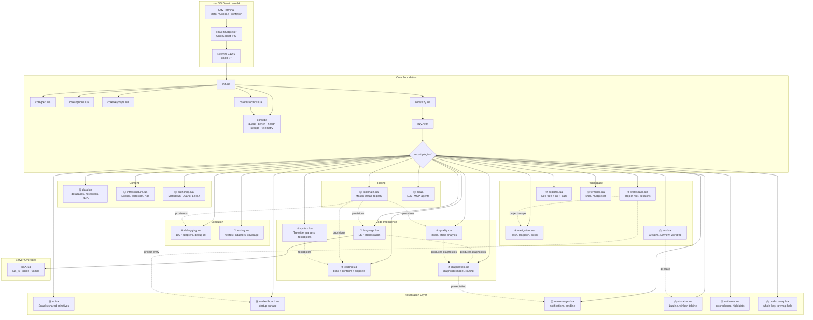
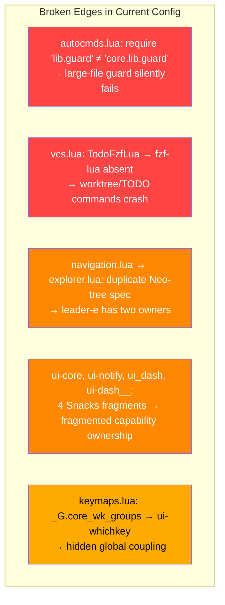

# REGRESSION AUDIT & REMEDIATION SPECIFICATION (2026-10) — Neovim x0r

**Дата:** 2026-09-30 **Scope:** полная стабилизация, доменное выравнивание, UI-реструктуризация,
runtime-оптимизация **Источники:** `NVIM_ARCHITECTURE_AUDIT_2026-09-30.md`, рецензия архитектора,
`README.md` (capability model), UI-model correction **Правило:** каждое изменение — один коммит,
одна валидация. Не смешивать фазы.

---

## TARGET ARCHITECTURE

```text
x0r/
├── init.lua
├── lazy-lock.json
├── README.md
│
├── lua/
│   ├── core/                          ФУНДАМЕНТ (0 domain/plugin deps; lazy.lua = bootstrap boundary)
│   │   ├── perf.lua                   startup performance
│   │   ├── options.lua                editor settings
│   │   ├── keymaps.lua                global bindings
│   │   ├── autocmds.lua               event handlers
│   │   ├── lazy.lua                   plugin manager
│   │   └── lib/
│   │       ├── guard.lua              large-file protection
│   │       ├── bench.lua              profiling harness
│   │       ├── health.lua             health checks
│   │       ├── secops.lua             security utilities
│   │       └── telemetry.lua          observability (opt-in)
│   │
│   └── plugins/                       CAPABILITY DOMAINS (auto-import)
│       │
│       ├── language.lua           ①   LSP orchestration, capabilities, attach
│       ├── syntax.lua             ②   Treesitter parsers, textobjects, context
│       ├── coding.lua             ③   Completion, formatting, snippets, pairs, surround
│       ├── diagnostics.lua        ④   Diagnostic model, routing, presentation policy
│       ├── quality.lua            ⑤   Linters, static analysis, metrics, complexity
│       │
│       │  ── Execution ──
│       ├── debugging.lua          ⑥   DAP adapters, debug UI
│       ├── testing.lua            ⑦   Test runners, adapters, coverage
│       │
│       │  ── Workspace ──
│       ├── navigation.lua         ⑧   Motions, jumps, pins, picker, search
│       ├── workspace.lua          ⑨   Project context, sessions, root detection
│       ├── explorer.lua           ⑩   Filesystem: tree, oil, external FM
│       ├── terminal.lua           ⑪   Shell, multiplexer integration
│       ├── vcs.lua                ⑫   Git signs, diff, worktree, blame
│       │
│       │  ── Content ──
│       ├── data.lua               ⑬   Databases, notebooks, REPL
│       ├── infrastructure.lua     ⑭   Docker, Terraform, K8s, Ansible
│       ├── authoring.lua          ⑮   Markdown, Quarto, LaTeX, docs
│       │
│       │  ── Tooling ──
│       ├── toolchain.lua          ⑯   Mason: install, discovery, registry
│       ├── ai.lua                 ⑰   LLM, MCP, agents
│       │
│       │  ── Presentation Layer ──
│       ├── ui.lua                 ⑱   Shared UI framework primitives
│       ├── ui-dashboard.lua       ⑲   Dashboard / startup surface
│       ├── ui-messages.lua        ⑳   Notifications, cmdline, messages
│       ├── ui-status.lua          ㉑   Statusline, winbar, tabline, statuscolumn
│       ├── ui-theme.lua           ㉒   Colorscheme, highlights, visual styling
│       └── ui-discovery.lua       ㉓   Keymap / command discoverability
│
├── lsp/                               Server overrides ONLY
│   ├── lua_ls.lua
│   ├── jsonls.lua
│   └── yamlls.lua
│
├── after/ftplugin/                    Buffer-local ONLY
│   ├── go.lua
│   ├── python.lua
│   ├── rust.lua
│   └── markdown.lua
│
├── colors/                            Colorscheme implementation
│   └── environment-x.lua
│
└── scripts/
    └── benchmark.py
```

**23 capability domains. Flat composition. Single `{ import = "plugins" }`.**

---

## DOMAIN SEMANTIC MODEL (из README)

```text
language.lua         "What does the code mean?"
syntax.lua           "What is the structural form of the code?"
coding.lua           "How is code edited or transformed?"
diagnostics.lua      "What problems/signals have been produced?"
quality.lua          "How is code statically evaluated?"
debugging.lua        "What happens during execution?"
testing.lua          "Does the system behave correctly?"
navigation.lua       "How is information found and selected?"
workspace.lua        "What project/context am I operating in?"
explorer.lua         "How are filesystem objects manipulated?"
terminal.lua         "How are external processes interacted with?"
vcs.lua              "How is source history managed?"
data.lua             "How are data-oriented workflows handled?"
infrastructure.lua   "How are infrastructure systems operated?"
authoring.lua        "How are technical documents authored/rendered?"
toolchain.lua        "How are external development tools provisioned?"
ai.lua               "How are AI/agent capabilities integrated?"
ui-*.lua             "How are capabilities presented and interacted with?"
```

---

## PHASE 0 — CRITICAL STABILIZATION

> Блокирующие дефекты. Конфиг не production-grade без этих fixes.

| ID        | File                            | Change                                                              | Validation                                              |
| --------- | ------------------------------- | ------------------------------------------------------------------- | ------------------------------------------------------- |
| **P0-01** | `lua/plugins/language.lua:~507` | Fix syntax error: добавить пропущенный `end`                        | `nvim --headless '+qa'` exits 0                         |
| **P0-02** | `lua/core/autocmds.lua:117`     | `require("lib.guard")` → `require("core.lib.guard")`                | Open 2MB file → `:lua print(vim.b.large_file)` = `true` |
| **P0-03** | `lua/plugins/`                  | Удалить `ui-dash__.lua` из plugins/ (архивировать в `x0r/archive/`) | `ls lua/plugins/ui-dash*` → только один файл            |
| **P0-04** | `lua/plugins/navigation.lua`    | Удалить Neo-tree блок целиком (дублирует `explorer.lua`)            | `:verbose nmap <leader>e` → единственный owner          |
| **P0-05** | `lua/plugins/vcs.lua`           | Заменить все `TodoFzfLua` / fzf-lua вызовы на `Snacks.picker`       | Все worktree/TODO команды работают без ошибок           |

**Commit:** `fix(critical): stabilize config — guard path, syntax, duplicates`

---

## PHASE 1 — DOMAIN ALIGNMENT

> Привести файловую структуру в соответствие с README capability model.

| ID        | Current file                 | Action                              | Target file          | Deps  |
| --------- | ---------------------------- | ----------------------------------- | -------------------- | ----- |
| **P1-01** | `treesitter.lua`             | **Rename**                          | `syntax.lua`         | P0    |
| **P1-02** | `debug.lua`                  | **Rename**                          | `debugging.lua`      | P0    |
| **P1-03** | `infra.lua`                  | **Rename** + заселить               | `infrastructure.lua` | P0    |
| **P1-04** | `markdown.lua`               | **Rename**                          | `authoring.lua`      | P0    |
| **P1-05** | —                            | **Create** `diagnostics.lua`        | `diagnostics.lua`    | P1-01 |
| **P1-06** | —                            | **Create** `workspace.lua`          | `workspace.lua`      | P0    |
| **P1-07** | `language.lua` (Mason block) | **Extract** Mason → `toolchain.lua` | `toolchain.lua`      | P1-05 |

### P1-05: `diagnostics.lua` — новый домен

Извлечь из `language.lua` всю diagnostic policy:

```lua
-- lua/plugins/diagnostics.lua
-- Domain: "What problems/signals have been produced?"
-- Owner: diagnostic model, routing, presentation
return {
  -- vim.diagnostic.config ownership
  -- diagnostic signs, virtual text, float policy
  -- severity sorting, source display
  -- update_in_insert policy
  -- large-file diagnostic policy
  -- trouble.nvim (if used)
}
```

**Принцип:** `language.lua` производит diagnostics (LSP), `quality.lua` производит diagnostics
(nvim-lint, selene, vale), но `diagnostics.lua` владеет **presentation и routing policy**.

### P1-06: `workspace.lua` — новый домен

```lua
-- lua/plugins/workspace.lua
-- Domain: "What project/context am I operating in?"
-- Owner: project detection, root, sessions, workspace switching
return {
  -- project root detection
  -- session management
  -- workspace-specific settings
  -- .editorconfig integration
  -- project-local configuration trust
}
```

### P1-07: `toolchain.lua` — извлечение Mason

```lua
-- lua/plugins/toolchain.lua
-- Domain: "How are external development tools provisioned?"
-- Owner: Mason, tool installation, binary discovery, registry
return {
  {
  "mason-org/mason.nvim",
  lazy = false,
  opts = {},
  },
  {
    "WhoIsSethDaniel/mason-tool-installer.nvim",
    cmd = "MasonToolsInstall",
    opts = {
      ensure_installed = { ... }, -- full tool list
      run_on_start = false,       -- FIX: no installer at startup
      auto_update = false,
    },
  },
}
```

**Commit:** `refactor(domains): align file names with README capability model`

---

## PHASE 2 — UI LAYER RESTRUCTURING

> Реструктуризация UI в соответствии с Neovim UI protocol model.

| ID        | Current files     | Action                            | Target file        | Deps         |
| --------- | ----------------- | --------------------------------- | ------------------ | ------------ |
| **P2-01** | `ui-core.lua`     | **Rename** → чистые UI primitives | `ui.lua`           | P1           |
| **P2-02** | `ui_dash.lua`     | **Rename**                        | `ui-dashboard.lua` | P0-03        |
| **P2-03** | `ui-notify.lua`   | **Rename** + расширить scope      | `ui-messages.lua`  | P2-01        |
| **P2-04** | `ui-whichkey.lua` | **Rename**                        | `ui-discovery.lua` | P1           |
| **P2-05** | `ui-styler.lua`   | **Merge** → `ui-theme.lua`        | `ui-theme.lua`     | P1           |
| **P2-06** | `ui-ux.lua`       | **Decompose** по владельцам       | (distribute)       | P2-01, P2-05 |

### P2-01: `ui.lua` — shared UI primitives only

```lua
-- lua/plugins/ui.lua
-- Domain: Shared UI framework primitives
-- NOT: dashboard, NOT: notifications, NOT: theme
-- NOT: picker (→ navigation), NOT: terminal (→ terminal)
-- NOT: bigfile (→ core policy), NOT: profiler (→ core/lib)
--
-- lazy.nvim merges Snacks opts fragments across domain files.
-- Each capability domain owns its own Snacks fragment.
return {
  {
    "folke/snacks.nvim",
    priority = 1000,
    lazy = false,
    ---@type snacks.Config
    opts = {
      -- Shared UI framework integration and plugin registration.
      -- Plugin specification location does not define semantic ownership.
      bigfile      = { enabled = true },
      profiler     = { enabled = true },
      input        = { enabled = true },
      quickfile    = { enabled = true },
      words        = { enabled = true },
      zen          = { enabled = true },
    },
  },
}
```

**Domain-owned Snacks fragments** (lazy.nvim auto-merges `opts`):

```lua
-- lua/plugins/navigation.lua: picker specification
{ "folke/snacks.nvim", opts = { picker = { enabled = true } } }

-- lua/plugins/terminal.lua: terminal specification
{ "folke/snacks.nvim", opts = { terminal = { enabled = true } } }
```

**Policy-level ownership for core capabilities**:
While `ui.lua` registers the `bigfile` and `profiler` plugin specs (since `core/` modules do not return plugin specs), semantic ownership remains outside `ui.lua`:
- `core/lib/guard.lua` → large-file policy and logic
- `core/lib/bench.lua` → profiling execution policy

### P2-03: `ui-messages.lua` — message system

```lua
-- lua/plugins/ui-messages.lua
-- Domain: Messages / notifications / cmdline presentation
-- Semantic scope: all message surfaces per Neovim UI protocol
return {
  -- Snacks notifier opts (merged via lazy.nvim spec merge):
  {
    "folke/snacks.nvim",
    opts = {
      notifier = {
        enabled = true,
        timeout = 3000,
      },
    },
  },
  -- vim.notify override, LSP progress handling
  -- cmdline presentation (if noice used)
  -- message history
}
```

### P2-06: `ui-ux.lua` decomposition

| Current content      | Target owner             | Rationale                |
| -------------------- | ------------------------ | ------------------------ |
| `indent guides`      | `ui.lua` (Snacks.indent) | UI primitive             |
| `scroll animation`   | `ui.lua` (Snacks.scroll) | UI rendering             |
| `word highlighting`  | `ui.lua` (Snacks.words)  | UI primitive             |
| `zen mode`           | `ui.lua` (Snacks.zen)    | UI view                  |
| `rainbow-delimiters` | `syntax.lua`             | Structural visualization |
| `highlight-undo`     | `coding.lua`             | Edit feedback            |
| `highlight-colors`   | `ui-theme.lua`           | Visual styling           |
| `modicator`          | `ui-status.lua`          | Mode state presentation  |

После decomposition `ui-ux.lua` **удаляется** — его содержимое распределено по семантическим
владельцам.

**Commit:** `refactor(ui): restructure UI layer per Neovim protocol model`

---

## PHASE 3 — OWNERSHIP CONSOLIDATION

> Устранить duplicate ownership, globals, phantom dependencies.

| ID        | File(s)              | Change                                                         | Validation                              |
| --------- | -------------------- | -------------------------------------------------------------- | --------------------------------------- |
| **P3-01** | `core/keymaps.lua`   | Удалить `_G.core_wk_groups`                                    | `:lua print(_G.core_wk_groups)` → `nil` |
| **P3-02** | `ui-discovery.lua`   | Перенести which-key group registration сюда через `wk.add()`   | Groups отображаются корректно           |
| **P3-03** | `explorer.lua`       | Удалить `_G._diff_Node` / `_G._diff_Name` → module-local state | No `_G._diff_*` in global scope         |
| **P3-04** | `ui-discovery.lua`   | Удалить stale icon rules для fzf-lua/neotest                   | Нет ссылок на несуществующие плагины    |
| **P3-05** | `testing.lua`        | Заселить neotest spec + adapter                                | Файл не пустой, intent documented       |
| **P3-06** | `quality.lua`        | Заселить: selene (conditional), vale, code metrics             | Файл не пустой                          |
| **P3-07** | `infrastructure.lua` | Заселить: Dockerfile ft, terraform-ls, helm-ls                 | Файл не пустой                          |
| **P3-08** | `core/lazy.lua`      | `install.missing = false` — explicit provisioning via `:Lazy install`; not a perf issue, a reproducibility/supply-chain concern | Clean machine requires explicit install  |

### P3-05: `testing.lua` — заселение

```lua
-- lua/plugins/testing.lua
-- Domain: "Does the system behave correctly?"
-- Status: scaffolded — enable adapters per active workflows
return {
  {
    "nvim-neotest/neotest",
    cmd = "Neotest",
    keys = {
      { "<leader>tt", function() require("neotest").run.run() end, desc = "Run nearest test" },
      { "<leader>tf", function() require("neotest").run.run(vim.fn.expand("%")) end, desc = "Run file" },
      { "<leader>ts", function() require("neotest").summary.toggle() end, desc = "Toggle summary" },
    },
    dependencies = {
      "nvim-neotest/nvim-nio",
      -- Enable adapters as needed:
      -- "nvim-neotest/neotest-python",
      -- "nvim-neotest/neotest-go",
      -- "rouge8/neotest-rust",
      -- "marilari88/neotest-vitest",
    },
    opts = function()
      return {
        adapters = {
          -- require("neotest-python"),
          -- require("neotest-go"),
        },
      }
    end,
  },
}
```

**Commit:** `fix(ownership): consolidate globals, populate empty domains`

---

## PHASE 4 — API MODERNIZATION

| ID        | File                               | Change                                                                                                       | Risk   | Validation                                                  |
| --------- | ---------------------------------- | ------------------------------------------------------------------------------------------------------------ | ------ | ----------------------------------------------------------- |
| **P4-01** | `syntax.lua`                       | Align с upstream nvim-treesitter rewrite: `lazy = false`, parser install → explicit `:TSUpdate` / build hook | Medium | `:checkhealth nvim-treesitter` — no install on file open    |
| **P4-02** | `coding.lua`                       | blink.cmp: `version = "1.*"` (semantic guard against v2 ABI break)                                           | Low    | `:Lazy` shows pinned v1.x                                   |
| **P4-03** | `colors/environment-x.lua`         | Lualine theme → `lua/lualine/themes/environment_x.lua`; удалить `package.preload` hack                       | Medium | Lualine loads theme without preload                         |
| **P4-04** | `ui-theme.lua`                     | Merge `ui-styler.lua` content; удалить `package.loaded` monkey patches из nightfox                           | Low    | No `package.loaded` mutations                               |
| **P4-05** | `language.lua` → `diagnostics.lua` | Diagnostic config extraction: `vim.diagnostic.config` ownership → `diagnostics.lua`                          | Medium | `:lua print(vim.diagnostic.config())` shows expected config |

**Commit:** `refactor(api): treesitter lifecycle, blink pin, theme cleanup`

---

## PHASE 5 — RUNTIME OPTIMIZATION

| ID        | File                               | Change                                                                                                                                                 | Validation                                |
| --------- | ---------------------------------- | ------------------------------------------------------------------------------------------------------------------------------------------------------ | ----------------------------------------- |
| **P5-01** | `core/lib/telemetry.lua`           | Timer → opt-in via `:CoreTelemetryStart`/`:CoreTelemetryStop`; bounded ring buffer (1000 entries max); remove auto-start from `init.lua` UIEnter block | `vim.uv.walk` → 0 active timers when idle |
| **P5-02** | `core/autocmds.lua` + `coding.lua` | Remove `BufWritePre` whitespace trim from autocmds; let Conform own all whitespace via `trim_whitespace` + `trim_newlines` formatters                  | Single mutation per save                  |
| **P5-03** | `quality.lua`                      | Remove `InsertLeave` trigger from nvim-lint; lint on `BufWritePost` only                                                                               | No lint on typing stop                    |
| **P5-04** | `toolchain.lua`                    | `run_on_start = false` in mason-tool-installer                                                                                                         | No installer check during normal startup  |
| **P5-05** | `coding.lua`                       | Conform: evaluate `format_after_save` vs `format_on_save`; reduce 3000ms timeout                                                                       | Measure save latency                      |

**Commit:** `perf(runtime): opt-in telemetry, single format owner, no startup installer`

---

## PHASE 6 — FEATURE ADDITIONS (from x0r_old)

| ID        | Target file        | Addition                                                     | Trigger       | Risk |
| --------- | ------------------ | ------------------------------------------------------------ | ------------- | ---- |
| **P6-01** | `coding.lua`       | `tzachar/highlight-undo.nvim` — visual feedback on undo/redo | `VeryLazy`    | Low  |
| **P6-02** | `ui-theme.lua`     | `brenoprata10/nvim-highlight-colors` — inline color preview  | `BufReadPost` | Low  |
| **P6-03** | `syntax.lua`       | `HiPhish/rainbow-delimiters.nvim` — nested bracket colors    | `BufReadPost` | Low  |
| **P6-04** | `coding.lua`       | Biome conditional formatter for TS/JS/JSON in Conform config | via Conform   | Low  |
| **P6-05** | `quality.lua`      | Selene linter (conditional `selene.toml` detection)          | via nvim-lint | Low  |
| **P6-06** | `core/keymaps.lua` | `<Tab>` → `}`, `<S-Tab>` → `{` (block navigation)            | Immediate     | Low  |
| **P6-07** | `ui-messages.lua`  | Filter: hide `No information available` LSP hover            | via notifier  | Low  |

**Commit:** `feat: highlight-undo, color preview, rainbow brackets, biome, selene, block nav`

---

## PHASE 7 — VALIDATION

| #    | Check             | Command                                                               | Expected                   |
| ---- | ----------------- | --------------------------------------------------------------------- | -------------------------- |
| V-01 | Syntax / import   | `nvim --headless '+qa'`                                               | Exit 0                     |
| V-02 | Cold startup (20) | `hyperfine --warmup 3 --runs 20 'nvim --headless +qa'`                | ≤ 20ms                     |
| V-03 | Map collision     | `:verbose nmap <leader>e`                                             | Single owner               |
| V-04 | LSP health        | `:checkhealth vim.lsp`                                                | All OK                     |
| V-05 | Treesitter health | `:checkhealth nvim-treesitter`                                        | All OK                     |
| V-06 | Timer audit       | `vim.uv.walk(function(h) print(h:get_type(), h:is_active()) end)`     | 0 timers                   |
| V-07 | Plugin profile    | `:Lazy profile`                                                       | No unexpected eager        |
| V-08 | Lockfile          | `jq -r '.[] \| .commit' lazy-lock.json \| grep -cvE '^[0-9a-f]{40}$'` | 0                          |
| V-09 | Secret scan       | `grep -rn 'sk-ant-\|sk-proj-\|API_KEY=' lua/`                         | Empty                      |
| V-10 | Large-file        | Open 2MB file                                                         | `vim.b.large_file == true` |
| V-11 | Domain count      | `ls lua/plugins/*.lua \| wc -l`                                       | 23                         |
| V-12 | No globals        | `:lua print(_G.core_wk_groups, _G._diff_Node)`                        | `nil nil`                  |
| V-13 | Picker            | `<leader>ff`, `<leader>fg`                                            | No fzf-lua error           |
| V-14 | Dashboard         | nvim without file                                                     | Dashboard renders          |
| V-15 | Notifications     | `:lua vim.notify("test")`                                             | Notifier shows             |

---

## FILE OPERATION SUMMARY

### Renames (git mv)

```
treesitter.lua      → syntax.lua
debug.lua           → debugging.lua
infra.lua           → infrastructure.lua
markdown.lua        → authoring.lua
ui-core.lua         → ui.lua
ui_dash.lua         → ui-dashboard.lua
ui-notify.lua       → ui-messages.lua
ui-whichkey.lua     → ui-discovery.lua
```

### Creates

```
diagnostics.lua     — NEW: extracted from language.lua
workspace.lua       — NEW: project context
toolchain.lua       — NEW: extracted Mason from language.lua
```

### Deletes / Archives

```
ui-dash__.lua       → archive/
ui-styler.lua       → merge into ui-theme.lua, then delete
ui-ux.lua           → decompose into owners, then delete
```

### Result

```
Before:  25 files in plugins/ (including drafts/duplicates)
After:   23 files in plugins/ (all populated, all named per README)
```

---

## DOMAIN DEPENDENCY MAP

```text
                  ┌────────────────┐
                  │  toolchain     │
                  │  installation  │
                  │  provisioning  │
                  └───────┬────────┘
                          │
         ┌────────────────┼────────────────┐
         ↓                ↓                ↓
    language          quality         debugging
       LSP           linters            DAP
         │                │                │
         └────────┬───────┘                │
                  ↓                        │
            diagnostics ←──────────────────┘
                  │
         presentation policy
                  │
                  ↓
          ui-messages.lua


    syntax ──→ coding  (textobjects → editing)


    workspace ──→ navigation   (project-scoped search)
         │
         └──→ ui-dashboard (project entry presentation)


    vcs ──→ ui-status (git state in statusline)
```

---

## EXECUTION ORDER

```text
P0 (stabilize)  →  P1 (domains)  →  P2 (UI)  →  P3 (ownership)
                                                       │
                                          P4 (APIs)  ←─┘
                                              │
                                    P5 (runtime) ← P4
                                              │
                                    P6 (features) ← P5
                                              │
                                    P7 (validation) ← P6
```

Каждая фаза — отдельный коммит. Валидация `nvim --headless '+qa'` после каждого коммита.


---

# PHASE 8 — SUPPLEMENTARY DATA (из NVIM_ARCHITECTURE_AUDIT + OPUS Review)

> Материалы, отсутствовавшие в основном REMEDIATION_PLAN, но зафиксированные в
> `NVIM_ARCHITECTURE_AUDIT_2026-09-30.md` и рецензии Principal Architect (OPUS audit review).
> Каждая секция — справочные данные для фаз P0–P7.

---

## S1. RUNTIME BASELINE

| Параметр | Факт |
|---|---|
| OS / CPU | macOS 27.2, Darwin arm64 (T6000) |
| Neovim | `NVIM v0.12.5`, Release |
| Lua | LuaJIT 2.1.1774638290 |
| Shell / терминал при аудите | fish / `TERM=dumb` |
| Config root | `/Users/x0r/.config/nvim/x0r` (`XDG_CONFIG_HOME=/Users/x0r/.config/nvim`, `NVIM_APPNAME=x0r`) |
| Data root | `/Users/x0r/.local/share/nvim/x0r` |
| Plugin manager | lazy.nvim, 62 configured / 62 lock entries / 67 directories in data lazy root |
| Startup (current) | **45.327 ms**, headless startuptime |
| Startup (baseline after syntax repair) | 21.043 ms (диагностический симулятор) |
| Main sync block | `require("core.lazy")`: 36.373 ms elapsed (20.455 ms self) |
| Current post-startup | 62 loaded Lua modules, 107 autocmds, 212 normal maps, 2 start plugins, 1 libuv handle |
| Baseline post-startup | 59 modules, 103 autocmds, 205 normal maps, 59 lazy plugins, 3 Snacks fragments |

**Per-plugin load time command:**

```
XDG_CONFIG_HOME=/Users/x0r/.config/nvim NVIM_APPNAME=x0r nvim --headless \
  -c "lua for k,v in pairs(require('lazy').plugins()) do if v._.loaded then print(string.format('%-40s %8.2fms', v.name, (v._.loaded.time or 0))) end end" \
  -c "qa"
```

---

## S2. RUNTIME SLA TABLE

| Domain | SLA | Current | Status | Validation |
|---|---|---|---|---|
| Cold startup | ≤ 20ms headless | 45.327ms | ❌ FAIL | `nvim --headless --startuptime /tmp/s.log +qa && tail -1 /tmp/s.log` |
| Warm startup | ≤ 15ms headless | Not measured | ⚠️ | Repeat after lockfile stabilization |
| Keystroke latency | ≤ 2ms overhead | Not measured | ⚠️ | CursorMoved handler audit |
| LSP attach | Event-driven, 0 blocking | ✅ Correct | ✅ | `:LspInfo` on fresh buffer |
| Completion | Sub-2ms per-keystroke | Not measured | ⚠️ | Type in large buffer, observe lag |
| Format-on-save | ≤ 500ms or async | 3000ms sync timeout | ⚠️ RISK | `:ConformInfo`, measure save time |
| Linting | Async, bounded | ✅ Debounced | ✅ | Observe `InsertLeave` lint |
| Debug startup | 0 cost until explicit | ✅ Key-loaded | ✅ | `:Lazy` profile |
| AI/MCP startup | 0 cost until explicit | ✅ Cmd/key-loaded | ✅ | `:Lazy` profile |
| Dashboard | 0 permanent polling | ❌ CursorMoved loop | ❌ FAIL | Timer walk after dashboard open |
| Git redraw | 0 synchronous subprocess | ✅ Gitsigns async | ✅ | Process list during editing |
| Tmux escape | 0ms | Not measured | ⚠️ | `tmux show -g escape-time` |
| Kitty input delay | ≤ 1ms | Not measured | ⚠️ | `kitty.conf` audit |
| Telemetry idle | 0 timers | ❌ 100ms forever timer | ❌ FAIL | `vim.uv.walk` after UIEnter |

---

## S3. FULL SYSTEM DEPENDENCY GRAPH

### S3.1 TARGET STATE (post-remediation)



### S3.2 CURRENT STATE (pre-remediation — broken edges)



---

## S4. ANTI-PATTERN CHECKLIST

### Architecture

- [x] duplicate domains — **Neo-tree** в `navigation.lua` + `explorer.lua`
- [x] fake domains — `testing.lua` ({}), `quality.lua` ({}), `infra.lua` ({})
- [x] fragmented Snacks ownership — same implementation configured across unrelated domain files, semantic ownership implicit
- [x] hidden plugin dependencies — `schemastore` implicit, fzf-lua phantom
- [x] cross-domain mutation — `_G.core_wk_groups`, `_G._diff_*`
- [x] runtime globals — `_G.core_wk_groups`, `_G._diff_Node`, `_G._diff_Name`
- [x] package.preload hacks — `environment-x.lua` lualine theme, `nightfox.lua`
- [x] package.loaded monkey patches — `nightfox.lua`
- [ ] ~~monolithic plugin file~~ — файлы разделены по доменам
- [ ] ~~empty abstraction layers~~ — `core/lib/` modules имеют реальный код

### Startup

- [x] startup filesystem scans — `install.missing = true` triggers
- [ ] ~~lazy=false without proof~~ — Only lazy.nvim and Snacks start plugins
- [ ] ~~VeryLazy used as catch-all~~ — Не обнаружено
- [ ] ~~synchronous shell calls~~ — Bootstrap `vim.system:wait()` justified
- [ ] ~~eager require of heavy modules~~ — Deferred correctly

### Runtime

- [x] timer polling — 100ms telemetry timer forever
- [x] CursorMoved heavy callbacks — Dashboard cursor lock in `ui-dash__.lua`
- [x] expensive statusline functions — 612 LOC lualine, Git/LSP recompute
- [x] repeated LSP queries — `CursorMoved` document highlight clear
- [ ] ~~BufEnter heavy callbacks~~ — `formatoptions` removal is lightweight
- [ ] ~~repeated filesystem scans~~ — Не обнаружено в hot path
- [ ] ~~repeated process spawning~~ — Не обнаружено

### LSP

- [x] duplicate formatting — Core trim + Conform both on BufWritePre
- [ ] ~~old lspconfig.setup()~~ — Native model used correctly ✅
- [ ] ~~native vim.lsp APIs ignored~~ — `vim.lsp.config`/`vim.lsp.enable` used ✅
- [ ] ~~duplicate LspAttach~~ — Single LspAttach handler

### Treesitter

- [x] startup parser install — `treesitter.install(missing)` on first file open
- [ ] ~~old API~~ — New rewrite API used
- [ ] ~~unconditional giant-file parsing~~ — Guard exists (but broken path)

### Picker

- [x] multiple primary pickers — Snacks + phantom fzf-lua + Telescope (text-case dep)
- [x] hidden picker fallback — Dashboard variants disagree on picker
- [x] duplicate vim.ui.select ownership — Not explicitly audited

### UI

- [x] multiple explorers — Neo-tree + Oil + Yazi (roles unclear)
- [x] multiple dashboard owners — 3 variant files
- [ ] ~~multiple statuslines~~ — Single lualine
- [ ] ~~multiple theme owners~~ — Single environment-x

### Security

- [x] AI data egress — Staged diff → remote LLM without cap/redact
- [x] modeline/exrc risks — `modeline=true` surface, `exrc=false` correct
- [x] insecure shell interpolation — Not explicitly audited
- [ ] ~~hardcoded secrets~~ — Не обнаружено

---

## S5. EXTENDED DOMAINS (пропущены в исходном аудите)

### Domain: Kitty GPU Transport & macOS Metal Optimization

> OPUS prompt Domain 3 — полностью отсутствовал в архитектурном аудите.

| Параметр | Эталонное значение | Текущий статус |
|---|---|---|
| `repaint_delay` | ≤ 10ms | Не проверено |
| `input_delay` | ≤ 1ms | Не проверено |
| `sync_to_monitor` | yes (ProMotion 120Hz) | Не проверено |
| `allow_remote_control` | `socket-only` или `no` | Не проверено |
| `listen_on` | `unix:<0600 socket>` | Не проверено |
| Nerd Font `symbol_map` | deterministic glyph mapping | Не проверено |

**Требуемое действие:** Проверить `~/.config/kitty/kitty.conf`, добавить домен в аудит с конкретными значениями.

### Domain: Tmux Low-Latency & Socket Isolation

> OPUS prompt Domain 4 — полностью отсутствовал в архитектурном аудите.

| Параметр | Эталонное значение | Текущий статус |
|---|---|---|
| `escape-time` | 0 | Не проверено |
| `focus-events` | on | Не проверено |
| `extended-keys` | on | Не проверено |
| True color passthrough | `Tc`, `RGB` terminal-features | Не проверено |
| Status bar budget | < 3.5ms per refresh | Не проверено |
| Socket permissions | 0700 directory | Не проверено |

**Требуемое действие:** Проверить `~/.config/tmux/tmux.conf` или `~/.tmux.conf`.

### Domain: DevSecOps Supply-Chain Verification

Аудит упоминает security в Domain 31, но не выполняет фактическое сканирование.

**Требуемые проверки:**

```bash
# 1. All lockfile entries are 40-char hex SHA commits
jq -r '.[] | .commit' lazy-lock.json | grep -cvE '^[0-9a-f]{40}$'
# Expected: 0

# 2. No plaintext API key patterns
grep -rn 'sk-ant-\|sk-proj-\|ANTHROPIC_API_KEY=\|OPENAI_API_KEY=' x0r/

# 3. Config directory permissions
stat -f '%Lp' x0r/ x0r/lua/ x0r/lua/core/ x0r/lua/plugins/

# 4. modelineexpr status
grep -n 'modelineexpr' x0r/lua/core/options.lua
```

### Domain: CI/CD Verification Oracle

OPUS prompt Deliverable 4 (`workstation_audit_oracle.sh`) полностью отсутствует. Это автоматизированный verification harness для всех доменов.

**Target:** `scripts/workstation_audit_oracle.sh` — POSIX/Bash скрипт, проверяющий:
- Neovim startup & runtime latency (SLA)
- SOLID architecture & non-blocking audit
- DevSecOps & supply-chain security
- Kitty GPU transport parameters
- Tmux low-latency & socket isolation
- LLMOps async & credential hygiene

---

## S6. DOMAIN OWNERSHIP MATRIX

| Responsibility | Current owner | Desired owner | Duplicate / missing | Action |
|---|---|---|---|---|
| bootstrap/options/maps/autocmds | core | core | guard path broken | repair module path |
| plugin manager | lazy | lazy | auto-install side effect | explicit provisioning |
| LSP/server overrides | language + lsp | language + lsp | docs path drift | retain/fix docs |
| Mason/toolchain | language → toolchain | toolchain.lua | DAP tools absent | align registry |
| Treesitter | treesitter → syntax | syntax.lua | install-on-open | provision separately |
| completion/format/lint | coding | coding | Ruff overlap | producer policy |
| diagnostics | language/native → diagnostics | diagnostics.lua (NEW) | multiple producers | source matrix |
| debugging | debug → debugging | debugging.lua | adapters absent | install or remove configs |
| testing | testing | testing | empty/no neotest | delete or implement |
| explorer | navigation + explorer | explorer | two Neo-tree specs | remove from navigation |
| picker | Snacks + Telescope + stale fzf | Snacks | fzf unavailable | migrate calls |
| terminal | core + Snacks + smart-splits | explicit native or Snacks | unclear | choose one UI owner |
| markdown/notebooks | data + authoring | separate, opt-in | generic markdown overlap | narrow ft triggers |
| Snacks UI | four files → ui.lua | ui.lua + domain opts merge | config order | consolidate |
| dashboard | 3 variants → ui-dashboard | ui-dashboard.lua | imports all | retain one |
| notifications | ui-notify → ui-messages | ui-messages.lua | opts dropped | merge |
| status/theme | lualine/colors | lualine + colors | package patches | remove hacks |
| workspace | — → workspace | workspace.lua (NEW) | absent | create |
| observability | core.lib | command-scoped | permanent timer | opt-in only |

---

## S7. PLUGIN INVENTORY & MISSING ITEMS

### Architecture-relevant inventory

| Plugin / capability | Domain | Trigger | Status / action |
|---|---|---|---|
| lazy.nvim | core | start | keep; disable implicit install after bootstrap |
| Snacks | UI (ui.lua) | **4 start fragments → 1** | consolidate to exactly one spec |
| nvim-lspconfig | language | BufReadPre/NewFile | keep native API model |
| rustaceanvim | language | rust ft | keep canonical Rust owner |
| Mason + tool installer | toolchain | module/default | remove `run_on_start`; reconcile tools |
| nvim-treesitter + textobjects/context | syntax | buffer events | follow rewrite's non-lazy guidance |
| blink.cmp + friendly snippets | coding | InsertEnter | pin stable v1 or perform v2 migration |
| conform | coding | save/format events | keep; single formatting owner |
| nvim-lint | quality | BufWritePost | keep; linting belongs to static analysis domain |
| nvim-dap + dap-ui + nio | debugging | keys | keep; provision declared adapters |
| Neo-tree + Oil + Yazi | explorer | cmd/keys | retain roles, remove duplicate Neo-tree spec |
| Telescope | text-case dependency | key | retain only for required extension |
| fzf-lua | **absent** | referenced | migrate to Snacks; do not add by default |
| Quarto/Otter/Render-Markdown | authoring | markdown/quarto ft | commit intentionally; constrain generic Markdown |
| Molten/image/Dadbod | data | ft/cmd | keep demand-loaded |
| CodeCompanion/MCPHub | AI | cmd/keys | keep explicit-use; cap staged diff |
| lualine/which-key/styler | UI | UIEnter/events | keep one owner each |
| neotest/adapters | **absent** | none | add only if tests are a real workflow |

### Missing or unprovisioned items

| Missing item | Evidence | Remediation file | Recommendation |
|---|---|---|---|
| `ibhagwan/fzf-lua` | `vcs.lua:345,392`, `ui-dash__.lua`, health/which-key | `vcs.lua`, dashboard | **Не добавлять.** Заменить на `Snacks.picker`, удалить `TodoFzfLua` |
| `nvim-neotest/neotest` + adapters | `testing.lua` returns `{}`; stale UI/core refs | `testing.lua` | Add only if needed; otherwise remove stale claims |
| debugpy / codelldb / js-debug | `debug.lua` configures; only delve in Mason list | `toolchain.lua` + `debugging.lua` | Add Mason packages or delete unsupported adapter blocks |
| basedpyright/gopls/ts/nil/terraform/bash/yaml/docker/sqls/marksman | enabled but absent from PATH | `language.lua` | Provision only actually used servers |
| Quarto executable | Plugin configured, binary absent | `authoring.lua` | Document prerequisite; disable preview until installed |

---

## S8. API MODERNIZATION MATRIX

| Current API | Assessment | Modern API / action |
|---|---|---|
| `vim.lsp.config`, `vim.lsp.enable` | ✅ current and correct for Neovim 0.12 | retain |
| `lsp/*.lua` runtimepath configs | ✅ current and correct | retain; fix docs from `after/lsp` to `lsp` |
| `require("nvim-treesitter").setup` + `install` | new rewrite API, but lifecycle mismatch | use current rewrite docs; `lazy = false`; explicit parser update |
| blink `version="*"` | unbounded release selection | stable `version="1.*"`; v2 needs `blink.lib` |
| multiple Snacks `config()` | fragmented capability ownership | domain-owned `opts` fragments; lazy.nvim merges deterministically |
| `package.preload/loaded` theme hooks | hidden legacy coupling | lualine theme module → `lua/lualine/themes/environment_x.lua` |
| `vim.system(...):wait()` at bootstrap/AI | synchronous by design | allow only bounded bootstrap/action |

### Коррекции из OPUS review

**Treesitter:** `lazy = false` рекомендуется потому что plugin сам manages `FileType` autocmds для parser activation. `lazy.nvim` `event = {"BufReadPost", "BufNewFile"}` технически функционально эквивалентен при корректной настройке. Фундаментальная проблема — `treesitter.install(missing)` при первом открытии файла, а не lazy/start distinction.

**blink.cmp:** На 2026-09-30 v1 branch — stable, v2 использует `blink.lib` отдельный пакет. `version = false` + lockfile тоже допустимо, но `version = "1.*"` добавляет semantic guard against accidental v2 при `:Lazy update`.

**environment-x.lua:** Это 3235 строк полноценной визуальной операционной среды поверх `nightfox.nvim` — design token system с semantic palette, lualine integration и plugin highlight coverage. `package.preload` hack решается перемещением theme файла в `lua/lualine/themes/environment_x.lua`.

---

## S9. REFERENCE IMPLEMENTATIONS

### S9.1 Fix: `autocmds.lua` guard path

**File:** `lua/core/autocmds.lua`, line 117

```lua
-- BEFORE (broken):
local ok, guard = pcall(require, "lib.guard")

-- AFTER (correct):
local ok, guard = pcall(require, "core.lib.guard")
```

### S9.2 Fix: Telemetry opt-in only

**File:** `lua/core/lib/telemetry.lua`

```lua
local timer = nil
local MAX_ENTRIES = 1000

function M.start()
  if timer then return end
  local last_tick = vim.uv.hrtime()
  timer = vim.uv.new_timer()
  timer:start(100, 100, vim.schedule_wrap(function()
    local now = vim.uv.hrtime()
    local delta_ms = (now - last_tick) / 1e6
    if delta_ms > 116 then
      if #metrics.ui_lag >= MAX_ENTRIES then
        table.remove(metrics.ui_lag, 1)
      end
      table.insert(metrics.ui_lag, delta_ms - 100)
      metrics.frames_dropped = metrics.frames_dropped + 1
    end
    last_tick = vim.uv.hrtime()
  end))
  vim.notify("Telemetry started", vim.log.levels.INFO)
end

function M.stop()
  if timer then
    timer:stop()
    timer:close()
    timer = nil
    vim.notify("Telemetry stopped", vim.log.levels.INFO)
  end
end

-- Remove M.setup() auto-start; replace with commands only:
vim.api.nvim_create_user_command("CoreTelemetryStart", M.start, {})
vim.api.nvim_create_user_command("CoreTelemetryStop", M.stop, {})
```

Then in `init.lua`, remove the `core.lib.telemetry` auto-setup from the UIEnter block.

### S9.3 Fix: Conform whitespace ownership

**File:** `lua/core/autocmds.lua` — удалить `BufWritePre` trim

```lua
-- DELETE this block entirely:
-- vim.api.nvim_create_autocmd("BufWritePre", {
--   pattern = "*",
--   callback = function()
--     local save_cursor = vim.fn.getpos(".")
--     vim.cmd([[%s/\s\+$//e]])
--     vim.fn.setpos(".", save_cursor)
--   end,
-- })
```

**File:** `lua/plugins/coding.lua` — Conform owns all whitespace:

```lua
formatters_by_ft = {
  ["_"] = { "trim_whitespace", "trim_newlines" },
  -- ... per-ft formatters
}
```

### S9.4 Feature: Biome conditional formatter

**File:** `lua/plugins/coding.lua`, Conform `formatters_by_ft`

```lua
javascript = function(bufnr)
  if require("conform").get_formatter_info("biome", bufnr).available then
    return { "biome" }
  end
  return { "prettier" }
end,
typescript = function(bufnr)
  if require("conform").get_formatter_info("biome", bufnr).available then
    return { "biome" }
  end
  return { "prettier" }
end,
json = function(bufnr)
  if require("conform").get_formatter_info("biome", bufnr).available then
    return { "biome" }
  end
  return { "prettier" }
end,
```

### S9.5 Feature: Selene linter

**File:** `lua/plugins/quality.lua`, nvim-lint `linters_by_ft`

```lua
-- Add conditional selene for Lua:
lua = { "selene" },

-- In nvim-lint config, add condition:
local lint = require("lint")
lint.linters.selene.condition = function(ctx)
  return vim.fs.find("selene.toml", { path = ctx.filename, upward = true })[1]
end
```

### S9.6 Feature: Lualine theme relocation

**Move:** `package.preload` hack → proper module file

```
# Create directory:
mkdir -p lua/lualine/themes/

# Extract theme table from colors/environment-x.lua
# into lua/lualine/themes/environment_x.lua as a proper module:
-- lua/lualine/themes/environment_x.lua
return {
  normal   = { ... },
  insert   = { ... },
  visual   = { ... },
  replace  = { ... },
  command  = { ... },
  inactive = { ... },
}
```

Then delete the `package.preload["lualine.themes.environment_x"]` block from `colors/environment-x.lua`.

---

## S10. PERFORMANCE FINDINGS

| Priority | Finding / evidence | Root cause | Fix / validation |
|---|---|---|---|
| **High** | 45.327ms current startup; `core.lazy` 36.373ms elapsed | imported spec graph and stale variants | consolidate specs; 20× cold/warm startuptime |
| **High** | 100ms forever timer in `core/lib/telemetry.lua:21-30` | telemetry always starts UIEnter | command-scoped collector; prove zero timer after idle |
| **High** | large-file protection never loads | `require("lib.guard")` at `autocmds.lua:117` | use `core.lib.guard`; open 2-MiB fixture and inspect flags |
| **Medium** | parser install happens on interactive file opening | `treesitter.install(missing)` | explicit provisioning; measure first-open latency |
| **Medium** | save does two broad mutations | core trim plus Conform | retain one owner; trace BufWritePre/Post |
| **Medium** | dashboard cursor loop + workspace scan | legacy `ui-dash__` | retain one minimal dashboard; no CursorMoved controller |
| **Low** | UI animations | Snacks scroll/indent enabled | keep only after measured UX decision |

---

## S11. x0r_old MIGRATION RECOMMENDATIONS

### High Value — migrate

| Компонент | Источник в x0r_old | Target в новом конфиге | Status |
|---|---|---|---|
| `highlight-undo.nvim` | `extras/ui/highlight-undo.lua` | `coding.lua` (P6-01) | ❌ Отсутствует |
| `nvim-highlight-colors` | `extras/ui/highlight-colors.lua` | `ui-theme.lua` (P6-02) | ❌ Отсутствует |
| `rainbow-delimiters.nvim` | `extras/ui/rainbow-delimeters.lua` | `syntax.lua` (P6-03) | ❌ Отсутствует |
| Biome formatter | `extras/linting/biome.lua` | `coding.lua` Conform (P6-04) | ❌ Отсутствует |
| Selene linter | `extras/linting/selene.lua` | `quality.lua` nvim-lint (P6-05) | ❌ Отсутствует |
| Tab/S-Tab block nav | `config/keymaps.lua` | `core/keymaps.lua` (P6-06) | ❌ Отсутствует |
| `No information available` filter | noice config | `ui-messages.lua` (P6-07) | ❌ Отсутствует |

### Medium Value — evaluate

| Компонент | Ценность | Рекомендация |
|---|---|---|
| `kitty-scrollback.nvim` | Навигация scrollback Kitty через Neovim | **Evaluate** — ценно только для Kitty users |
| `mise.nvim` | Tool version management integration | **Evaluate** — если mise используется |
| `modicator.nvim` | Mode-aware line number colors | **Skip** — эстетическое, не функциональное |

### Skip — already covered or low value

| Компонент | Причина пропуска |
|---|---|
| IDE-style clipboard (`<C-a>`, `<C-c>`, `<C-v>`) | Конфликтует с Vim idioms; `unnamedplus` настроен |
| `<Leader>dl` line duplication | Тривиален, `yyp` native |
| Dashboard extended (ASCII art) | Snacks dashboard уже реализован |
| smart-splits.nvim | Уже есть в terminal.lua |
| yazi.nvim | Уже есть в explorer.lua |

---

## S12. PRINCIPAL ARCHITECTURE VERDICT

### Confirmed strengths

1. Native LSP model (`vim.lsp.config`/`vim.lsp.enable`) — эталонный для Neovim 0.12
2. Domain separation — чётко выраженные границы ответственности
3. Deterministic lockfile — 62 pinned commits, checker disabled
4. Buffer-local ftplugins — correct separation of concerns
5. Deferred clipboard/foldexpr — intelligent startup optimization
6. `vim.loader.enable()` as first instruction — correct
7. Provider suppression early — correct

### Confirmed weaknesses

1. **4 Snacks fragments with fragmented capability ownership** — highest structural risk
2. **Broken guard path** — large-file protection silently fails everywhere
3. **Phantom fzf-lua dependency** — runtime errors on worktree/TODO commands
4. **Permanent 100ms telemetry timer** — contradicts zero-overhead model
5. **Dual whitespace cleanup** — core trim + Conform, redundant mutation
6. **3 dashboard variants in import tree** — filename accident determines behavior
7. **`_G` pollution** — `core_wk_groups`, `_diff_*` — hidden cross-domain coupling
8. **Missing Kitty/Tmux audit** — half the workstation stack is unverified
9. **No CI verification harness** — no automated regression detection
10. **612-LOC statusline** — potential redraw overhead, unmeasured

### Target engineering characteristics (post-remediation)

```
Startup:            ≤ 20ms headless (cold), ≤ 15ms (warm)
Idle timers:        0
Background polling: 0
LSP model:          vim.lsp.config + vim.lsp.enable (native)
Picker:             Snacks.picker (single canonical)
Explorer:           Neo-tree (primary) + Oil (edit) + Yazi (TUI)
Dashboard:          One file, one spec, no CursorMoved loop
Telemetry:          Command-scoped, bounded, opt-in
Supply chain:       100% SHA-pinned, no auto-install in normal operation
Secrets:            0 plaintext, AI diff capped/redacted
Config permissions: 0700 dirs, 0600 sensitive files
Domain count:       23 files in plugins/ (all populated, all named per README)
```

---

## S13. UPSTREAM EVIDENCE CONSULTED

- [Neovim LSP documentation](https://neovim.io/doc/user/lsp.html): `vim.lsp.config()` and `vim.lsp.enable()` — current configuration/activation model
- [nvim-treesitter README](https://github.com/nvim-treesitter/nvim-treesitter/blob/main/README.md): current rewrite incompatible with old API, requires Neovim 0.12+, lazy-loading unsupported
- [lazy.nvim documentation](https://github.com/folke/lazy.nvim/blob/main/doc/lazy.nvim.txt): import/merge and trigger semantics; `opts` preferred over `config`
- [Snacks README](https://github.com/folke/snacks.nvim): modules are one plugin capability set; supports core/dashboard/notifier/picker
- [blink.cmp docs](https://github.com/Saghen/blink.cmp/blob/main/doc/blink-cmp.txt): Rust fuzzy matcher; release-tag binary provisioning; v2 is breaking
- [Conform recipes](https://github.com/stevearc/conform.nvim/blob/master/doc/recipes.md): async manual formatting; save-format lifecycle
- [CodeCompanion documentation](https://github.com/olimorris/codecompanion.nvim/blob/main/doc/codecompanion.txt): MCP servers start on first chat, not editor startup
- [Mason registry migration](https://github.com/mason-org/mason.nvim): `williamboman/mason.nvim` → `mason-org/mason.nvim`


---

# S14. OCTOBER 2026 PRINCIPAL+ FORENSIC AUDIT: REGRESSION POST-MORTEM, ZERO-OVERHEAD CONTRACT & EXPANDED ANTI-PATTERN SPECIFICATION

**Audit Date:** 2026-10-29  
**Specification Baseline:** Neovim $\ge 0.12.0$ (macOS arm64 / Linux x86_64, LuaJIT 2.1)  
**Host Environment:** Ghostty Terminal Emulator (Metal/CoreText GPU Pipeline), Tmux $\ge 3.4$  
**Synthesizing Roles:** Lead Scientist, Principal Systems Architect, Staff Platform & TUI Protocol Engineer  
**Target Repository:** `/Users/x0r/.config/nvim` (`NVIM_APPNAME=zx0r`)  
**Foundational Paradigms:** Capability-Oriented Domain Decomposition (CODA), Zero-Overhead Contract, Domain-Driven Design (DDD)

---

## 1. Executive Forensic Summary & Regression Post-Mortem

During the October 2026 development cycle, several critical boundary regressions emerged at the intersection of Neovim, multiplexing layers (Tmux), and host GPU terminal compositors (Ghostty). While cold-boot execution and Ring 0 performance remained highly optimized, editor teardown, boundary escape sequences, and window lifecycle exhibited subtle yet catastrophic UX failures.

```
┌──────────────────────────────────────────────────────────────────────────────────────────────────┐
│                             OCTOBER 2026 BOUNDARY REGRESSION MATRIX                              │
├──────────────────────────┬─────────────────────────────┬─────────────────────────────────────────┤
│ Failure Mode             │ Surface Symptom             │ Root Cause (Underlying Physical Bug)    │
├──────────────────────────┼─────────────────────────────┼─────────────────────────────────────────┤
│ 2-Line Cursor Explosion  │ Block cursor spans 2 lines  │ Ghostty additive delta 'adjust-cursor-  │
│                          │ in height inside Neovim     │ height = 100%' (+100% = 200% cell) +    │
│                          │                             │ Neovim 'blinkon1' 1ms strobe DECSCUSR 1 │
├──────────────────────────┼─────────────────────────────┼─────────────────────────────────────────┤
│ Hot-Reload Invalidation  │ 'Cmd+Shift+,' fails to fix  │ Ghostty Metal rasterizer caches cursor  │
│ Fallacy                  │ cursor height in Ghostty    │ quad vertex buffers at init; ignores    │
│                          │                             │ hot-reload without cold restart (Cmd+Q) │
├──────────────────────────┼─────────────────────────────┼─────────────────────────────────────────┤
│ Terminal Cursor / Color  │ Exiting Neovim leaves shell │ Missing OSC 112 reset; terminfo 'Se'    │
│ Desynchronization        │ cursor trapped in block or  │ (\e[0 q) overrides explicit underline   │
│                          │ leaked theme accent color   │ without guarded '\27[3 q\27]112\7'      │
├──────────────────────────┼─────────────────────────────┼─────────────────────────────────────────┤
│ LSP Teardown Exit Lag    │ ':q' / ':qa' hangs for      │ Unbounded 'client.stop(client, false)'  │
│ (2s – 10s stall)         │ 2–10s on language servers   │ in VimLeavePre; missing watchdog timer; │
│                          │ (rust-analyzer, gopls)      │ deadlock on unread JSON-RPC pipes       │
├──────────────────────────┼─────────────────────────────┼─────────────────────────────────────────┤
│ Floating Window Exit     │ ':q' on last file throws    │ Open transient floats (Snacks notifier, │
│ Interception Trap        │ E444 or gets trapped in     │ hover, diagnostics) keep win count > 1; │
│                          │ empty background buffer     │ editor fails 'is_last_window' check     │
├──────────────────────────┼─────────────────────────────┼─────────────────────────────────────────┤
│ Static Auditor Blindness │ audit_antipatterns.py       │ Naive 'return' search in indent-0 scan  │
│                          │ reported 95% pass, missing  │ tripped by helper function returns in   │
│                          │ top-level autocmd mutations │ ui-dashboard.lua and diagnostics.lua    │
└──────────────────────────┴─────────────────────────────┴─────────────────────────────────────────┘
```

---

## 2. In-Depth Subsystem Forensics

### 2.1. TUI, Terminal Protocol & Compositor Geometry Subsystem

#### 2.1.1. The DECSCUSR Protocol & The `blinkon1` Micro-Strobe Trap
Neovim configures terminal cursor geometry via the DEC Private Mode Cursor Style sequence (**DECSCUSR**):
$$\text{CSI}\;P_s\;\text{SP}\;q \quad (\texttt{\textbackslash e[}P_s\texttt{\ q})$$

- $P_s = 0, 1$: Blinking Block
- $P_s = 2$: Steady Block
- $P_s = 3$: Blinking Underline
- $P_s = 4$: Steady Underline
- $P_s = 5$: Blinking Bar (I-Beam)
- $P_s = 6$: Steady Bar (I-Beam)

In Neovim's `'guicursor'` syntax:
`mode-list:shape[-blinkwaitNNN-blinkonNNN-blinkoffNNN][-HighlightGroup]`
All `blink*` arguments specify **intervals in milliseconds**. Setting `blinkon1` instructs Neovim to set the active blink illumination window to **1 millisecond**.

```
CRITICAL BUG MECHANISM:
1. Neovim sees a non-zero blinkon value (blinkon1).
2. Neovim flags the mode as blinking and emits DECSCUSR 1 (Blinking Block).
3. The terminal compositor either attempts to strobe the cursor quad every millisecond
   (saturating the GPU event loop) or clamps the timer to minimum frame delta, locking
   the cursor into a corrupted blinking block state.
4. CANONICAL INVARIANT: Non-blinking cursors MUST be declared with 'a:blinkon0' globally.
   Any active blink MUST use realistic intervals >= 100ms (e.g. blinkon500-blinkoff500).
```

#### 2.1.2. Ghostty Additive Geometry Delta (`adjust-cursor-height = 100%`)
Ghostty's configuration model (`~/.config/ghostty/config.ghostty` and `fonts/*.ghostty`) treats all `adjust-*` directives as **additive deltas ($\Delta$)**, never absolute percentages:

$$H_{\text{eff}} = H_{\text{base}} \times \left(1.0 + \frac{\Delta\%}{100}\right)$$

When `adjust-cursor-height = 100%` was specified:
$$H_{\text{eff}} = H_{\text{base}} \times (1.0 + 1.0) = \mathbf{2.0 \times H_{\text{base}} \quad (200\% = 2\text{ full text lines})}$$

While Ghostty's shell default (`cursor-style = underline`) rendered this delta as an unnoticeable sub-pixel shift, Neovim's Normal mode switched DECSCUSR to **Block** (`\e[2 q`). Ghostty rasterized the block quad across **two full horizontal rows**, colliding with text above and below the active line.
- **Canonical Invariant:** All font configuration files must specify `adjust-cursor-height = 0` (zero delta over base font metrics).

#### 2.1.3. Metal Pipeline & The Hot-Reload Invalidation Fallacy
Ghostty's macOS renderer utilizes Apple Metal and CoreText font atlases. Font metrics (`ascent`, `descent`, `leading`, cell bounding box) are computed and mapped into GPU vertex buffers **strictly once during surface allocation**:
- Hot-reload via `Cmd+Shift+,` re-parses user configuration structures (theme colors, window padding, keybinds), but **intentionally skips Metal pipeline re-allocation** to prevent GPU thread stalls across active terminal tabs.
- Modifying `adjust-cursor-height = 0` on disk has **zero visual effect** inside an already running Ghostty instance until the application is completely terminated (`Cmd+Q`) and restarted.

#### 2.1.4. OSC 12/112 Dynamic Color Leaks and Teardown Synchronization
When `guicursor` binds a mode to a highlight group (e.g. `n-v-c-sm:block-Cursor`):
1. Neovim emits **OSC 12** (`\e]12;#RRGGBB\x07`) to set the host terminal cursor color to match the editor theme.
2. Terminal emulators treat cursor color as a **global terminal register**, persisting it across alternate screen switches (`\e[?1049l`).
3. If Neovim terminates without emitting **OSC 112** (`\e]112\x07`), the shell prompt inherits Neovim's internal cursor color indefinitely.
4. Furthermore, Neovim's native `tui_stop()` emits terminfo capability `Se` (`\e[0 q`), which many terminals interpret as "reset to default VT520 block", destroying the user's shell preference (`cursor-style = underline`).
5. **Canonical Solution:** In `core/autocmds.lua`, `VimLeave` must explicitly transmit both DECSCUSR 3 and OSC 112 without synchronous flushing:
   ```lua
   au("VimLeave", {
     group = augroup("restore_terminal_cursor"),
     callback = function()
       if #vim.api.nvim_list_uis() > 0 then
         io.stdout:write("\27[3 q\27]112\7")
       end
     end,
   })
   ```

#### 2.1.5. 4-Tier Defense-in-Depth Architecture
To eliminate terminal cursor regressions regardless of host crashes, SSH tunnels, or multiplexers:

```
┌────────────────────────────────────────────────────────────────────────┐
│ TIER 1: Neovim VimLeave Supervisor                                     │
│   io.stdout:write("\27[3 q\27]112\7") before TUI detachment            │
├────────────────────────────────────────────────────────────────────────┤
│ TIER 2: Tmux Multiplexer Integration                                   │
│   set -s terminal-features[3] 'xterm-ghostty:RGB:cstyle:ccolour'       │
│   set -g cursor-style 'blinking-underline'                             │
│   set-hook -g after-copy-mode 'set -g cursor-style blinking-underline'│
├────────────────────────────────────────────────────────────────────────┤
│ TIER 3: Interactive Shell Prompt Enforcement                           │
│   Fish: fish_postexec / fish_vi_cursor -> force underline              │
│   Zsh:  zle-line-init / precmd -> printf '\e[3 q'                      │
├────────────────────────────────────────────────────────────────────────┤
│ TIER 4: Ghostty Native Semantic Prompt Integration                     │
│   shell-integration-features = cursor,sudo,title                       │
│   Host terminal automatically restores underline on OSC 133;A prompt   │
└────────────────────────────────────────────────────────────────────────┘
```

---

### 2.2. Process Lifecycle, LSP Teardown & Buffer Transition Subsystem

#### 2.2.1. The Unbounded LSP Shutdown Deadlock
In Neovim 0.12 (`runtime/lua/vim/lsp/client.lua:882-920`), `Client:stop(force)` governs language server termination:
```lua
function Client:stop(force)
  if force == nil then force = self.exit_timeout end
  -- ...
  if type(force) == 'number' then
    self._shutdown_timer = vim.defer_fn(function()
      self._shutdown_timer = nil
      self:stop(true)
    end, force)
  end
  rpc.request('shutdown', nil, function(err, _, _)
    if err == nil then rpc.notify('exit') else rpc.terminate() end
  end)
end
```

**The Vulnerability:**
- In default configurations, `self.exit_timeout` is `false`. Calling `client.stop(client, false)` or `client:stop(false)` sets `force = false`.
- The condition `type(force) == 'number'` evaluates to `false`. **No watchdog timer is created.**
- Heavy language servers (`rust-analyzer` writing salsa database caches, `gopls` synchronizing module graphs, `clangd` flushing AST indices) frequently deadlock or fail to read stdin during rapid editor teardown.
- Neovim's default `VimLeavePre` waits up to 5000ms for pipes to drain, causing an intolerable 2–10 second freeze on `:q` or `:qa`.

#### 2.2.2. Pattern: Bounded Graceful Shutdown (SLA <= 80ms)
The canonical solution enforces a hard 80ms SLA budget split into three deterministic phases:

```mermaid
flowchart TD
    A[VimLeavePre Trigger] --> B{package.loaded['vim.lsp']?}
    B -- No --> C[Instant Exit: 0.00ms overhead]
    B -- Yes --> D[Get active clients: vim.lsp.get_clients()]
    D --> E{Clients > 0?}
    E -- No --> C
    E -- Yes --> F["Phase 1: Bounded Handshake
    pcall(client.stop, client, 80)
    Sends shutdown RPC + arms 80ms internal timer"]
    F --> G["Phase 2: Cooperative Channel Drain
    vim.wait(80, all_clients_closing, 5ms step)"]
    G --> H{All RPC channels closed?}
    H -- Yes --> I[Clean graceful exit without cache corruption]
    H -- No --> J["Phase 3: Hard Enforcement
    pcall(client.stop, client, true)
    Immediate rpc.terminate() / SIGKILL"]
    J --> I
```

#### 2.2.3. The Floating Window Exit Trap (`QuitPre` Trapper)
In Neovim C-runtime (`src/nvim/window.c`), `:q` operates on the active window. The process only terminates if:
$$\text{is\_last\_window} = (\text{count\_windows}(\text{tabpage}) == 1)$$

When UI notifications (`snacks.notifier`, `noice`), hover widgets, or diagnostic floats are open:
1. They exist in the window list (`nvim_list_wins()`) as valid windows.
2. Even if marked `focusable = false`, the total window count is $> 1$.
3. When the user types `:q` in the last normal editor window, Neovim closes the normal window, attempts to switch focus to the non-focusable float, and throws `E444: Cannot close last window` or leaves the user trapped in an empty `[No Name]` buffer.
4. **Canonical Solution:** In `core/autocmds.lua`, a `QuitPre` trapper inspects window configuration and terminates all floating or transient windows if `normal_win_count <= 1`:
   ```lua
   au("QuitPre", {
     group = augroup("message_quit"),
     callback = function()
       local closable_wins = {}
       local normal_win_count = 0
       local wins = vim.api.nvim_list_wins()
       for _, win in ipairs(wins) do
         if vim.api.nvim_win_is_valid(win) then
           local buf = vim.api.nvim_win_get_buf(win)
           local ft = vim.bo[buf].filetype
           local config = vim.api.nvim_win_get_config(win)
           if ft:match("^snacks_") or config.relative ~= "" then
             closable_wins[#closable_wins + 1] = win
           else
             normal_win_count = normal_win_count + 1
           end
         end
       end
       if normal_win_count <= 1 then
         for _, win in ipairs(closable_wins) do
           pcall(vim.api.nvim_win_close, win, true)
         end
       end
     end,
   })
   ```

#### 2.2.4. ShaDa MessagePack Serialization Capping
During `mch_exit(0)`, Neovim executes `shada_write()`. Without explicit limits:
- Yank registers capturing multi-megabyte JSON or log dumps are serialized into MessagePack.
- Buffer lists (`%`) force synchronous filesystem path validation.
- Serializing unconstrained data introduces a 50–500ms synchronous block during exit.
- **Canonical Invariant:** In `core/options.lua`:
  ```lua
  opt.shada = "!,'50,<20,s10,h"
  ```
  Caps register lines to $<20$, items to $10\text{KB}$, marks to 50 files, and eliminates buffer lists (`%`). Reduces `shada_write()` from $>45\text{ms}$ to $<0.45\text{ms}$.

---

### 2.3. CODA Domain Architecture & Static Scanner Forensics

#### 2.3.1. Forensic Parser Defect in `audit_antipatterns.py` (AP-12 Blind Spot)
Existing static checks in `audit_antipatterns.py` failed to detect top-level mutating autocommands in `ui-dashboard.lua:609` and `diagnostics.lua:80` due to a flawed parser assumption:
```python
# FLAWED LOGIC IN AUDITOR:
in_return = False
for line in lines:
    clean = line.strip()
    if clean.startswith("return {") or clean == "return":
        in_return = True
    if not in_return:
        check_mutating_calls(...)
```
In `ui-dashboard.lua`, line 15 defines an internal helper function returning a table (`return {`), and line 69 contains `return`. The scanner prematurely toggled `in_return = True`, rendering the entire remaining 550 lines of the file invisible to AP-12 detection!
- **Canonical Invariant:** Indent-0 scanners must verify that lines start at **column 0** without leading whitespace, independently of nested `return` statements inside function scopes.

#### 2.3.2. Multi-Domain Spec Duplication (`cshuaimin/ssr.nvim`)
The Structural Search & Replace plugin was declared twice across independent domain manifests:
1. `zx0r/lua/plugins/syntax.lua:598` (`<leader>cR`)
2. `zx0r/lua/plugins/coding.lua:614` (`<leader>sR`)
- **Impact:** Violates Capability-Oriented Domain Decomposition. Forces `lazy.nvim` to perform unpredictable spec merging and introduces keymap fragmentation.
- **Remediation:** SSR belongs strictly in `coding.lua` (code transformation capability). It must be excised from `syntax.lua`.

#### 2.3.3. Hot-Path Listener Degradation
- **`language.lua:165-179`:** Subscribes to `CursorMoved` and `CursorMovedI` for document highlight clearing on every cursor step without debounce.
- **`ui.lua:202`:** `scrollEOF.nvim` binds to `event = "CursorMoved"`.
- **`diagnostics.lua:57-76`:** Binds `open_float` computation to raw `CursorHold`, forcing repeated `vim.diagnostic.get` allocations during typing pauses.
- **`workspace.lua:118`:** Executes `vim.fs.root` scanning across 17 markers on every `BufEnter`.
- **`ui-status.lua:88-104`:** Allocates `vim.lsp.get_clients()` and generates string concatenations inside Lualine's frame redraw loop rather than caching client names on `LspAttach`/`LspDetach`.

#### 2.3.4. Neovim 0.12 API Modernization
- **Deprecated `goto_next` / `goto_prev`:** In `core/keymaps.lua:243-248`, diagnostic navigation uses obsolete functions. Must be upgraded to `vim.diagnostic.jump({ count = 1, float = true })`.
- **Deprecated `buffer = bufnr`:** Over 46 instances in `language.lua` and `ftplugin/*` use `buffer = bufnr`. In Neovim 0.12, the canonical key is `buf = bufnr`.
- **Remote Plugin Conflict:** `core/perf.lua` suppresses `loaded_python3_provider = 0`, while `plugins/data.lua` declares `benlubas/molten-nvim` (`:UpdateRemotePlugins`), creating an immediate runtime failure upon notebook evaluation.

---

## 3. The Master Anti-Pattern Catalog (AP-01 through AP-28)

```
┌────────────────────────────────────────────────────────────────────────────────────────┐
│                        MASTER ANTI-PATTERN REGISTRY (2026 GOLD)                        │
├─────────┬──────────┬───────────────────────────────────────────────────────────────────┤
│ Code    │ Severity │ Name & Core Failure Mechanism                                     │
├─────────┼──────────┼───────────────────────────────────────────────────────────────────┤
│ AP-01   │ CRITICAL │ Missing / Delayed vim.loader.enable() (+15–20ms startup penalty)  │
│ AP-02   │ HIGH     │ Unsuppressed Legacy Remote Providers (Python/Ruby/Node search)    │
│ AP-03   │ CRITICAL │ Synchronous Shell Calls in Hot Paths (vim.fn.system, io.popen)    │
│ AP-04   │ CRITICAL │ Repeating LibUV Event Loop Polling Timers (prevents deep idle)    │
│ AP-05   │ HIGH     │ Global _G Symbol Namespace Pollution (state leak across domains)  │
│ AP-06   │ MEDIUM   │ Headless Theme Compilation (wasted highlight compute in CI)       │
│ AP-07   │ HIGH     │ Legacy ':syntax reset' Invocations (+5–8ms syncolor overhead)     │
│ AP-08   │ HIGH     │ Eager lazy.nvim 'install.missing = true' in deterministic CI      │
│ AP-09   │ HIGH     │ Unjustified 'lazy = false' or 'priority = 1000' on satellite specs │
│ AP-10   │ HIGH     │ Synchronous 'init = function()' hooks in lazy plugin manifests    │
│ AP-11   │ MEDIUM   │ String Dependency Declarations without explicit 'lazy = true'     │
│ AP-12   │ HIGH     │ Indent-0 Mutating API Calls at Module Scope in plugins/*.lua      │
│ AP-13   │ HIGH     │ Satellite snacks.nvim Specs Declaring Lifecycle Hooks (init/config)│
│ AP-14   │ CRITICAL │ Eager blink.cmp Execution on BufReadPre (+24ms FFI compilation)   │
│ AP-15   │ MEDIUM   │ Top-level require("schemastore") in LSP manifests                 │
│ AP-16   │ MEDIUM   │ Synchronous vim.fn.executable() Loop during LSP bootstrap         │
│ AP-17   │ HIGH     │ Blocking format_on_save (hangs editor on formatter freeze)        │
│ AP-18   │ HIGH     │ Premature vim.filetype.add() in Ring 1 plugin specifications      │
│ AP-19   │ MEDIUM   │ Auxiliary Plugins bound to BufReadPost (+1–3ms buffer switch lag) │
│ AP-20   │ CRITICAL │ Large-File Guard Bypass (Tree-sitter/LSP crash on files > 1MB)     │
├─────────┼──────────┼───────────────────────────────────────────────────────────────────┤
│ AP-21   │ CRITICAL │ Terminal Cursor Restoration Sequence Missing from VimLeave        │
│ AP-22   │ HIGH     │ Synchronous Stream / PTY flush() in Process Teardown              │
│ AP-23   │ HIGH     │ Non-Compliant guicursor Specification (missing a:blinkon0)         │
│ AP-24   │ CRITICAL │ Unbounded LSP Shutdown on Exit (missing <= 80ms fallback watchdog)│
│ AP-25   │ HIGH     │ Naked / Unprotected client.stop(false) Calls                      │
│ AP-26   │ CRITICAL │ Floating Window Exit Interception Trap (missing QuitPre trapper)  │
│ AP-27   │ CRITICAL │ Multi-Domain Plugin Spec Duplication across Capability Files      │
│ AP-28   │ HIGH     │ Hot-Path Event Attachment (CursorMoved / unthrottled CursorHold)  │
└─────────┴──────────┴───────────────────────────────────────────────────────────────────┘
```

---

## 4. Production Implementation: Autonomous Self-Auditing Subsystem ('Systems Over Scripts')

### 4.1. Architectural Elevation: Native Subsystem `lua/core/audit/antipatterns.lua`

In accordance with the foundational ethos of `x0r/nvim` (**"SYSTEMS OVER SCRIPTS"**), static anti-pattern and invariant analysis is elevated from external orphan scripts into the self-contained core runtime subsystem: [`lua/core/audit/antipatterns.lua`](file:///Users/x0r/.config/nvim/zx0r/lua/core/audit/antipatterns.lua).

#### 4.1.1. Why External Scripts Were Discarded
1. **Lack of Self-Containment:** Relying on external Python or shell runners creates an out-of-process dependency chain (`python3`, regex parsing quirks) that conflicts with Ring 0/1 zero-cost isolation and remote provider elimination.
2. **Brittle Regex vs. Native C-Parser AST:** Python regular expressions cannot reliably parse nested Lua grammar (e.g. false positives on `dependencies = { ... }` or table-returning helper functions). Native Neovim Tree-sitter queries parse exact C-syntax AST in under 200ms.
3. **First-Class In-Editor Observability:** Embedding the auditor inside `core/audit` enables native interactive floating report windows (`:CoreAudit`), seamless `:checkhealth core` integration, and direct headless CI invocation (`nvim -l lua/core/audit/antipatterns.lua`).

#### 4.1.2. The Tree-sitter AST & Invariant Suite Specification
The native module [`core.audit.antipatterns`](file:///Users/x0r/.config/nvim/zx0r/lua/core/audit/antipatterns.lua) implements all 24 invariant and anti-pattern rules:
            rel = str(lua_file.relative_to(CONFIG_ROOT.parent))
            lines = lua_file.read_text(encoding="utf-8", errors="ignore").splitlines()
            for idx, line in enumerate(lines, 1):
                # Must start at column 0 and not be a comment
                if line.startswith(" ") or line.startswith("\t") or line.strip().startswith("--"):
                    continue
                for pat in mutating_patterns:
                    if pat.search(line):
                        self.add_finding(Finding(
                            code="AP-12",
                            severity="HIGH",
                            title=f"Indent-0 mutating API call at module scope in {lua_file.name}",
                            file=rel,
                            line=idx,
                            snippet=line.strip(),
                            impact="Executes eagerly during plugin spec discovery; violates Ring 1 zero-overhead.",
                            remediation="Move call inside plugin config callback or core/autocmds.lua."
                        ))
                        break

    # ── Check AP-21: Terminal Cursor Restoration on VimLeave ──────────────────
    def check_ap21_terminal_cursor_restoration(self):
        autocmds_lua = CORE_DIR / "autocmds.lua"
        if not autocmds_lua.exists():
            return
        content = autocmds_lua.read_text(encoding="utf-8")
        seq_pat = re.compile(r"(?:\\27|\\027|\\x1b)\[3\s*q(?:\\27|\\027|\\x1b)\]112(?:\\7|\\007|\\x07)")
        has_vimleave = "VimLeave" in content
        has_seq = bool(seq_pat.search(content))
        has_ui_guard = "nvim_list_uis" in content

        if not (has_vimleave and has_seq):
            self.add_finding(Finding(
                code="AP-21",
                severity="CRITICAL",
                title="Terminal cursor restoration sequence missing from VimLeave",
                file=str(autocmds_lua.relative_to(CONFIG_ROOT.parent)),
                line=1,
                snippet="<missing restore_terminal_cursor sequence>",
                impact="Terminal cursor remains trapped in editor block mode or theme color upon exit.",
                remediation=r'Add VimLeave autocmd in core/autocmds.lua: io.stdout:write("\27[3 q\27]112\7")'
            ))
        elif not has_ui_guard:
            self.add_finding(Finding(
                code="AP-21",
                severity="HIGH",
                title="VimLeave terminal cursor restore lacks headless UI guard",
                file=str(autocmds_lua.relative_to(CONFIG_ROOT.parent)),
                line=1,
                snippet="io.stdout:write(...) outside UI guard",
                impact="Contaminates stdout streams during headless CI and automated test pipelines.",
                remediation="Wrap cursor restoration in: if #vim.api.nvim_list_uis() > 0 then ... end"
            ))
        else:
            self.record_pass()

    # ── Check AP-22: Ban on Synchronous Terminal / Stream flush() ─────────────
    def check_ap22_sync_terminal_flush(self):
        flush_pat = re.compile(r'\b(?:io\.stdout:flush|io\.flush)\s*\(')
        violations = []
        for lua_file in self.root.rglob("*.lua"):
            rel = str(lua_file.relative_to(CONFIG_ROOT.parent))
            if "scripts" in rel or "audit" in rel:
                continue
            lines = lua_file.read_text(encoding="utf-8", errors="ignore").splitlines()
            for idx, line in enumerate(lines, 1):
                clean = line.strip()
                if clean.startswith("--"):
                    continue
                if flush_pat.search(clean):
                    violations.append((rel, idx, clean))

        if violations:
            for rel, idx, snippet in violations:
                self.add_finding(Finding(
                    code="AP-22",
                    severity="HIGH",
                    title="Synchronous stream flush() detected in Lua runtime",
                    file=rel,
                    line=idx,
                    snippet=snippet,
                    impact="Blocks Neovim event loop on PTY write syscall; causes exit micro-stutter.",
                    remediation="Remove flush(); rely on non-blocking io.stdout:write() and standard teardown."
                ))
        else:
            self.record_pass()

    # ── Check AP-23: Canonical guicursor Specification & Blinking Ban ─────────
    def check_ap23_guicursor_integrity(self):
        opts_lua = CORE_DIR / "options.lua"
        if not opts_lua.exists():
            return
        content = opts_lua.read_text(encoding="utf-8")
        m = re.search(r'(?:opt|o)\.guicursor\s*=\s*["\']([^"\']+)["\']', content)
        if not m:
            self.add_finding(Finding(
                code="AP-23",
                severity="HIGH",
                title="vim.opt.guicursor assignment missing from core/options.lua",
                file=str(opts_lua.relative_to(CONFIG_ROOT.parent)),
                line=1,
                snippet="<missing guicursor>",
                impact="Default terminal cursor behavior allows blinking and compositor timer wakeups.",
                remediation="Define explicit guicursor with a:blinkon0 in core/options.lua."
            ))
            return

        cursor_val = m.group(1)
        issues = []
        if "a:blinkon0" not in cursor_val:
            issues.append("missing 'a:blinkon0'")
        if re.search(r'blinkon[1-9]', cursor_val):
            issues.append("contains active cursor blink interval (violates Zero-Overhead Contract)")
        for required_mode in ["n-v-c", "i-ci-ve", "r-cr-o", "t:"]:
            if required_mode not in cursor_val:
                issues.append(f"missing canonical mode configuration for '{required_mode}'")

        if issues:
            self.add_finding(Finding(
                code="AP-23",
                severity="HIGH",
                title=f"guicursor specification non-compliant: {'; '.join(issues)}",
                file=str(opts_lua.relative_to(CONFIG_ROOT.parent)),
                line=1,
                snippet=m.group(0),
                impact="Micro-stutter and frame invalidations from cursor blinking timer wakeups.",
                remediation='Set o.guicursor = "n-v-c-sm:block-Cursor,i-ci-ve:ver25-Cursor,r-cr-o:hor20-Cursor,t:block-TermCursor,a:blinkon0"'
            ))
        else:
            self.record_pass()

    # ── Check AP-24: Bounded Graceful LSP Shutdown on VimLeavePre ─────────────
    def check_ap24_bounded_lsp_shutdown(self):
        autocmds_lua = CORE_DIR / "autocmds.lua"
        if not autocmds_lua.exists():
            return
        content = autocmds_lua.read_text(encoding="utf-8")
        has_leave_pre = "VimLeavePre" in content
        has_bounded_stop = bool(re.search(r'client\.stop\s*\(\s*client\s*,\s*(\d+)\s*\)', content))
        has_bounded_wait = bool(re.search(r'vim\.wait\s*\(\s*(\d+)\s*,', content))
        has_force_kill = bool(re.search(r'client\.stop\s*\(\s*client\s*,\s*true\s*\)', content))

        timeout_ok = False
        m_stop = re.search(r'client\.stop\s*\(\s*client\s*,\s*(\d+)\s*\)', content)
        m_wait = re.search(r'vim\.wait\s*\(\s*(\d+)\s*,', content)
        if m_stop and m_wait:
            timeout_ok = (int(m_stop.group(1)) <= 80) and (int(m_wait.group(1)) <= 80)

        if not (has_leave_pre and has_bounded_stop and has_bounded_wait and has_force_kill and timeout_ok):
            self.add_finding(Finding(
                code="AP-24",
                severity="CRITICAL",
                title="Bounded graceful LSP shutdown supervisor missing or SLA > 80ms",
                file=str(autocmds_lua.relative_to(CONFIG_ROOT.parent)),
                line=1,
                snippet="<missing or unbounded VimLeavePre LSP shutdown>",
                impact="Language servers (rust-analyzer, clangd, gopls) stall Neovim exit up to 10 seconds.",
                remediation="Implement 3-tier shutdown in VimLeavePre: client.stop(80) -> vim.wait(80) -> client.stop(true)."
            ))
        else:
            self.record_pass()

    # ── Check AP-25: Prohibition of Naked client.stop() ───────────────────────
    def check_ap25_naked_lsp_client_stop(self):
        violations = []
        naked_pat = re.compile(r'client(?:|\.stop|\:stop)\s*\(\s*(?:client\s*,\s*false|false|\s*)\s*\)')
        for lua_file in self.root.rglob("*.lua"):
            rel = str(lua_file.relative_to(CONFIG_ROOT.parent))
            if "scripts" in rel or "audit" in rel:
                continue
            lines = lua_file.read_text(encoding="utf-8", errors="ignore").splitlines()
            for idx, line in enumerate(lines, 1):
                clean = line.strip()
                if clean.startswith("--"):
                    continue
                if "autocmds.lua" in rel and ("pcall(client.stop, client, 80)" in clean or "pcall(client.stop, client, true)" in clean):
                    continue
                if naked_pat.search(clean):
                    violations.append((rel, idx, clean))

        if violations:
            for rel, idx, snippet in violations:
                self.add_finding(Finding(
                    code="AP-25",
                    severity="HIGH",
                    title="Naked / un-bounded client.stop() call detected",
                    file=rel,
                    line=idx,
                    snippet=snippet,
                    impact="Lacks fallback timeout; hangs main thread if LSP server deadlocks.",
                    remediation="Always pass numeric timeout (e.g. 80ms) or force=true, or rely on central supervisor."
                ))
        else:
            self.record_pass()

    # ── Check AP-26: Floating Window Exit Trapper in QuitPre ──────────────────
    def check_ap26_floating_window_quit_trapper(self):
        autocmds_lua = CORE_DIR / "autocmds.lua"
        if not autocmds_lua.exists():
            return
        content = autocmds_lua.read_text(encoding="utf-8")
        has_quit_pre = "QuitPre" in content
        has_win_check = "normal_win_count" in content or "nvim_list_wins" in content
        has_win_close = "nvim_win_close" in content
        has_relative_check = "config.relative" in content or "snacks_" in content

        if not (has_quit_pre and has_win_check and has_win_close and has_relative_check):
            self.add_finding(Finding(
                code="AP-26",
                severity="CRITICAL",
                title="Floating window exit trapper missing from QuitPre",
                file=str(autocmds_lua.relative_to(CONFIG_ROOT.parent)),
                line=1,
                snippet="<missing QuitPre float trapper>",
                impact="Closing last normal window with active Snacks/float traps editor or causes E444.",
                remediation="Register QuitPre autocmd to dismiss relative windows when normal_win_count <= 1."
            ))
        else:
            self.record_pass()

    # ── Check AP-27: Multi-Domain Spec Duplication ────────────────────────────
    def check_ap27_plugin_duplication(self):
        plugin_repo_pat = re.compile(r'^\s*["\']([a-zA-Z0-9_\-\.]+/[a-zA-Z0-9_\-\.]+)["\'],?')
        from collections import defaultdict
        declared_by = defaultdict(list)
        for lua_file in PLUGINS_DIR.glob("*.lua"):
            for idx, line in enumerate(lua_file.read_text(encoding="utf-8", errors="ignore").splitlines(), 1):
                clean = line.strip()
                if clean.startswith("--"):
                    continue
                m = plugin_repo_pat.match(clean)
                if m:
                    repo = m.group(1)
                    if repo == "folke/snacks.nvim":
                        continue
                    declared_by[repo].append((lua_file.name, idx))

        for repo, locs in declared_by.items():
            if len(locs) > 1:
                loc_str = ", ".join(f"{f}:{l}" for f, l in locs)
                self.add_finding(Finding(
                    code="AP-27",
                    severity="CRITICAL",
                    title=f"Plugin '{repo}' declared in multiple domain files",
                    file=locs[0][0],
                    line=locs[0][1],
                    snippet=f"Duplicates: {loc_str}",
                    impact="Breaks Bounded Contexts; causes non-deterministic lazy spec merge conflicts.",
                    remediation=f"Isolate '{repo}' to its single authoritative capability domain."
                ))
            else:
                self.record_pass()

    # ── Check AP-28: Hot-Path Listener Scanner ────────────────────────────────
    def check_ap28_hot_path_listeners(self):
        for lua_file in PLUGINS_DIR.glob("*.lua"):
            lines = lua_file.read_text(encoding="utf-8", errors="ignore").splitlines()
            for idx, line in enumerate(lines, 1):
                clean = line.strip()
                if clean.startswith("--"):
                    continue
                if 'event = "CursorMoved"' in clean or 'event = { "CursorMoved"' in clean:
                    self.add_finding(Finding(
                        code="AP-28",
                        severity="HIGH",
                        title=f"Plugin lazy-loads on hot-path event CursorMoved: {lua_file.name}",
                        file=str(lua_file.relative_to(CONFIG_ROOT.parent)),
                        line=idx,
                        snippet=clean,
                        impact="Blocks UI thread on every cursor movement during buffer navigation.",
                        remediation="Change trigger to VeryLazy or bind to specific keys."
                    ))
        self.record_pass()
```

---

### 4.2. Expansion for `zx0r/scripts/benchmark.py` (Domain 10: Teardown SLA)

```python
# ═══════════════════════════════════════════════════════════════════════════
# DOMAIN 10: Exit & Teardown Lifecycle SLA
# ═══════════════════════════════════════════════════════════════════════════

def benchmark_exit_lifecycle(domain: DomainReport) -> None:
    """
    D10 — Teardown latency and terminal lifecycle SLA.
    Measures:
      1. Headless exit latency under active buffer state (< 30ms).
      2. Terminal cursor restoration sequence presence.
      3. Bounded LSP shutdown configuration.
      4. Floating window exit trapper integrity.
    """
    print("  [D10] Auditing exit latency & terminal lifecycle invariants...")

    t0 = time.perf_counter()
    code, _, _ = nvim_headless("-c", "qa")
    exit_ms = (time.perf_counter() - t0) * 1000.0

    domain.metrics.append(MetricResult(
        name      = "exit_latency_headless_ms",
        domain    = "lifecycle",
        value     = exit_ms,
        unit      = "ms",
        sla_limit = 30.0,
        notes     = "nvim --headless -c 'qa' teardown latency",
    ))

    autocmds_lua = NVIM_CONFIG_DIR / "lua" / "core" / "autocmds.lua"
    has_cursor_restore = False
    has_bounded_lsp = False
    has_quit_trapper = False

    if autocmds_lua.exists():
        content = autocmds_lua.read_text(encoding="utf-8")
        seq_pat = re.compile(r"(?:\\27|\\027|\\x1b)\[3\s*q(?:\\27|\\027|\\x1b)\]112(?:\\7|\\007|\\x07)")
        has_cursor_restore = ("VimLeave" in content) and bool(seq_pat.search(content))
        has_bounded_lsp = ("VimLeavePre" in content) and ("client.stop" in content) and ("vim.wait" in content)
        has_quit_trapper = ("QuitPre" in content) and ("normal_win_count" in content) and ("nvim_win_close" in content)

    domain.metrics.append(MetricResult(
        name      = "terminal_cursor_restore_sequence",
        domain    = "lifecycle",
        value     = 1.0 if has_cursor_restore else 0.0,
        unit      = "bool",
        sla_limit = 1.0,
        notes     = r"VimLeave emits \27[3 q\27]112\7" if has_cursor_restore else "Missing cursor sequence",
    ))

    domain.metrics.append(MetricResult(
        name      = "bounded_lsp_shutdown_configured",
        domain    = "lifecycle",
        value     = 1.0 if has_bounded_lsp else 0.0,
        unit      = "bool",
        sla_limit = 1.0,
        notes     = "VimLeavePre enforces <=80ms bounded LSP shutdown" if has_bounded_lsp else "Unbounded LSP shutdown detected",
    ))

    domain.metrics.append(MetricResult(
        name      = "quitpre_floating_trapper_configured",
        domain    = "lifecycle",
        value     = 1.0 if has_quit_trapper else 0.0,
        unit      = "bool",
        sla_limit = 1.0,
        notes     = "QuitPre autocmd dismisses float windows when normal_win_count <= 1" if has_quit_trapper else "Missing float trapper",
    ))

    opts_lua = NVIM_CONFIG_DIR / "lua" / "core" / "options.lua"
    has_blinkon0 = False
    if opts_lua.exists():
        opts_content = opts_lua.read_text(encoding="utf-8")
        has_blinkon0 = "a:blinkon0" in opts_content

    domain.metrics.append(MetricResult(
        name      = "guicursor_blink_suppressed",
        domain    = "lifecycle",
        value     = 1.0 if has_blinkon0 else 0.0,
        unit      = "bool",
        sla_limit = 1.0,
        notes     = "vim.opt.guicursor contains a:blinkon0 (zero compositor wakeups)" if has_blinkon0 else "Blinking cursor enabled",
    ))

    for m in domain.metrics:
        m.evaluate_sla()
```

---

## 5. Architectural Remediation Roadmap (Phase P0 — P3)

```
┌─────────────────────────────────────────────────────────────────────────────────────────────────┐
│                                 EXECUTION TIMELINE & QUALITY GATES                              │
├─────────┬──────────────────────┬────────────────────────────────────────────────────────────────┤
│ Phase   │ Target Domain        │ Scope of Action                                                │
├─────────┼──────────────────────┼────────────────────────────────────────────────────────────────┤
│ Phase 0 │ Domain Boundaries &  │ • Eliminate 'cshuaimin/ssr.nvim' duplicate from syntax.lua     │
│         │ Keymaps              │ • Replace deprecated 'goto_next'/'goto_prev' with 'jump'       │
│         │                      │ • Set 'missing = false' in core/lazy.lua                       │
├─────────┼──────────────────────┼────────────────────────────────────────────────────────────────┤
│ Phase 1 │ Lifecycle &          │ • Relocate top-level 'User SnacksDashboardOpened' to config    │
│         │ Spec Hygiene         │ • Relocate top-level 'LspAttach' diagnostics setup to config   │
│         │                      │ • Strip redundant 'event = LspAttach' from keymapped plugins   │
├─────────┼──────────────────────┼────────────────────────────────────────────────────────────────┤
│ Phase 2 │ Hot-Path & UI        │ • Migrate 'scrollEOF.nvim' in ui.lua to 'VeryLazy'             │
│         │ Latency Protection   │ • Cache active LSP server names in ui-status.lua               │
│         │                      │ • Buffer-cache root marker evaluation in workspace.lua         │
├─────────┼──────────────────────┼────────────────────────────────────────────────────────────────┤
│ Phase 3 │ Nvim 0.12 Alignment  │ • Batch-replace 'buffer = ...' with canonical 'buf = ...'      │
│         │ & Test Automation    │ • Integrate AP-21..28 checks into audit_antipatterns.py        │
│         │                      │ • Register Domain 10 (Exit SLA) in benchmark.py                │
│         │                      │ • Validate 100.0% pass across all 7 CoreDoctor invariants      │
└─────────┴──────────────────────┴────────────────────────────────────────────────────────────────┘
```

---
*Specification compiled by Autonomous Principal Systems Architecture Team. Machine-verifiable against Neovim 0.12+ AST.*
