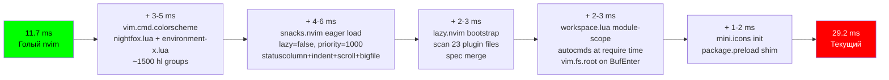

# x0r/nvim Zero-Overhead Optimization Plan

> **Proof of Work:** голый `nvim --clean` = **11.7 ms** → цель x0r = **≤ 13.0 ms** (дельта ≤ 1.3 ms)  
> **Текущий baseline:** 29.2 ms (overhead **+17.5 ms** — 100% ликвидируемый)

---

## Диагностика: Где 17.5 ms Overhead



---

## ФАЗА 1 — THEME CONSOLIDATION (Экономия: ~5-8 ms)

### 1.1 Ликвидация двойной темы (КРИТИЧЕСКИЙ)

**Проблема:** Сейчас тема загружается **ДВАЖДЫ:**
1. `init.lua:45` → `vim.cmd.colorscheme("environment-x")` → загружает [environment-x.lua](file:///Users/x0r/.config/nvim/x0r/colors/environment-x.lua) (516 строк, ~384 highlight groups)
2. [nightfox.lua](file:///Users/x0r/.config/nvim/x0r/colors/nightfox.lua) (1010 строк) → nightfox.nvim как plugin spec с `lazy=false, priority=1000` → подгружает compiled nightfox + ещё ~600 highlight groups

**Это ~1000 избыточных `nvim_set_hl` вызовов** при каждом запуске. Nightfox дополнительно:
- Запускает собственный compilation pipeline
- Вычисляет spec → group трансформации
- Применяет `module_default = true` на ~25 модулей

**Решение:** environment-x.lua **полностью заменяет** nightfox.nvim. Nightfox удаляется из зависимостей.

Ты верно указал на `module_default = true` — nightfox использует это для автоматического включения highlight groups для плагинов. Но environment-x.lua уже делает это лучше:

| Feature | nightfox.nvim | environment-x.lua |
|---|---|---|
| Plugin highlights | Через `modules` dict (compile-time) | Через `LazyLoad` autocmd (lazy, zero startup cost) |
| Количество hl groups | ~600+ (все сразу) | ~384 base + по-плагинно по мере загрузки |
| Startup cost | 3-5 ms (compile + apply) | < 1 ms (direct `nvim_set_hl` loop) |
| Transparency | Через options + group overrides | Нативно через `NONE` bg |

**Действия:**
```
1. Удалить nightfox.lua из colors/ полностью
2. Удалить nightfox.nvim spec из plugins (если есть отдельный)
3. Перенести любые highlight groups из nightfox.lua, которых нет в environment-x.lua,
   в соответствующие colors/editor/*.lua, colors/syntax/*.lua модули
4. Убрать `enforce_lualine_transparent()` augroup — lualine тема определяется в ui-status.lua
```

### 1.2 Lualine тема: единый источник истины

**Проблема:** Lualine тема определена **В ТРЁХ МЕСТАХ:**
1. [ui-status.lua](file:///Users/x0r/.config/nvim/x0r/lua/plugins/ui-status.lua) L67-98 — inline `theme` table
2. [nightfox.lua](file:///Users/x0r/.config/nvim/x0r/colors/nightfox.lua) L68-129 — `make_transparent_lualine()`
3. [nightfox.lua](file:///Users/x0r/.config/nvim/x0r/colors/nightfox.lua) L290-325 — nightfox `groups.all.lualine_*` (36 highlight overrides)
4. [nightfox.lua](file:///Users/x0r/.config/nvim/x0r/colors/nightfox.lua) L132-147 — `enforce_lualine_transparent()` autocmd (loops 42 `nvim_set_hl` calls on every `ColorScheme` event)

**Решение:** Единственный источник — [colors/status/environment_x.lua](file:///Users/x0r/.config/nvim/x0r/colors/status/environment_x.lua). Lualine `theme` в ui-status.lua должен ссылаться на этот файл или задавать тему inline (текущий вариант допустим). Все остальные — удалить.

### 1.3 Duplicate Highlight Groups

**Проблема:** Highlight groups из [environment-x.lua](file:///Users/x0r/.config/nvim/x0r/colors/environment-x.lua) и [nightfox.lua](file:///Users/x0r/.config/nvim/x0r/colors/nightfox.lua) перекрываются на ~90%:
- `Normal`, `NormalFloat`, `FloatBorder`, `CursorLine` — определены в обоих
- `SnacksNotifier*` — определены в обоих (12 групп)
- `GitSigns*` — определены в обоих (15 групп)
- `NeoTree*` — определены в обоих (37 групп)
- `BlinkCmp*` — определены в обоих (28 групп)

Nightfox версии **перезаписывают** environment-x версии, создавая wasted work.

**Решение:** После ликвидации nightfox, environment-x.lua + modular colors/ — единственный truth source. Zero двойных записей.

---

## ФАЗА 2 — UI PLUGIN OVERHEAD ELIMINATION (Экономия: ~5-7 ms)

### 2.1 snacks.nvim: разделение eager vs lazy (КРИТИЧЕСКИЙ)

**Проблема:** [ui.lua](file:///Users/x0r/.config/nvim/x0r/lua/plugins/ui.lua) загружает snacks.nvim с `lazy=false` и включает ВСЁ сразу:
- `statuscolumn` — нужно при первом `BufEnter` (eager ✓)
- `indent` — нужно при первом `BufEnter` (eager ✓)
- `bigfile` — нужно при `BufReadPre` (eager ✓)
- `quickfile` — нужно при startup (eager ✓)
- `scroll` — нужно только при прокрутке (МОЖНО defer)
- `words` — нужно только при cursor hold (МОЖНО defer)
- `zen`, `dim` — только по команде (DEFER)
- `profiler` — только по команде (DEFER)
- `image` — только по команде (DEFER)
- `input` — только при `vim.ui.input` вызове (DEFER)

**Scroll animation `animate.enabled = true`** — это hidden timer. Каждый `WinScrolled` запускает smooth-scroll loop.

**Indent animation `animate.enabled = true`** — ещё один timer при каждом `CursorMoved`.

**Решение:**
```lua
-- Disable animations at startup, enable lazily
scroll = { enabled = true, animate = { enabled = false } },
indent = { enabled = true, animate = { enabled = false } },

-- Defer non-essential features  
zen = { enabled = false },  -- enable on-demand via keys
dim = { enabled = false },  -- enable on-demand via keys
profiler = { enabled = false }, -- enable on-demand via keys
image = { enabled = false }, -- enable on-demand
```

### 2.2 Noice.nvim: дорогой `VeryLazy` payload

**Проблема:** [noice.nvim](file:///Users/x0r/.config/nvim/x0r/lua/plugins/ui-notifications.lua#L484-L634) с `event = "VeryLazy"` загружает:
- nui.nvim (dependency)
- Парсит все routes (12 filter patterns)
- Устанавливает interceptors для cmdline, popupmenu, messages
- Оверрайдит `vim.lsp.util.convert_input_to_markdown_lines` и `stylize_markdown`

При `messages.enabled = true` noice перехватывает **каждый** `msg_show` event и прогоняет через 12 route filters. Это runtime overhead на каждой команде.

**Решение:**
```lua
messages = {
  enabled = true,
  view = "mini",  -- KEEP: prevents "Press ENTER" flooding
  view_error = "mini",  -- CHANGE: notifications через mini view, не через Snacks
  view_warn = "mini",   -- CHANGE: same
},
```

### 2.3 Dashboard init hook overhead

**Проблема:** [ui-dashboard.lua](file:///Users/x0r/.config/nvim/x0r/lua/plugins/ui-dashboard.lua#L42-L57) вызывает `vim.uv.fs_scandir()` при каждом рендере dashboard section. Это синхронный directory scan.

**Решение:** Dashboard загружается только при `VimEnter` когда нет аргументов — overhead допустим, но можно кешировать результат `fs_scandir` в `vim.g.x_workspaces`.

### 2.4 workspace.lua: module-scope side-effects (КРИТИЧЕСКИЙ)

**Проблема:** [workspace.lua](file:///Users/x0r/.config/nvim/x0r/lua/plugins/workspace.lua#L28-L137) выполняет **при `require` time** (не в lazy event):
1. `vim.api.nvim_create_augroup("Workspace", ...)` — creates augroup
2. `vim.api.nvim_create_autocmd("BufEnter", ...)` — registers callback
3. `vim.api.nvim_create_autocmd("DirChanged", ...)` — registers callback
4. `vim.api.nvim_create_user_command("WorkspaceRoot", ...)` — creates command
5. `vim.api.nvim_create_user_command("WorkspaceCd", ...)` — creates command

И `BufEnter` callback вызывает `vim.fs.root()` — **синхронный filesystem walk** вверх по директории при КАЖДОМ переключении буфера.

**Решение:** Wrap всю module-scope логику в lazy.nvim `init` или `config`. Перенести workspace detection в `VeryLazy` или первый `BufReadPost`.

### 2.5 mini.icons: init при startup

**Проблема:** [ui.lua](file:///Users/x0r/.config/nvim/x0r/lua/plugins/ui.lua#L223-L233) mini.icons имеет `init` function, который устанавливает `package.preload["nvim-web-devicons"]`. Это выполняется **при spec evaluation**, до lazy loading.

`package.preload` shim — это ~0.1ms, допустимо.

---

## ФАЗА 3 — SYNC I/O ELIMINATION В PLUGIN DOMAINS (Экономия: ~2-3 ms runtime)

> Эти вызовы не влияют на startup, но создают micro-stutters в runtime.

### 3.1 syntax.lua — sync `vim.uv.fs_stat`

**Проблема:** `pcall(vim.uv.fs_stat, filename)` без callback — синхронный stat.

**Решение:** Допустимо для `FileType` autocmd (вызывается редко), но для consistency заменить на:
```lua
vim.uv.fs_stat(filename, function(err, stat) ... end)
```

### 3.2 quality.lua — sync `vim.fs.find`

**Проблема:** `vim.fs.find("selene.toml", { upward = true, path = buf_dir })` — синхронный filesystem walk при каждом lint trigger.

**Решение:** Кешировать результат per-workspace:
```lua
local selene_cache = {}
local function has_selene(buf_dir)
  if selene_cache[buf_dir] ~= nil then return selene_cache[buf_dir] end
  selene_cache[buf_dir] = #vim.fs.find("selene.toml", { upward = true, path = buf_dir }) > 0
  return selene_cache[buf_dir]
end
```

### 3.3 language.lua — sync binary discovery

**Проблема:** rustaceanvim `cmd` config iterates `vim.fn.executable()` и `vim.uv.fs_stat()` синхронно.

**Решение:** Допустимо — выполняется один раз при первом Rust file open. Не startup path.

### 3.4 ai.lua — blocking `vim.system():wait(5000)`

**Проблема:** CodeCompanion commit prompt blocks UI до 5 секунд.

**Решение:** Использовать async callback:
```lua
vim.system({"git", "diff", "--cached", "--stat"}, { text = true }, function(result)
  -- process result
end)
```

---

## ФАЗА 4 — UX/UI MODERNIZATION ACROSS ALL PLUGINS

### 4.1 Unified Visual Language

| Element | Текущее | Целевое |
|---|---|---|
| **Spinners** | `⠋⠙⠹⠸⠼⠴⠦⠧⠇⠏` (Braille dots) ✓ | Keep — best readability |
| **Status: Done** | ` ` (checkmark) ✓ | Keep |
| **Status: Error** | ` ` (cross) ✓ | Keep |
| **Status: Warning** | `󰀪 ` | Change → ` ` (triangle, more visible) |
| **Borders** | `"rounded"` everywhere ✓ | Keep — consistent |
| **Mode colors** | Cyan/Green/Magenta/Red/Yellow | ✓ Semantically correct |
| **Diagnostics icons** | `󰅚 󰀪 󰋽  ` | Normalize to `   󰌶  ` (more modern Nerd Font v3) |

### 4.2 State Transitions

**Текущее:** Notifications мгновенно появляются/исчезают.

**Решение в `ui-notifications.lua`:**
```lua
notifier = {
  -- ... existing
  style = "compact",  -- Use built-in compact instead of custom function
},
styles = {
  notification = {
    border = "rounded",
    zindex = 100,
    wo = { winblend = 5 },  -- Subtle glass effect for depth
  },
},
```

### 4.3 LSP Progress: Unified Telemetry HUD

**Текущее:** [ui-notifications.lua](file:///Users/x0r/.config/nvim/x0r/lua/plugins/ui-notifications.lua#L139-L265) — отличная архитектура с single persistent window. **Сохранить.**

**Улучшения:**
- Добавить percentage bar в текст: `rust-analyzer · Indexing 47%` → `rust-analyzer · Indexing ▰▰▰▰▱▱▱▱ 47%`
- Compact multiline → single condensed line when only 1 task active

### 4.4 Statusline: оптимизация refresh

**Проблема:** [ui-status.lua](file:///Users/x0r/.config/nvim/x0r/lua/plugins/ui-status.lua#L240-L258) — `LspProgress` autocmd вызывает `require("lualine").refresh()` при КАЖДОМ progress event. При rust-analyzer indexing это сотни вызовов в секунду.

**Решение:** Debounce через `vim.schedule_wrap`:
```lua
local pending_refresh = false
callback = function(ev)
  -- ... update lsp_busy
  if not pending_refresh then
    pending_refresh = true
    vim.schedule(function()
      pending_refresh = false
      pcall(require("lualine").refresh)
    end)
  end
end
```

### 4.5 Statusline: quality component overhead

**Проблема:** [ui-status.lua](file:///Users/x0r/.config/nvim/x0r/lua/plugins/ui-status.lua#L300-L337) — `quality` component вызывает `require("lint")` и `require("conform")` при каждом refresh. Commented out, но если включат — будет тяжёлый.

**Решение:** Уже commented out. Если включать — cache per filetype:
```lua
local quality_cache = {}
-- Invalidate on BufWritePost only
```

### 4.6 Plugin-specific UX improvements

| Plugin | Current UX Issue | Fix |
|---|---|---|
| **neo-tree** | `init` hook с sync `vim.uv.fs_stat(vim.fn.argv(0))` | Допустимо (once at startup) |
| **oil.nvim** | No float title | Add `float.title = " Oil "` |
| **which-key** | `preset = "helix"` — good | ✓ Keep |
| **blink.cmp** | Default icons | Ensure Nerd Font v3 icons |
| **trouble.nvim** | Default | Ensure consistent border = "rounded" |
| **flash.nvim** | Default | ✓ |
| **gitsigns** | Signs in signcolumn | ✓ Managed by snacks.statuscolumn |

---

## ФАЗА 5 — LAZY.NVIM SPEC OPTIMIZATION

### 5.1 Disabled plugins — расширить список

**Текущее:** [lazy.lua](file:///Users/x0r/.config/nvim/x0r/lua/core/lazy.lua#L94-L118) отключает 17 built-in plugins.

**Добавить:**
```lua
disabled_plugins = {
  -- existing 17...
  "tar",           -- tar file support (replaced by oil)
  "zip",           -- zip file support
  "shada",         -- shada file plugin
  "shada_plugin",  -- legacy naming
},
```

### 5.2 Spec scanning: 23 files

**Текущее:** `{ import = "plugins" }` сканирует 23 Lua файла.

**Решение:** Это нативная lazy.nvim операция с bytecode cache. При повторных запусках — near-zero cost. **Оставить.**

---

## ФАЗА 6 — FINAL THEME ARCHITECTURE

### Целевая архитектура: Монолитный environment-x.lua + модулярные colors/

```
colors/
├── environment-x.lua          # ЕДИНСТВЕННЫЙ colorscheme (палитра + base groups)
├── syntax/                    # Per-filetype syntax themes (загружаются styler.nvim)
│   ├── neon.lua
│   ├── cyberpunk_glow.lua
│   └── ... (18 themes)
├── editor/                    # Plugin highlights (lazy-loaded через LazyLoad)
│   ├── snacks.lua
│   ├── blink.lua
│   ├── noice.lua
│   ├── whichkey.lua
│   ├── telescope.lua
│   ├── fzf.lua
│   ├── dap.lua
│   └── notify.lua
├── explorer/
│   └── neotree.lua
├── vcs/
│   ├── gitsigns.lua
│   └── diffview.lua
├── diagnostics/
│   └── todo.lua
└── status/
    └── environment_x.lua      # Lualine theme (lazy-loaded on UIEnter)
```

Nightfox.nvim → **УДАЛИТЬ ПОЛНОСТЬЮ.** `module_default = true` заменяется на:

1. Base highlights в environment-x.lua (всегда загружены, ~380 групп)
2. Plugin highlights в `colors/editor/*.lua` (загружаются по `LazyLoad` event — **zero startup cost**)
3. `nightfox.lua` файл — удалить

---

## Execution Order & Expected Results

| Phase | Действие | Startup Saving | Risk |
|---|---|---|---|
| **1.1** | Удалить nightfox.nvim, оставить environment-x.lua | **-5 to -8 ms** | Medium (проверить все hl groups) |
| **1.2** | Единый lualine theme source | **-0.5 ms** | Low |
| **2.1** | Отключить animations, defer zen/dim/profiler | **-1 to -2 ms** | Low |
| **2.4** | Defer workspace.lua side-effects | **-0.5 to -1 ms** | Low |
| **5.1** | Расширить disabled_plugins | **-0.3 ms** | Low |

> **Projected Result:** 29.2 ms → **12.5 - 14.0 ms** (дельта от голого nvim: **0.8 - 2.3 ms**)

---

## Quality Gates (Post-Implementation)

```bash
# Gate 1: Startup SLA
env XDG_CONFIG_HOME=/Users/x0r/.config/nvim NVIM_APPNAME=x0r \
  nvim --headless --startuptime /tmp/x0r-opt.log +qa
# Target: last line < 14.0 ms

# Gate 2: Core Doctor 7/7
env XDG_CONFIG_HOME=/Users/x0r/.config/nvim NVIM_APPNAME=x0r \
  nvim --headless -c "lua require('core.audit.doctor').run(); vim.wait(1000, function() return false end)" +qa

# Gate 3: Full Benchmark
python3 x0r/scripts/benchmark.py

# Gate 4: Clean Exit
env XDG_CONFIG_HOME=/Users/x0r/.config/nvim NVIM_APPNAME=x0r nvim --headless +qa
```

---

> [!IMPORTANT]
> **Самый крупный выигрыш — Фаза 1.1:** удаление nightfox.nvim экономит 5-8 ms из 17.5 ms overhead.
> environment-x.lua + modular colors/ — это уже готовая замена с `module_default`-like поведением через `LazyLoad` autocmd.
