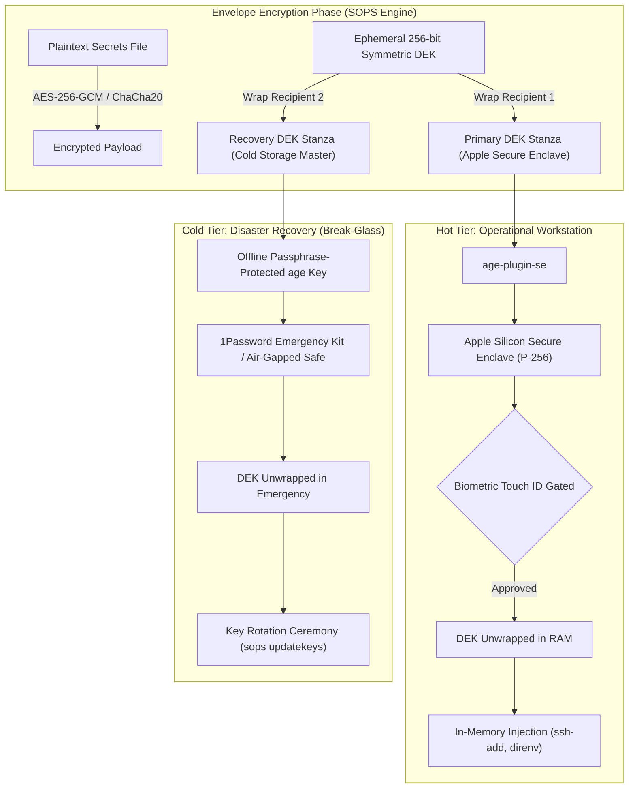

# SOPS & Apple Secure Enclave: Dual-Recipient Disaster Recovery Architecture
### Platform : macOS Sequoia (Apple Silicon arm64 Darwin 25+)
### Standards: NIST SP 800-57 Pt. 1 Rev. 5 | RFC 5647 | Age Encryption Specification | FIPS 203
### Toolchain: Mozilla SOPS 3.13+ | age 1.3+ | age-plugin-se 0.2+ | Apple SEP (Secure Enclave Processor)
### Path     : `~/.ssh/docs/architecture/sops-dual-recipient-disaster-recovery.md`

---

## 1. Executive Summary & Problem Statement

Default secrets management on developer workstations introduces an acute security-reliability paradox:
1. **Software Key Risk**: Storing plaintext private keys on disk (`~/.config/sops/age/keys.txt`) creates a high-value target for userland malware, infostealers, or accidental exfiltration.
2. **Naive Hardware Enclave Trap**: Migrating solely to hardware-bound credentials (such as Apple Secure Enclave via `age-plugin-se`) achieves non-exportable biometric protection (Touch ID), but introduces a **Single Point of Failure (SPOF)**. Because Secure Enclave private keys can never leave physical silicon, device loss, water damage, motherboard failure, or OS wipe results in the **catastrophic, irrevocable loss of 100% of encrypted secrets**.
3. **Headless & CI Execution Barrier**: Apple Secure Enclave strictly requires an active WindowServer (Aqua) user session to present biometric prompts. Headless CI/CD runners, automated containers, and remote SSH sessions cannot raise Touch ID dialogs.

To resolve this paradox, this architecture implements the **Dual-Recipient Disaster Recovery (DR) Protocol**.

---

## 2. Cryptographic Envelope Topology & Dual-Recipient Model

Under the `age` and SOPS envelope encryption standard (NIST SP 800-57 §8.1):
* Every encrypted file is secured by an ephemeral 256-bit symmetric **Data Encryption Key (DEK)**.
* The DEK is encrypted separately for each configured recipient in the `.sops.yaml` key group.
* Decryption succeeds if **either** recipient can unwrap the DEK (1-of-2 OR logic).



---

## 3. Recipient Classification & Specifications

### 3.1 Primary Recipient: Hot Operational Tier (`age-plugin-se`)
* **Cryptographic Primitive**: NIST P-256 (`secp256r1`) elliptic curve keypair generated inside the Secure Enclave Processor.
* **Storage Location**: Hardware SEP. Key material is physically unreadable by macOS kernel or root.
* **Local Identity Token**: The identity file (`~/.config/sops/age/keys.txt`) contains an opaque handle starting with `AGE-PLUGIN-SE-1...`. This handle is not a secret; it serves only as a hardware slot pointer and is completely useless on any other machine.
* **Recipient Format**: `--recipient-type=tag` (`age1tag1...`).
  * *Why `tag` instead of `se`?* The `tag` format is natively parsed by `age` (v1.3.0+) and SOPS without requiring the `age-plugin-se` binary during encryption. This allows external developers or Linux CI environments to encrypt files for this Mac without needing macOS.
* **Access Control**: `--access-control=any-biometry-or-passcode` (or `current-biometry` for strict anti-tamper locking against newly added fingerprints).

### 3.2 Recovery Recipient: Cold Disaster Recovery Tier
* **Cryptographic Primitive**: X25519 (Curve25519) standard `age` recipient (`age1...`).
* **Storage Location**: Air-gapped offline storage. It is **strictly forbidden** to keep the unencrypted recovery private key on the operational workstation SSD.
* **Protection Mechanism**: Encrypted at rest with a high-entropy passphrase via Argon2id/scrypt (`age -p`) or held across physical split media (Shamir's Secret Sharing / SLIP-0039).
* **Escrow Locations**:
  1. Primary offline vault (e.g., 1Password Emergency Kit / Bitwarden offline backup).
  2. Physical tamper-evident paper/steel card in a fireproof safe.

---

## 4. Threat Modeling Matrix

| Threat Scenario | Impact without Protocol | Impact with Dual-Recipient Protocol |
| :--- | :--- | :--- |
| **Infostealer Malware on Workstation** | Full compromise of secrets (reads `keys.txt`). | **Protected**. Private key is in SEP. Decryption triggers Touch ID modal; malware cannot extract raw key. |
| **Hardware Failure / Logic Board Death** | **Total permanent data loss**. | **Recoverable**. Cold DR key retrieved from vault to decrypt and re-mint keys. |
| **Evil Maid adds Fingerprint to Mac** | Access granted if using legacy keychain. | **Neutralized** when using `current-biometry` (key instantly locks upon fingerprint set change). |
| **MacBook Theft / Seizure** | Attacker has SSD image. | **Protected**. SEP key inaccessible without biometric/passcode. Hardware encrypted. |
| **Headless CI/CD Execution** | Touch ID fails (no WindowServer). | **Supported**. Dedicated CI recipient or Break-Glass key used in pipeline secrets. |

---

## 5. Declarative SOPS Specification (`.sops.yaml`)

SOPS evaluates `creation_rules` using `key_groups`. Listing both recipients in a single group enforces logical OR (either key can decrypt):

```yaml
# ==============================================================================
# SOPS Enterprise Configuration — Dual-Recipient Disaster Recovery
# Platform: macOS Apple Silicon (arm64 Darwin 25+)
# ==============================================================================

creation_rules:
  - path_regex: '.*(\.enc(\.|$)|secrets|vault|credentials).*'
    key_groups:
      - age:
          # Recipient 1: Hot Tier — Apple Silicon Secure Enclave (Touch ID)
          - 'age1tag1...'
          # Recipient 2: Cold Tier — Offline Disaster Recovery Master Key
          - 'age1recovery...'
    encrypted_regex: '^(data|stringData|secrets|password|token|api_key|private_key|apiKey|secret.*)$'

  - key_groups:
      - age:
          - 'age1tag1...'
          - 'age1recovery...'
```

---

## 6. Zero-Disk In-Memory Workflows

Operational SSH client identities are rooted directly in silicon via Secretive (Touch ID SEP), ensuring private keys never exist as software files. For repository deploy keys and runtime environment variables managed by SOPS, credentials are unwrapped strictly in volatile RAM without persistent NVMe residue:

```bash
# In-Memory Decryption directly to SSH Authentication Agent (Deploy Keys):
sops decrypt <repo>/secrets/deploy_key.enc | ssh-add -

# In-Memory Environment Loading:
eval (sops decrypt <repo>/secrets/infra.enc.env | string match -r '^[A-Za-z0-9_]+=.+')
```
