```mermaid
flowchart TD
    subgraph UI ["User / Shell Ingress"]
        CLI["wget CLI / Aliases (wget, wget-resume, wget-mirror, wget-spider)"]
    end

    subgraph Security ["Zero-Trust & Sanitization Layer"]
        TLS["Strict TLS Verification\nhttps-only = on\ncheck-certificate = on\nsecure-protocol = auto"]
        Trust["CA Bundle Anchoring\n($HOMEBREW_PREFIX/etc/ca-certificates/cert.pem)"]
        HSTS["RFC 6797 HSTS Database\n(~/.config/wget/.wget-hsts)"]
        Sanitize["Filesystem Defense\nrestrict-file-names = unix,nocontrol\n(Strips ../ & NUL bytes)"]
    end

    subgraph Governance ["Network Resilience & Timing Governors"]
        Timeouts["Granular Timeout Bounding\nconnect: 5s | dns: 5s | read: 10s | total: 15s"]
        Retry["Adaptive Retry Engine\ntries = 3 | waitretry = 2s\nretry-on-http-error: 429, 500, 502, 503, 504"]
        DualStack["Dual-Stack Priority\nprefer-family = IPv6"]
    end

    subgraph Acceleration ["HTTP Transport & Storage Acceleration"]
        KeepAlive["Persistent Connection Reuse\nhttp-keep-alive = on"]
        Compress["Payload Decompression\ncompression = auto (gzip, deflate)"]
        Resume["Fault-Tolerant Resumption\ncontinue = on (HTTP Range Requests)"]
        Conditional["Conditional GET Engine\ntimestamping = on (If-Modified-Since)"]
        Headers["Content-Disposition Mapping\ncontent-disposition = on\ntrust-server-names = on"]
    end

    subgraph APFS ["macOS APFS Storage Layer"]
        Xattr["Extended Attributes (xattr = on)\nuser.xdg.origin.url\ncom.apple.provenance"]
    end

    CLI --> TLS
    TLS --> Trust
    Trust --> HSTS
    HSTS --> Sanitize
    Sanitize --> Governance
    Governance --> Acceleration
    Acceleration --> APFS
```

# Principal Systems Architecture & Transport Engineering Guide
## GNU Wget Production Stack for macOS (Apple Silicon / aarch64 Darwin)

> **Architectural Standard**: GNU Wget 1.25+ | OpenSSL 4.x / 3.x | libidn2 | libpsl | APFS xattr  
> **Governing RFCs**: RFC 7230-7235 (HTTP/1.1), RFC 6797 (HSTS), RFC 6265 (HTTP State / Cookies), RFC 5890 (IDNA)  
> **Core Deliverables**: [`wgetrc`](wgetrc) | [`README.md`](README.md)

---

## 1. Executive Summary & The macOS Environment Landscape

Unlike `curl`, which is bundled directly into macOS by Apple as a locked system shim in `/usr/bin/curl`, **macOS does not provide a native `wget` binary**. Wget is provisioned exclusively through user package managers (Homebrew on Apple Silicon):

* **Homebrew Provisioning (`$HOMEBREW_PREFIX/bin/wget`)**: Linked into `$HOMEBREW_PREFIX/bin/wget` and dynamically compiled against Homebrew's audited `openssl@4` (or `openssl@3`), `libidn2`, and `libpsl`.
* **The XDG Configuration Dilemma**: By default, GNU Wget searches for its configuration in `$HOME/.wgetrc`. Without explicit environment management, Wget litters dotfiles (`~/.wgetrc`, `~/.wget-hsts`) across the user's home directory.
* **The HSTS Leak**: Using unexpanded or relative paths in `wgetrc` (such as `hsts-file = ~/.wget-hsts`) causes Wget to bypass XDG directories and pollute the user's home directory root with `~/.wget-hsts`.
* **Zero-Trust & Autonomous Crawling**: Wget is built for resilient, autonomous, recursive document retrieval, mirror synchronization, and batch downloading. In enterprise environments, Wget must be hardened with strict TLS validation, rate-limit backoff, sanitization against path traversal exploits, and seamless Apple Silicon APFS metadata persistence.

```
┌────────────────────────────────────────────────────────────────────────────────────────┐
│                              WGET vs CURL ON macOS APPLE SILICON                        │
├───────────────────────────────────────────┬────────────────────────────────────────────┤
│           GNU WGET (AUTONOMOUS RETRIEVAL) │         LIBCURL (TRANSPORT ENGINE)         │
├───────────────────────────────────────────┼────────────────────────────────────────────┤
│ • Primary: Recursive sync & batch fetch   │ • Primary: Multiprotocol API client        │
│ • State: Native auto-resume (continue = on│ • State: Explicit offset (-C -)            │
│ • Hierarchy: Directory recursion (-r, -m) │ • Hierarchy: Flat transfers (per URL)      │
│ • HTTP Protocol: HTTP/1.1 persistent conn │ • HTTP Protocol: Native HTTP/2 & HTTP/3    │
│ • Provisioning: Homebrew ($HOMEBREW_PREFIX│ • Provisioning: Keg-only ($HOMEBREW_PREFIX/│
│ • Config Discovery: WGETRC environment var│ • Config Discovery: CURL_HOME / .curlrc    │
└───────────────────────────────────────────┴────────────────────────────────────────────┘
```

---

## 2. Architectural Cross-Section & Deep Research Findings

Following deep analysis of GNU Wget 1.25.0 internals, Darwin XNU kernel networking mechanics, and OpenSSL cryptographic boundaries, the architecture of the Principal Wget pipeline is structured as follows:

```
┌────────────────────────────────────────────────────────────────────────┐
│                        USER / SHELL INTERACTION                        │
│          wget <url>  │  wget-resume  │  wget-mirror  │  wget-spider    │
└───────────────────────────────────┬────────────────────────────────────┘
                                    │
┌───────────────────────────────────▼────────────────────────────────────┐
│              ZERO-TRUST TLS & SECURITY SANITIZATION ENGINE             │
│  https-only = on │ check-certificate = on │ ca-certificate = cert.pem  │
│  restrict-file-names = unix,nocontrol (Blocks ../ Path Traversal)      │
│  HSTS Cache (~/.config/wget/.wget-hsts) [RFC 6797]                     │
└───────────────────────────────────┬────────────────────────────────────┘
                                    │
         ┌──────────────────────────┴──────────────────────────┐
         │                                                     │
┌────────▼─────────────────────────┐        ┌──────────────────▼─────────────────┐
│     NETWORK TIMING & GOVERNANCE  │        │   HTTP ACCELERATION & RESILIENCE   │
│  timeout = 15s │ connect = 5s    │        │  http-keep-alive = on              │
│  dns-timeout = 5s │ read = 10s   │        │  compression = auto (gzip,deflate) │
│  tries = 3 │ waitretry = 2s      │        │  continue = on (HTTP Range Resume) │
│  retry-on-http-error: 429,5xx    │        │  timestamping = on (If-Modified)   │
│  prefer-family = IPv6            │        │  content-disposition = on          │
└────────────────┬─────────────────┘        └──────────────────┬─────────────────┘
                 │                                             │
                 └──────────────────────────┬──────────────────┘
                                            │
┌───────────────────────────────────────────▼────────────────────────────────────┐
│                  APFS FILESYSTEM & PROVENANCE INTEGRATION                      │
│        xattr = on (com.apple.provenance, user.xdg.origin.url, referrer)        │
│        User-Agent: Safari WebKit Normalization (Bypasses WAF Bot Heuristics)   │
└────────────────────────────────────────────────────────────────────────────────┘
```



---

### Detailed Findings from Architectural Deep Research

#### Finding 1: Elimination of the HSTS Path Leak (State Isolation)
* **Root Cause Analysis**: The default configuration specified:
  ```ini
  hsts-file = ~/.wget-hsts
  ```
  Because GNU Wget does not expand tildes in all execution paths, or when expanded, writes directly to `$HOME/.wget-hsts`, it polluted the user's home directory.
* **Empirical Verification**: Executing `wget` without isolation confirmed the immediate creation of `~/.wget-hsts`.
* **Architectural Remedy**: Enforce a deterministic path anchored inside the XDG directory tree:
  ```ini
  hsts-file = ~/.config/wget/.wget-hsts
  ```
  Verified live execution creates `~/.config/wget/.wget-hsts` with zero `$HOME` dotfile contamination.

#### Finding 2: OpenSSL Cryptographic Posture & Protocol Negotiation
* **Mechanics**: GNU Wget 1.25.0 is compiled with OpenSSL (`+ssl/openssl`). Configuring:
  ```ini
  secure-protocol = auto
  check-certificate = on
  ca-certificate = $HOMEBREW_PREFIX/etc/ca-certificates/cert.pem
  ```
  instructs OpenSSL to negotiate the highest mutually supported TLS version (TLS 1.3 preferred with TLS 1.2 fallback). Forcing `secure-protocol = TLSv1_3` globally is an anti-pattern because it immediately breaks connections to enterprise servers and legacy documentation hosts that only support TLS 1.2.
* **Anchored Trust**: Binding `ca-certificate` directly to Homebrew's audited bundle ensures consistent trust validation independent of system keychain corruption.

#### Finding 3: Darwin XNU Kernel Socket Tuning & Timeout Governors
* **Problem**: Wget's default timeouts are unbound or excessively long (up to 900 seconds), causing automation scripts and pipelines to hang indefinitely on stalled sockets or dropped packets.
* **Architectural Remedy**: Deconstruct the monolithic timeout into fine-grained bounds:
  - `connect-timeout = 5`: Fast-fail unresponsive TCP handshakes.
  - `dns-timeout = 5`: Fast-fail DNS resolution hangs.
  - `read-timeout = 10`: Abort stalled data streams.
  - `timeout = 15`: Total operational ceiling.
  - `tries = 3` & `waitretry = 2`: Prevent retry storms while gracefully absorbing transient network drops.
  - `retry-connrefused = on` & `retry-on-http-error = 429,500,502,503,504`: Absorbs microservice restarts and handles edge rate limits.

#### Finding 4: Apple Silicon APFS Metadata & Origin Provenance
* **Mechanics**: Enabling `xattr = on` on macOS Apple Silicon binds download metadata directly into APFS inodes.
* **Empirical Verification**: Downloading test artifacts confirmed Darwin APFS metadata preservation:
  ```text
  com.apple.provenance:
  user.xdg.origin.url: https://www.cloudflare.com/favicon.ico
  user.xdg.referrer.url: https://cloudflare.com
  ```
  Enables provenance auditing, security forensics, and automated artifact tracking.

#### Finding 5: Content-Disposition & Path Traversal Hardening
* **The Vulnerability**: Setting `content-disposition = on` causes Wget to name downloaded files according to server HTTP response headers (`Content-Disposition: attachment; filename=...`). Malicious servers can attempt directory traversal (`filename=../../.bashrc`) or inject control characters.
* **The Defense**: Pair `content-disposition = on` with `restrict-file-names = unix,nocontrol`. This strips path traversal sequences, NUL bytes, and terminal escape codes, confining output strictly to the destination directory.

#### Finding 6: The "Must NOT" Matrix for Global `wgetrc`

| Directive | Hazard Level | Empirical Failure Mode |
| :--- | :---: | :--- |
| `no-check-certificate = on` | 🔴 **CRITICAL** | **Total Security Annihilation.** Completely disables TLS certificate verification, exposing every download to trivial MITM interception and credential theft. |
| `no-hsts = on` | 🔴 **CRITICAL** | **Exposes SSL-Stripping.** Ignores Strict-Transport-Security directives, allowing attackers to downgrade connections to plaintext HTTP. |
| `recursive = on` (`-r`) | 🔴 **CRITICAL** | **Recursive Domain Explosion.** Every single CLI invocation (`wget https://site.com/file`) will crawl and recursively download the entire website, exhausting bandwidth and disk space. |
| `mirror = on` (`-m`) | 🔴 **CRITICAL** | **Automatic Mirroring.** Turns simple downloads into infinite recursive site crawls with timestamp comparison and infinite recursion depth. |
| `no-clobber = on` (`-nc`) | 🟡 **HIGH** | **Breaks Release Workflows.** Incompatible with `continue = on`; silently ignores new versions of files when repeatedly downloaded under the same name. |
| `report-speed = bytes` | 🟠 **SYNTAX ERROR** | **Syntax Crash.** Empirically verified: GNU Wget only accepts `bits` for `report-speed`. Setting `bytes` causes Wget to abort with exit code 2: `wget: report-speed: Invalid value 'bytes'`. |

---

## 3. Verbatim Terminal Audit & Live Telemetry Logs

### 3.1 Binary Compilation & Feature Flags (`wget -V`)

```text
$ which wget
[HOMEBREW_PREFIX]/bin/wget

$ [HOMEBREW_PREFIX]/bin/wget -V
GNU Wget 1.25.0 built on darwin27.0.0.

-cares +digest -gpgme +https +ipv6 +iri +large-file -metalink +nls 
+ntlm +opie +psl +ssl/openssl 

Wgetrc: 
    ~/.config/wget/wgetrc (env)
    [HOMEBREW_PREFIX]/etc/wgetrc (system)
Locale: 
    [HOMEBREW_PREFIX]/share/locale 
Compile: 
    clang -DHAVE_CONFIG_H -DSYSTEM_WGETRC="[HOMEBREW_PREFIX]/etc/wgetrc" 
    -DLOCALEDIR="[HOMEBREW_PREFIX]/share/locale" -I. 
    -I../lib -I../lib -I[HOMEBREW_PREFIX]/opt/openssl@4/include 
    -I[HOMEBREW_PREFIX]/include -DNDEBUG -g -O2 
Link: 
    clang -L[HOMEBREW_PREFIX]/opt/openssl@4/lib -lssl -lcrypto -ldl -lz 
    -L[HOMEBREW_PREFIX]/lib -lpsl -lidn2 ../lib/libgnu.a 
    -liconv -lintl -Wl,-framework -Wl,CoreFoundation -Wl,-framework 
    -Wl,CoreServices -lunistring 
```

### 3.2 Live Download Trace with Header Inspection

```text
$ wget -v -S -O /dev/null https://cloudflare.com
--2026-10-08 02:28:41--  https://cloudflare.com/
Resolving cloudflare.com (cloudflare.com)... 104.16.132.229, 104.16.133.229
Connecting to cloudflare.com (cloudflare.com)|104.16.132.229|:443... connected.
HTTP request sent, awaiting response... 
  HTTP/1.1 301 Moved Permanently
  Date: Wed, 07 Oct 2026 19:28:41 GMT
  Content-Type: text/html; charset=UTF-8
  Connection: keep-alive
  Location: https://www.cloudflare.com/
  Strict-Transport-Security: max-age=15780000; includeSubDomains
  Vary: accept-encoding
  Server: cloudflare
Location: https://www.cloudflare.com/ [following]
--2026-10-08 02:28:41--  https://www.cloudflare.com/
Resolving www.cloudflare.com (www.cloudflare.com)... 104.16.124.96, 104.16.123.96
Connecting to www.cloudflare.com (www.cloudflare.com)|104.16.124.96|:443... connected.
HTTP request sent, awaiting response... 
  HTTP/1.1 200 OK
  Date: Wed, 07 Oct 2026 19:28:41 GMT
  Content-Type: text/html; charset=utf-8
  Connection: keep-alive
  Strict-Transport-Security: max-age=31536000; includeSubDomains
  Content-Security-Policy: default-src 'self' ...
Length: 1333874 (1.3M) [text/html]
Saving to: ‘/dev/null’
```

### 3.3 Live APFS Metadata & Provenance Verification

```text
$ wget -q https://cloudflare.com/favicon.ico -O test_wget_fav.ico
$ xattr -l test_wget_fav.ico
com.apple.provenance:
user.xdg.origin.url: https://www.cloudflare.com/favicon.ico
user.xdg.referrer.url: https://cloudflare.com
```

### 3.4 Isolated HSTS Cache Database Audit

```text
$ cat ~/.config/wget/.wget-hsts
# HSTS 1.0 Known Hosts database for GNU Wget.
# Edit at your own risk.
# <hostname>	<port>	<incl. subdomains>	<created>	<max-age>
www.cloudflare.com	0	1	1791401713	31536000
cloudflare.com	0	1	1791401713	15780000
```

---

## 4. Production Configuration: [`wgetrc`](wgetrc)

The canonical production configuration is maintained in [`wgetrc`](wgetrc) (anchored via the `$WGETRC` environment variable and optional POSIX fallback `~/.wgetrc`). It enforces zero-trust TLS, deterministic state isolation, and resilient autonomous batch transfers.

### Architectural Directives Matrix

| Domain | Key Directives | Purpose & Standard Parity |
| :--- | :--- | :--- |
| **Zero-Trust TLS** | `https-only = on`, `check-certificate = on`, `ca-certificate`, `secure-protocol = auto` | Eliminates plaintext protocol downgrade and SSL-stripping; anchors trust in Homebrew CA bundle; negotiates TLS 1.3 with TLS 1.2 fallback. |
| **Deterministic State** | `hsts = on`, `hsts-file = "~/.config/wget/.wget-hsts"` | Enforces RFC 6797 HSTS persistence while preventing dotfile pollution in `$HOME` or `$CWD`. |
| **Resilience & Governors** | `timeout = 15`, `connect-timeout = 5`, `dns-timeout = 5`, `read-timeout = 10`, `tries = 3`, `waitretry = 2`, `retry-connrefused = on`, `retry-on-http-error = 429,500,502,503,504` | Eliminates hangs on stalled sockets; absorbs rolling service restarts and rate-limit bursts with linear backoff. |
| **Transport & Dual-Stack** | `prefer-family = IPv6`, `http-keep-alive = on`, `compression = auto`, `continue = on`, `timestamping = on` | RFC 8305 dual-stack prioritization; persistent connection reuse; automatic gzip/deflate decompression; HTTP Range resume. |
| **Filesystem & Security** | `content-disposition = on`, `trust-server-names = on`, `restrict-file-names = unix,nocontrol`, `xattr = on` | Sanitizes server-suggested filenames against directory traversal (`../`) and control characters; preserves APFS origin metadata. |
| **Identity & UX** | `user_agent`, `verbose = off`, `show-progress = on`, `progress = bar:force:noscroll`, `report-speed = bits` | Conforms to W3C/WebKit anti-fingerprinting frozen token (`10_15_7`); provides clean full-width terminal progress reporting. |

> [!NOTE]
> For the complete configuration directives and detailed inline comments, inspect [`wgetrc`](wgetrc).

---

## 5. Usage Methodology for macOS

### Mode 1: Automatic Discovery via `WGETRC` (Recommended)
GNU Wget honors the `WGETRC` environment variable. In Fish shell, `WGETRC` is exported in `~/.config/fish/conf.d/01_env.fish`:
```fish
set -gx WGETRC "$XDG_CONFIG_HOME/wget/wgetrc"
```
Whenever `wget` is invoked, it automatically loads `~/.config/wget/wgetrc`.

### Mode 2: Explicit Profile Invocation (`--config`)
To explicitly execute Wget against the canonical specification:
```bash
wget --config=~/.config/wget/wgetrc https://example.com/archive.tar.gz
```

### Mode 3: Traditional User Root Symlink (POSIX Fallback)
For external scripts or non-Fish shells that expect `~/.wgetrc`:
```bash
ln -sf ~/.config/wget/wgetrc ~/.wgetrc
```

---

## 6. Fish Shell Integration: Conflict-Free Architecture

To ensure Homebrew Wget operates with zero friction in Fish shell, adhere to these configuration patterns:

### Component 1: `conf.d/01_env.fish`
Verify that `WGETRC` is exported to point to the XDG directory:
```fish
set -gx WGETRC "$XDG_CONFIG_HOME/wget/wgetrc"
```

### Component 2: `conf.d/02_toolchain.fish`
Ensure OpenSSL CA bundle synchronization:
```fish
set -gx SSL_CERT_FILE "$HOMEBREW_PREFIX/etc/ca-certificates/cert.pem"
```

### Component 3: `conf.d/20_abbrs.fish` (Production Abbreviations)

Production transport abbreviations in Fish configuration:

```fish
# 1. Custom Destination Target
abbr -a wget 'wget -O {url}'

# 2. Quiet Pipe to Stdout
abbr -a wget_output 'wget -qO- {url}'

# 3. Destination Directory Target
abbr -a wgetd 'wget -P <some/dir/filename> {url}'

# 4. Fault-Tolerant Resuming Downloader
abbr -a wget-resume "wget -c"

# 5. Complete Static Site Mirror (Clean, bounded, no parent escape, localized assets)
abbr -a wget-mirror "wget -m -np -k -E -p"

# 6. Fast Broken Link & Status Spider (No content download)
abbr -a wget-spider "wget --spider -r -nd -nv -H -l 2"

# 7. Strict Single-File Batch Ingestion from File List
abbr -a wget-batch "wget -i"
```

---

## 7. Darwin Kernel Sysctl Optimization (`/etc/sysctl.conf`)

For sustained multi-stream TCP throughput on Apple Silicon hardware:

```ini
# Enable bidirectional TCP Fast Open
net.inet.tcp.fastopen=3

# Expand dynamic TCP receive and send window ceilings to 8 MB
net.inet.tcp.autorcvbufmax=8388608
net.inet.tcp.autosndbufmax=8388608

# Maximize IPC socket buffer ceiling
kern.ipc.maxsockbuf=33554432
```

---

## 8. Automated Verification Suite

Run this validation sequence to verify operational compliance:

```bash
# 1. Verify Wget Binary Resolution
test (which wget) = "$HOMEBREW_PREFIX/bin/wget"; and echo "✅ PATH: HOMEBREW WGET ACTIVE"; or echo "❌ PATH: WGET NOT FOUND"

# 2. Verify Wget Execution with Production Config
wget --config=~/.config/wget/wgetrc -q -O /dev/null https://cloudflare.com; and echo "✅ WGET: CONFIG OK"; or echo "❌ WGET: CONFIG ERROR"

# 3. Verify Deterministic HSTS Database Generation
test -s ~/.config/wget/.wget-hsts; and echo "✅ HSTS: DATABASE PERSISTED"; or echo "❌ HSTS: FAILED"

# 4. Verify Zero Dotfile Pollution in User Home
test ! -f ~/.wget-hsts; and echo "✅ ISOLATION: NO LEAKS IN HOME"; or echo "❌ ISOLATION: LEAK DETECTED"
```

---

## 9. Diagnostic & Verification Suite (`~/.local/bin/wget/validate`)

To verify the operational integrity of the Wget configuration stack, an automated test harness is maintained at `~/.local/bin/wget/validate`. It performs deterministic assertions against binary features, configuration syntax, TLS validation, HSTS isolation, extended attributes, and User-Agent conformity.

Execute via terminal or automation pipelines:
```bash
# Human-readable diagnostic output
~/.local/bin/wget/validate

# Machine-readable JSON output for CI/CD assertions
~/.local/bin/wget/validate --json
```

---

## 10. References & Standards

* GNU Wget Manual & Option Reference: https://www.gnu.org/software/wget/manual/
* GNU Wget HSTS Feature: https://www.gnu.org/software/wget/manual/html_node/HSTS.html
* Fish Shell Documentation: https://fishshell.com/docs/current/
* RFC 7230-7235 (HTTP/1.1 Protocol & Semantics)
* RFC 6797 (HTTP Strict Transport Security - HSTS)
* RFC 6265 (HTTP State Management Mechanism - Cookies)
* RFC 5890 (Internationalized Domain Names in Applications - IDNA)
* RFC 8305 (Happy Eyeballs v2: Better Connectivity Using Concurrency)
* Apple File System (APFS) Extended Attributes & Provenance Specification
