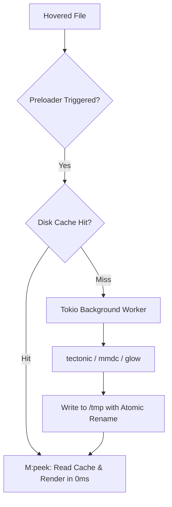

# ⚡ ARCHITECTURAL SPECIFICATION: YAZI CONFIGURATION

> **Platform:** macOS Apple Silicon (`aarch64-apple-darwin`) | **Engine:** Yazi v26.x
> **Core Directives:** System-as-Interface | Zero Overhead | Deterministic Modality

---

```
 ██████╗ ██████╗ ██╗███╗   ██╗ ██████╗██╗██████╗  █████╗ ██╗
 ██╔══██╗██╔══██╗██║████╗  ██║██╔════╝██║██╔══██╗██╔══██╗██║
 ██████╔╝██████╔╝██║██╔██╗ ██║██║     ██║██████╔╝███████║██║
 ██╔═══╝ ██╔══██╗██║██║╚██╗██║██║     ██║██╔═══╝ ██╔══██║██║
 ██║     ██║  ██║██║██║ ╚████║╚██████╗██║██║     ██║  ██║███████╗
 ╚═╝     ╚═╝  ╚═╝╚═╝╚═╝  ╚═══╝ ╚═════╝╚═╝╚═╝     ╚═╝  ╚═╝╚══════╝
```

---

## 1. Executive Summary & Paradigm

This architecture elevates Yazi from a standard CLI file browser to an **Enterprise-grade Developer
Dispatcher**. It is tuned specifically for macOS Apple Silicon hardware, Kitty Graphics Protocol
(`Kgp`), Neovim integration, and high-frequency filesystem triage.

### Core Tenets:

1. **Deterministic Modality:** Immediate single-key actions never compete with prefix trees.
2. **Zero Overhead Preview Engine:** Heavy rendering (LaTeX, Mermaid, Glow Markdown) executes
   strictly out-of-band in background Tokio threadpools (`preload`) with atomic disk caching. Cursor
   navigation on hover (`peek`) hits the cache with 0ms UI blocking.
3. **Total Transparency:** Seamless visual blending with terminal emulators (Kitty/Ghostty/WezTerm)
   without opaque container boxes.

---

## 2. Selection Mechanics vs. Leader Paradigm (Deep Architectural Analysis)

### 2.1 The Problem: Is `<Space>` for File Selection an Anti-pattern?

**Absolute Verdict: NO. It is the core primitive of high-throughput TUI file managers.**

In text editors like Neovim, the cursor operates inside a continuous 2D text buffer. Navigating or
editing text does not require staging discrete entities, making `<Space>` an ideal `<Leader>` key
during Normal mode.

In file managers (Yazi, Ranger, Vifm, Midnight Commander), the fundamental workload is **staging
discrete filesystem nodes (files/directories)** for atomic batch operations (`copy`, `cut`,
`delete`, `diff`, `archive`, `chmod`).

There are two selection paradigms:

1. **Discrete Multi-Selection (Sparse Tagging):** Selecting file #1, file #4, and file #9.
2. **Contiguous Range Selection (Block Tagging):** Selecting files #10 through #25.

If `<Space>` were reassigned as `<Leader>`, sparse selection would require entering Visual Mode
(`v`), selecting, exiting (`<Esc>`), jumping, re-entering Visual Mode (`v`), which introduces severe
cognitive friction and degrades throughput.

### 2.2 Why `<Space>` CANNOT be Both Leader and Selection in Yazi

Unlike Neovim, which features an ambiguous key timeout engine (`timeoutlen` = 300ms), Yazi's input
router (`yazi-fm/src/router.rs`) evaluates key chords linearly using a deterministic prefix-tree:

```rust
// yazi-fm/src/router.rs
fn matches(&mut self, src: Layer, dist: Layer, key: Key) -> bool {
    for chord in &*KEYMAP.chords(src) {
        let Chord { on, .. } = chord.as_ref();
        if on.is_empty() || on[0] != key {
            continue;
        }

        if on.len() > 1 {
            let cx = &mut Ctx::active(&mut self.app.core, &mut self.app.term);
            act!(which:activate, cx, WhichOpt::new(src, dist, key)).ok();
        } else {
            Dispatcher::new(self.app).dispatch_seq(chord.to_seq(dist));
        }
        return true;
    }
    false
}
```

#### The Execution Collision:

- Chords registered in `prepend_keymap` are evaluated **first**.
- If a multi-key chord like `[ "<Space>", "f" ]` is defined, `on[0]` matches `<Space>`, and
  `on.len() > 1` triggers `act!(which:activate)`.
- The router **immediately returns `true` and pops up the Which-Key menu**, completely starving the
  vanilla atomic toggle `{ on = "<Space>", run = [ "toggle", "arrow 1" ] }`.
- **Conclusion:** Any configuration binding multi-key chords to `<Space>` destroys single-key file
  selection.

### 2.3 The Principal Leader Standard: `,` (Comma) / `\` (Backslash)

- **`,` (Comma):** 100% unmapped in vanilla Yazi `[mgr]`, situated directly on the right-hand home
  cluster. Serves as Vim's canonical `<LocalLeader>`.
- Pressing `,` instantly triggers Which-Key dispatch with zero ambiguity and zero latency.
- Single `<Space>` remains dedicated to atomic selection (`toggle` + step down).

---

## 3. Keyboard Matrix & Ergonomic Domains

### Domain 1: File Selection & Visual Staging

| Keybinding        | Action                    | Architecture Rationale                                                             |
| :---------------- | :------------------------ | :--------------------------------------------------------------------------------- |
| `<Space>`         | `toggle` + `arrow 1`      | **Atomic Tag & Advance:** Tags hovered item and steps down 1 row without wrapping. |
| `v`               | `visual_mode`             | **Visual Range Select:** Vim-style contiguous multi-item selection.                |
| `V`               | `visual_mode --unset`     | **Visual Range Unset:** Continuous batch deselection.                              |
| `<C-a>`           | `toggle_all --state=on`   | Select all files in directory.                                                     |
| `<C-r>`           | `toggle_all`              | Invert selection state across directory.                                           |
| `<Esc>` / `<C-[>` | `escape --all` + `unyank` | Instant atomic deselect, cancels visual mode, unyanks clipboard.                   |

### Domain 2: Leader Dispatch Matrix (`,`)

| Keybinding  | Command                                 | Description                                       |
| :---------- | :-------------------------------------- | :------------------------------------------------ |
| `, f`       | `plugin fg -- fzf`                      | Fast fuzzy file finder via FZF                    |
| `, s`       | `plugin fg -- rg`                       | Ripgrep full-text codebase search                 |
| `, d`       | `plugin diff`                           | Interactive diff comparison (selected vs hovered) |
| `, ,` / `T` | `plugin toggle-pane max-preview`        | Fullscreen maximize / restore preview pane        |
| `, t`       | `shell 'tmux new-session -A -s x_term'` | Instant drop-in Tmux terminal session             |
| `, g`       | `shell 'lazygit' --block`               | Fullscreen Lazygit interactive TUI                |
| `, b` / `'` | `plugin bookmarks jump`                 | Interactive directory bookmark teleport           |
| `, m`       | `plugin bookmarks save`                 | Save current path as bookmark                     |
| `, M`       | `plugin mount`                          | Disk/Volume Mount & Eject Manager                 |
| `, e`       | `open --with edit`                      | Open target in Neovim                             |
| `, z`       | `plugin zoxide`                         | Fast Zoxide frecency jump                         |

### Domain 3: Mnemonic Navigation (`g`)

| Keybinding    | Target                       | Description                                  |
| :------------ | :--------------------------- | :------------------------------------------- |
| `g r`         | `plugin git-root`            | Teleport to root of active Git repository    |
| `g b`         | `gh browse .`                | Open active repository in GitHub web browser |
| `g f`         | `gh browse "$1"`             | Open hovered file on GitHub                  |
| `g h` / `g c` | `~` / `~/.config`            | Home / Config directory                      |
| `g w` / `g p` | `~/Workspace` / `~/Projects` | Active workspaces                            |

---

## 4. Zero-Overhead Preview Architecture

Heavy file previews (LaTeX formulas, Mermaid diagrams, formatted Markdown) are structured into an
asynchronous pipeline:



### Pipelines:

1. **Enterprise Runtime Cache & TTL Rotation:**
    - Isolated secure cache location: `$XDG_RUNTIME_DIR/yazi-cache` or `$TMPDIR/yazi-cache` (macOS
      sandbox, permissions `0700`, eliminating shared `/tmp` collisions).
    - Automated debounced TTL rotation: background pruning of entries older than 24 hours
      (`find -mtime +1 -delete`).
    - LRU size-budget enforcement: checks storage footprint and evicts oldest items when cache
      exceeds 500 MB.
2. **Adaptive Display DPI Engine (`bin/yazi-dpi`):**
    - Micro-second native Mach-O binary dynamically probes active display scale factor
      (`[NSScreen mainScreen] backingScaleFactor`).
    - Automatically adapts render density:
        - **100 DPI / scale 1.0:** External standard 1080p, 1440p, or 2K displays (zero blurry
          downsampling artifacts).
        - **200 DPI / scale 2.0:** Built-in Liquid Retina XDR, Studio Display 5K, 4K Retina.
    - Cache keys incorporate active DPI/scale, ensuring seamless sharpness when dragging terminal
      windows between monitors.
3. **Mermaid Diagrams (`*.mmd`, `*.mermaid`):**
    - Headless local `mmdc` rendering with adaptive scale (`-s 1` or `-s 2`), transparent
      background, and dark theme.
    - Outputs PNG to `$TMPDIR/yazi-cache/mermaid-yazi-<hash>.png`.
    - Rendered natively via Kitty Graphics Protocol (`ya.image_show(Url, job.area)`).
4. **Markdown with Embedded Mermaid (`*.md`, `*.markdown`, `*.mdx`):**
    - **Mode Architecture (`M m` keymap):** Supports `inline` (default in-document embedding),
      `image` (100% full-screen diagram preview), `text` (pure glow ANSI), and `split` (top 65% text
      / bottom 35% diagram).
    - **Aspect Ratio Mathematical Lock:** Monospace cell ratio $r_{cell} = \frac{W_{px}}{H_{px}}
      \times 2.0$. Width and height inside the frame are computed to match the native PNG aspect
      ratio down to $< 1\%$ error.
    - **Custom-Tailored Framed Boxes:** Replaces markdown code fences with pixel-perfect UTF-8 box
      boundaries (`╭─ 󱈖 Mermaid [k/N] ──╮`, `│`, `╰──╯`). Box width $W_{box} = W_{img} + 2$ and
      height $H_{box} = H_{img} + 2$ hug the diagram snugly with zero empty voids.
    - **Zero-Lag Lockstep Scrolling:** Coordinates move 1:1 with `skip` ($Y_{img} =
      \text{job.area.y} + (B_{start} - \text{skip})$). Elimination of `ya.sleep` guarantees
      synchronous event loop emission, preventing image floating, stutter, or lag.
    - **Multi-Diagram Viewport Routing:** In documents with multiple diagrams, detects all box
      boundaries and dynamically activates the diagram currently inside the preview pane.
5. **LaTeX & Typst (`*.tex`, `*.typ`):**
    - `.tex` compiles via `tectonic` in sandboxed runtime directory -> `pdftoppm` with adaptive DPI
      -> crisp PNG.
    - `.typ` compiles natively to PNG via `typst` with `--ppi <adaptive_dpi>`.
    - Automatic fallback to syntax-highlighted `bat` on compilation syntax error without freezing
      UI.
6. **Code & Text:**
    - Unified `bat` syntax highlighting synchronized with `x` theme tokens.

---

## 5. Apple Silicon & macOS Performance Tuning

Configured in `yazi.toml`:

```toml
[mgr]
ratio = [ 1, 2, 4 ]          # 14.3% parent, 28.6% current, 57.1% preview
scrolloff = 8                 # Smooth cursor kinematics for 120Hz ProMotion

[preview]
max_width     = 3840          # Native 4K/Retina preview render bounds
max_height    = 2400
image_delay   = 10            # Frame sync delay (ms)
image_filter  = "lanczos3"    # High-order sinc filter for razor-sharp typography

[tasks]
file_workers     = 4          # APFS instant clone workers
plugin_workers   = 4          # Concurrent Lua plugin runtimes
fetch_workers    = 4          # Git status & inode telemetry
preload_workers  = 3          # Headless background pre-cache workers
process_workers  = 4          # Heavy external processors (tectonic/mmdc)
image_alloc      = 536870912  # 512 MB memory cache for high-res Retina graphics
```

---

## 6. Theme & Visual Telemetry ("x" Identity)

- **Total Transparency:** `bg = reset / NONE` across panels, dialogs, and which-key menus.
- **Top Bar (Header):**
    - Left: Clean directory breadcrumb `󰄾 {cwd}` without machine/user prefix clutter.
    - Right: Live telemetry badge displaying active selection counts (`󰄲 N SELECTED`), cut state
      (`󰆐 N CUT`), and yank state (`󰆏 N YANKED`).
- **Bottom Bar (Status):**
    - Left: Mode indicator (`󰘳 NORMAL`, `󰈈 SELECT`, `󰘳 UNSET`) + Devicon + filename + symlink
      target.
    - Right: File ownership (`uid:gid`), human-readable size, permissions, and position metrics.

---

_Authored by Principal Systems Architecture for x0r macOS Environment._
